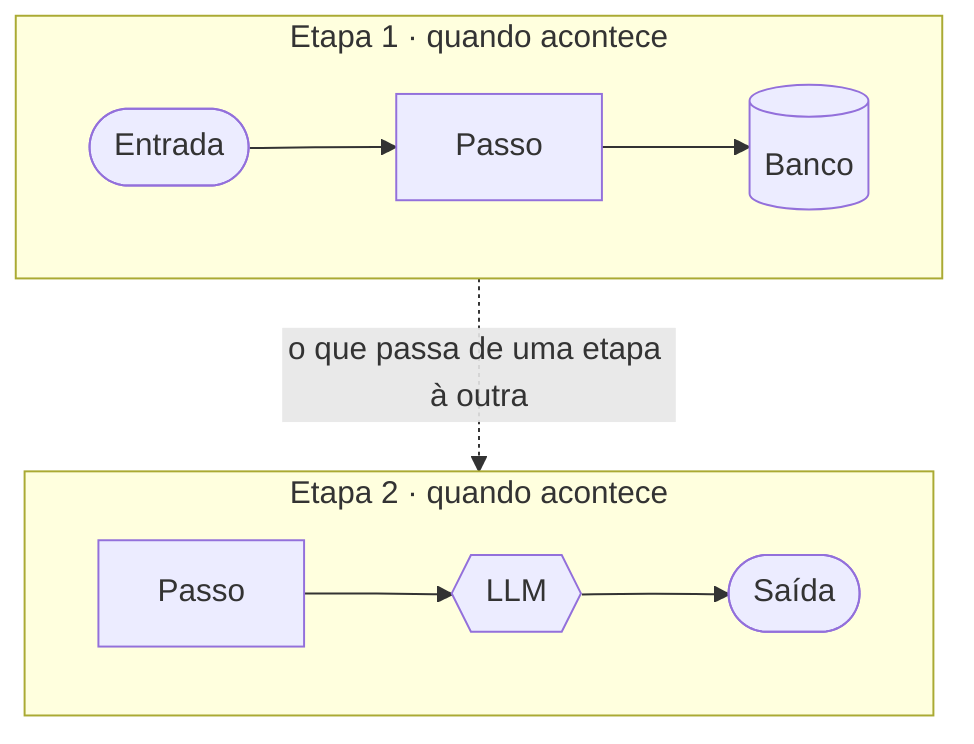

# Fluxogramas

Os diagramas do roadmap são escritos em [Mermaid](https://mermaid.js.org/) dentro do próprio Markdown, num bloco ` ```mermaid `. No build, o `rehype-mermaid` transforma cada bloco em SVG (sem JavaScript no navegador), e o `src/styles/fluxo.css` repinta tudo com os tokens do site: mesmas cores, fonte Inter, tema claro e escuro automáticos.

Arquivos envolvidos:

- `astro.config.mjs`: liga o `rehype-mermaid` (renderiza com o Chrome do sistema e a fonte Inter) e o `rehypeFluxo`.
- `src/lib/mermaid-tema.mjs`: configuração do Mermaid e o plugin que põe cada diagrama numa moldura com legenda.
- `src/styles/fluxo.css`: as cores de nós, grupos, setas e diagramas de sequência.
- `scripts/lint-conteudo.mjs`: blocos Mermaid não contam na faixa de palavras do tópico.

O Astro guarda o HTML já renderizado de cada Markdown. Depois de mudar `mermaid-tema.mjs` ou a configuração do Mermaid, rode `npx astro sync --force` antes do build para refazer os diagramas.

## Template

Copie, troque os nós e mantenha as regras abaixo.

````markdown

````

### Formas

| Forma | Sintaxe | Use para |
| --- | --- | --- |
| Retângulo | `X[Texto]` | passo, componente |
| Pílula | `X([Texto])` | entrada e saída do fluxo |
| Hexágono | `X{{Texto}}` | chamada ao modelo (LLM) ou agente |
| Cilindro | `X[(Texto)]` | banco, índice, memória |
| Losango | `X{Texto}` | decisão |

### Classes (`X[Texto]:::classe`)

| Classe | Visual | Use para |
| --- | --- | --- |
| (nenhuma) | fundo claro, borda fina | passos comuns |
| `destaque` | preenchido com a cor de destaque | o resultado ou o passo principal; no máximo um ou dois por diagrama |
| `modelo` | fundo suave, borda forte | LLM, agente, orquestrador |
| `dado` | borda escura | bancos, índices, memória |
| `externo` | borda tracejada, texto mais claro | fonte externa ou não confiável (web, documento do usuário) |
| `humano` | borda verde | aprovação ou revisão humana |
| `risco` | borda vermelha tracejada | ponto de ataque, falha ou dado sensível |

### Setas

| Sintaxe | Significado |
| --- | --- |
| `A --> B` | fluxo principal |
| `A -- rótulo --> B` | fluxo com o que passa |
| `A -.-> B` ou `A -. rótulo .-> B` | assíncrono, opcional ou consulta |
| `A ==> B` | caminho crítico (fica na cor de destaque) |
| `A -.-x B` | bloqueado, proibido |

### Regras

1. Sempre `accTitle` (vira a legenda) e `accDescr` (acessibilidade).
2. No máximo 5 nós por linha horizontal e cerca de 12 nós por diagrama. Se passar, divida em dois diagramas.
3. Fluxo geral de cima para baixo (`flowchart TB`) com grupos em linha (`direction LR`). Diagramas só horizontais ficam largos e a letra encolhe.
4. Uma seta só pode sair de dentro de um grupo para fora se o grupo puder perder a direção própria; para manter o grupo em linha, ligue o grupo inteiro (`A --> B`), não um nó de dentro.
5. Rótulos curtos (até cerca de 25 caracteres) e em português; termos técnicos como no texto.
6. Sem cores no próprio diagrama (`style`, `classDef` com cor): use as classes acima, que acompanham os dois temas.
7. Use `sequenceDiagram` quando a ordem das mensagens entre participantes é o ponto (tool use, MCP, A2A, aprovação). Outros tipos de diagrama do Mermaid ainda não têm estilo próprio.
8. Losango (`{...}`) só com texto curto, de uma a três palavras ("Limite ok?"). Texto longo deixa o losango enorme; use um retângulo.
9. Evite setas de volta para um nó anterior fora de um grupo: o Mermaid reorganiza o desenho inteiro para acomodá-las. Para indicar repetição, escreva no rótulo ("Atualiza e repete") ou mantenha o ciclo dentro de um grupo.
10. Grupos que não se ligam por seta ficam lado a lado e alargam o diagrama. Para empilhá-los, ligue um ao outro com `A ~~~ B` (seta invisível).
11. Em diagramas de sequência, mensagens curtas (até cerca de 30 caracteres): a largura de cada coluna vem da maior mensagem.
12. O diagrama complementa o texto: ele aparece logo depois do parágrafo ou da lista que descreve o mesmo fluxo.

Exemplos no site: `topico/rag` (pipeline em duas etapas), `topico/tool-use` (sequência), `projeto/p5-pesquisador-multiagente` (arquitetura), `topico/fine-tuning` (decisão) e `nivel/5` (visão do nível).

## Mapa por nível

Prioridade: **A** é o diagrama que mais ajuda a entender o tópico, **B** ajuda, **C** é opcional. Tópicos sem diagrama ficam de fora de propósito: em fundamentos de programação, o código explica melhor que uma caixa.

Cada página de nível mostra o texto do arquivo do nível (`src/content/niveis/N.md`), que começa com a **visão do nível**: um diagrama de como os grupos de tópicos se ligam e levam ao projeto. As cinco visões estão feitas.

### Nível 1 · Base

| Tópico | Tipo | O que o diagrama mostra | Prior. |
| --- | --- | --- | --- |
| Git e GitHub | Fluxo | branch, commit, push, pull request, revisão, merge | B |
| Terminal e ambientes | Arquitetura | sistema, Python, venv, pacotes e projeto em camadas | C |
| Evolução dos modelos | Fluxo | pré-treino, ajuste por instruções, preferências, raciocínio | B |
| Tokens e janela de contexto | Fluxo | texto, tokenizador, ids, janela com entrada e saída dividindo o limite | A |
| Alucinação | Decisão | quando o modelo inventa e onde entram fonte, citação e "não sei" | B |
| Embeddings | Fluxo | textos, modelo de embedding, vetores, similaridade | A |
| Fine-tuning | Decisão | prompt, RAG ou fine-tuning, pela natureza do problema | A |
| API e parâmetros | Sequência | app, API, modelo; temperatura e max_tokens na requisição | B |
| Saída estruturada | Fluxo | schema, geração, validação, nova tentativa em caso de erro | A |
| Prompt engineering | Arquitetura | blocos do prompt: papel, contexto, exemplos, tarefa, formato | B |

Fora do mapa: Python fundamentos, POO e tipagem, SQL essencial.

### Nível 2 · Conceitos

| Tópico | Tipo | O que o diagrama mostra | Prior. |
| --- | --- | --- | --- |
| RAG | Fluxo | indexação e consulta | A |
| Busca híbrida e reranking | Fluxo | BM25 e vetor em paralelo, fusão, reranker, top-k | A |
| Tool use | Sequência | ciclo de chamada de ferramenta | A |
| MCP | Arquitetura | host, cliente, servidores, ferramentas, recursos e prompts | A |
| Workflow ou agente | Decisão | caminho fixo ou modelo decidindo; os padrões de workflow lado a lado | A |
| Human-in-the-loop | Fluxo | ação proposta, aprovação, execução ou recusa, registro | A |
| Engenharia de contexto | Arquitetura | o que entra na janela e em que ordem | A |
| Evals | Fluxo | golden set, execução, métricas e juiz, relatório, comparação | A |
| Guardrails | Fluxo | filtros de entrada e saída em volta do modelo | B |
| Prompt injection | Fluxo | instrução escondida em documento chegando ao agente (nós `risco`) | A |
| LGPD e dados pessoais | Fluxo | detecção, máscara, envio ao LLM, log sem dado pessoal | B |
| Custo e latência | Arquitetura | onde vai o tempo e o custo de uma requisição: cache, modelo, saída | B |

### Nível 3 · Construção

| Item | Tipo | O que o diagrama mostra | Prior. |
| --- | --- | --- | --- |
| Agentes de programação | Fluxo | pedido, plano, edição, testes, revisão humana, commit | B |
| FastAPI | Sequência | cliente, rota, validação, serviço, LLM, resposta | B |
| Postgres e pgvector | Arquitetura | tabela com texto, metadados e vetor; índice; consulta | B |
| Frontend com IA | Sequência | streaming da resposta do servidor até a tela | C |
| Docker local | Arquitetura | contêineres da API, banco e rede local | B |
| Testes e evals no projeto | Fluxo | testes unitários, evals e o portão no CI | A |
| Frameworks de agentes | Arquitetura | o que o framework cuida (estado, ferramentas, laço) e o que é seu | B |
| P1: Assistente da Montadora | Arquitetura | as sete camadas como uma pilha de versões | A |
| P2: RAG de Manuais Técnicos | Arquitetura | ingestão, busca híbrida, geração com citação, evals | A |
| P3: Servidor MCP de Manuais | Sequência | cliente MCP, servidor, ferramenta de leitura e de ação com aprovação | A |
| P4: Triagem de Ordens de Manutenção | Fluxo | ordem chega, classificação, prioridade, revisão humana | A |

### Nível 4 · Produção

| Item | Tipo | O que o diagrama mostra | Prior. |
| --- | --- | --- | --- |
| AWS: fundamentos | Arquitetura | conta, região, rede, computação, banco, segredos | B |
| Segurança e custo na nuvem | Fluxo | orçamento, alerta, ação; chaves fora do código | B |
| CI/CD | Fluxo | push, testes, evals, build, deploy, rollback | A |
| Observabilidade | Arquitetura | app, rastros, métricas, painel, alertas | A |
| Rate limit e fallback | Decisão | erro 429, espera crescente, modelo reserva, resposta degradada | A |
| Filas e tarefas assíncronas | Sequência | API, fila, worker, LLM, notificação | A |
| PF: Agente Completo | Arquitetura | deploy completo: API, agente, MCP, banco, observabilidade, CI | A |

### Nível 5 · Fronteira

| Item | Tipo | O que o diagrama mostra | Prior. |
| --- | --- | --- | --- |
| Transformer por dentro | Arquitetura | tokens, embeddings, N blocos (atenção e MLP), próximo token | A |
| KV cache e inferência | Fluxo | prefill e decode, com o cache crescendo a cada token | A |
| Servir modelos abertos | Arquitetura | pesos quantizados, servidor de inferência, API compatível, clientes | B |
| Modelos de raciocínio | Fluxo | pergunta, pensamento com orçamento, resposta; quando ligar | B |
| RL com recompensa verificável | Fluxo | grupo de respostas, verificador, vantagem relativa, atualização | A |
| Engenharia de contexto avançada | Fluxo | contexto crescendo, teto por componente, compactação e notas | A |
| Memória de agentes | Arquitetura | os quatro tipos de memória e o ciclo escrever, recuperar, esquecer | A |
| Multiagentes e orquestração | Arquitetura | orquestrador com subagentes paralelos e o que volta | A |
| Protocolo A2A | Sequência | Agent Card, tarefa, estados, artefato; ao lado do MCP | A |
| Execução durável | Fluxo | passos com checkpoint, queda, retomada sem repetir | A |
| Computer use e navegador | Fluxo | observar, decidir, agir, em sandbox com lista de domínios | B |
| Skills e ferramentas dinâmicas | Fluxo | índice curto, escolha, carga sob demanda | B |
| Avaliação de agentes | Fluxo | tarefas, k execuções, notas de resultado e trajetória, pass^k | A |
| Segurança de agentes | Arquitetura | a tríade letal e onde cada controle corta o caminho | A |
| Observabilidade de agentes | Arquitetura | árvore de spans: tarefa, passos, subagentes, ferramentas | A |
| P5: Pesquisador Multiagente | Arquitetura | orquestrador, subagentes, memória e aprovação | A |

### Carreira

As dicas de carreira são passo a passo em texto; diagrama só onde há um processo com etapas claras:

| Dica | Tipo | O que o diagrama mostra | Prior. |
| --- | --- | --- | --- |
| Design de sistemas com LLM | Arquitetura | o esqueleto de resposta de uma entrevista de design | A |
| Entrevista técnica | Fluxo | etapas comuns de um processo seletivo | C |
| Teste prático | Fluxo | do enunciado à entrega com README | C |

Situação: todos os 36 diagramas de prioridade A estão no site, mais as 5 visões de nível (41 no total). Os de prioridade B e C ficam para depois.
