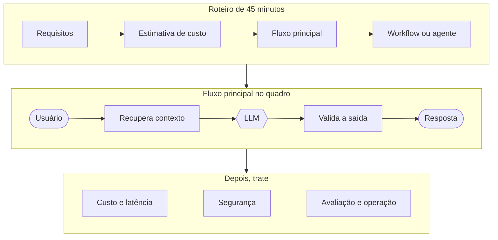

## O que é

Design de sistemas (system design) é a entrevista em que você desenha, num quadro, a arquitetura de um produto e defende suas decisões. Na versão para LLM, o enunciado é algo como "projete um assistente de atendimento para 1 milhão de clientes" ou "projete busca sobre os documentos de uma empresa". Não há resposta única. Quem entrevista avalia como você organiza o problema, as alternativas que considera e os compromissos que aceita.

## Por que importa

Em algumas empresas, esta etapa aparece para vagas pleno e sênior. Mostra se você enxerga o sistema inteiro: além do modelo, existem dados, custo, latência, segurança, avaliação e operação. Quem construiu e colocou no ar um projeto como o PF, com custo medido e evals, já tem material para responder.

O formato varia por empresa, e esta dica é um roteiro de estudo. O artigo de Chip Huyen nas referências descreve os componentes de uma plataforma de IA generativa (gateway, RAG, guardrails, observabilidade) e serve de mapa para o desenho.

## Passo a passo

1. **Esclareça os requisitos.** Quantos usuários? Qual latência aceitável? Que dados? Quem erra, e o que acontece quando erra? Escreva as respostas no quadro.
2. **Faça uma estimativa simples.** Número de requisições por dia, tokens por requisição e custo por mês. Números aproximados bastam, e você deve dizer que são estimativas.
3. **Desenhe o fluxo principal.** Entrada do usuário, recuperação de contexto (RAG, buscar trechos relevantes nos documentos), chamada ao LLM (o modelo de linguagem), validação da saída e resposta.
4. **Escolha entre workflow e agente.** Justifique pelo problema. Comece pelo mais simples e explique quando um agente compensa (veja o artigo da Anthropic).
5. **Trate custo e latência.** Modelo menor para tarefas simples, cache de prompt, streaming, filas para tarefas longas.
6. **Trate segurança.** Prompt injection (instrução maliciosa escondida em texto que o modelo lê), dados pessoais, privilégio mínimo para ferramentas, aprovação humana em ações irreversíveis (veja a lista da OWASP).
7. **Trate avaliação e operação.** Golden set (perguntas com resposta esperada), evals (testes de qualidade) no CI, rastreamento de cada resposta, alertas e plano para quando o provedor do modelo falhar.
8. **Treine em voz alta**, com cronômetro de 45 minutos, e peça a alguém para questionar cada caixa do desenho.

## Exemplo

Pergunta: "Como você reduziria o custo do assistente?"

Resposta, antes:

> Usaria um modelo mais barato.

Depois (números ilustrativos):

> Primeiro mediria onde o custo está: no RAG, 70% dos tokens vêm dos trechos recuperados. Reduziria de 10 para 5 trechos com reranking (reordenação dos resultados por um modelo extra) e mediria se a qualidade se mantém no golden set. Usaria um modelo menor para classificar a intenção e o maior só para a resposta final. Colocaria cache de prompt (reaproveitar o trecho fixo do prompt entre chamadas) para o texto fixo. Por fim, acompanharia o custo por conversa no rastreamento, com alerta quando passar do limite.

A segunda resposta mede antes de mudar, tem mais de uma alavanca e fecha com monitoramento.

## Erros comuns

- **Começar a desenhar sem perguntar.** Os requisitos mudam o desenho.
- **Citar tecnologias sem justificar.** "Usaria um banco vetorial" precisa de por quê.
- **Ignorar avaliação e segurança.** São onde sistemas com LLM mais falham.
- **Propor um agente para tudo.** Mais autonomia significa mais custo e menos previsibilidade.
- **Fingir certeza.** Diga o que é estimativa e o que você mediria.
- **Esquecer falhas.** E se o modelo estiver fora do ar? E se a resposta vier errada?

## Checklist

- Roteiro de oito passos memorizado.
- Duas arquiteturas desenhadas do zero em 45 minutos.
- Estimativa de custo feita para cada uma.
- Respostas prontas sobre RAG, custo, latência, segurança e avaliação.
- Um dos seus projetos explicado no mesmo formato.
- Uma simulação feita com outra pessoa.
