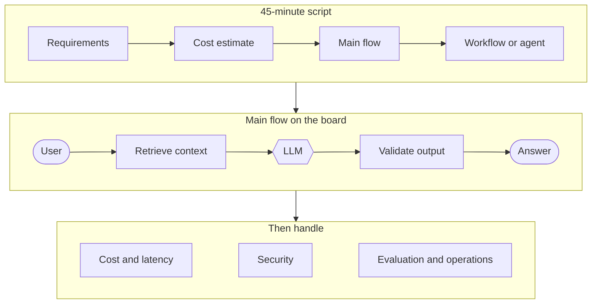

## What it is

System design is the interview where you draw, on a whiteboard, the architecture of a product and defend your decisions. In the LLM version, the prompt is something like "design a customer service assistant for 1 million customers" or "design search over a company's documents". There is no single answer. The interviewer evaluates how you organize the problem, the alternatives you consider and the trade-offs you accept.

## Why it matters

At some companies, this stage shows up for mid-level and senior roles. It shows whether you see the whole system: besides the model, there are data, cost, latency, security, evaluation and operations. Someone who built and deployed a project like the PF, with measured cost and evals, already has material to answer.

The format varies by company, and this tip is a study guide. The GenAI platform article in the references describes the components of a generative AI platform (gateway, RAG, guardrails, observability) and works as a map for the design.

## Step by step

1. **Clarify the requirements.** How many users? What latency is acceptable? What data? Who makes mistakes, and what happens when they do? Write the answers on the board.
2. **Make a simple estimate.** Requests per day, tokens per request and cost per month. Rough numbers are enough, and you should say they are estimates.
3. **Draw the main flow.** User input, context retrieval (RAG, fetching relevant passages from documents), the LLM call (the language model), output validation and the answer.
4. **Choose between a workflow and an agent.** Justify it by the problem. Start with the simplest and explain when an agent pays off (see the Anthropic article).
5. **Handle cost and latency.** A smaller model for simple tasks, prompt caching, streaming, queues for long tasks.
6. **Handle security.** Prompt injection (a malicious instruction hidden in text the model reads), personal data, least privilege for tools, human approval for irreversible actions (see the OWASP list).
7. **Handle evaluation and operations.** Golden set (questions with expected answers), evals (quality tests) in CI, tracing of every answer, alerts and a plan for when the model provider fails.
8. **Practice out loud**, with a 45-minute timer, and ask someone to question every box in the drawing.

## Example

Question: "How would you reduce the assistant's cost?"

Answer, before:

> I would use a cheaper model.

After (illustrative numbers):

> First I would measure where the cost is: in RAG, 70% of the tokens come from the retrieved passages. I would reduce from 10 to 5 passages with reranking (reordering the results with an extra model) and measure whether quality holds on the golden set. I would use a smaller model to classify the intent and the larger one only for the final answer. I would add prompt caching (reusing the fixed part of the prompt across calls) for the fixed text. Finally, I would track cost per conversation in the traces, with an alert when it goes over the limit.

The second answer measures before changing, has more than one lever and closes with monitoring.

## Common mistakes

- **Starting to draw without asking.** The requirements change the design.
- **Naming technologies without justifying them.** "I would use a vector database" needs a why.
- **Ignoring evaluation and security.** That is where LLM systems fail the most.
- **Proposing an agent for everything.** More autonomy means more cost and less predictability.
- **Pretending to be certain.** Say what is an estimate and what you would measure.
- **Forgetting failures.** What if the model is down? What if the answer comes back wrong?

## Checklist

- Eight-step script memorized.
- Two architectures drawn from scratch in 45 minutes.
- Cost estimate done for each one.
- Answers ready on RAG, cost, latency, security and evaluation.
- One of your projects explained in the same format.
- One mock interview done with another person.
