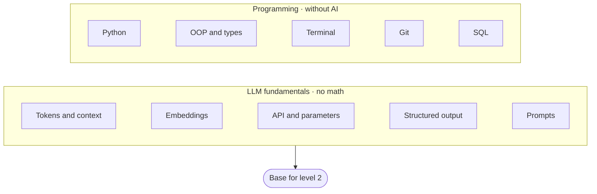

This is the base level. It has two tracks that run in parallel: programming without AI assistance and understanding, without math, how a language model works inside.

## Why this level comes now

People who jump straight to agents learn to assemble pieces without knowing what they do. When something breaks, they do not know where to look. Writing the code yourself builds the logic and vocabulary that, later on, let you critically review what a coding agent generates.

The LLM track has a practical goal: answering interview questions with confidence, such as "why did the model make up this answer?" or "why did switching models change the cost?". You do not need the math behind the models for that.

## How to study this level

The rule is the same in both tracks: do it yourself. In programming, avoid asking AI to write the exercise; use it, at most, to clear up a conceptual doubt. In the LLM track, do not settle for reading: call an API, vary the parameters and write down what changed.

Set aside 10 to 15 hours a week. Timelines are indicative and depend on your routine and previous experience; the path calculator adjusts the estimate to your starting point. Version everything in Git from your first script and keep API keys out of the repository.
