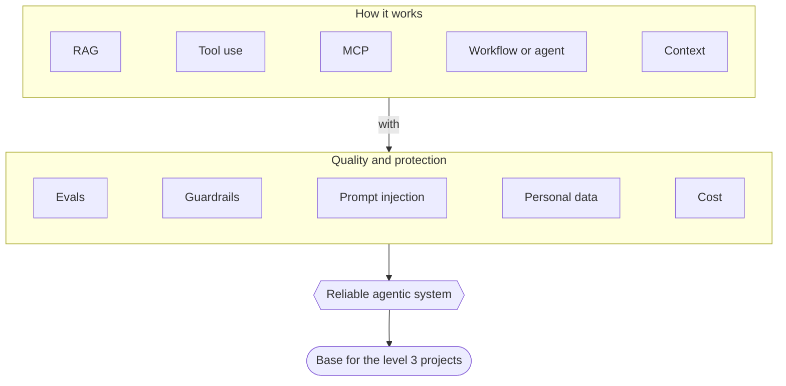

This level is about study and reading, with small experiments. Building comes in level 3: here the goal is to understand the role of each piece of an agentic system before putting them together.

## Why this level comes now

Separating theory from practice avoids a common mistake: learning to plug framework pieces together without knowing what they are for. When something fails, the person who understands the concept can diagnose it; the person who only copied the configuration has no idea where to start.

This level can begin at the end of level 1, as soon as you can call an LLM API with confidence. It covers two subjects: how the system works (RAG, tools, MCP, workflow or agent, human approval, context) and how to keep it good and safe (evals, guardrails, prompt injection, personal data under Brazil's LGPD, cost and latency).

## How to study this level

For each topic, answer three questions: what it is, why it exists and when not to use it. Run small experiments that make the concept visible, such as comparing vector search with keyword search on a set of your own texts.

At the end, try to draw the full map of an agentic system from memory. If you cannot explain a layer, go back to the corresponding topic. Timelines are indicative and depend on the hours you can dedicate each week; the path calculator does that math for your case.
