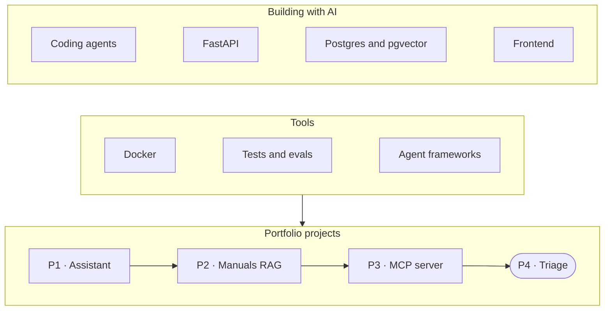

This is the level where you build. There are two sides to an AI Engineer's work, and the market asks for both: building AI solutions for companies and using AI to build software faster.

## Why this level comes now

With the base and the concepts in place, you can review what a coding agent produces. Without them, AI writes code you cannot evaluate, and your portfolio becomes a demo you cannot defend in an interview.

Projects P1 to P4 cover the layers of an agentic system: conversation and tools, RAG with hybrid search, an MCP server with human approval and a triage workflow. All of them use public or synthetic data.

## How to study this level

Learn to use the coding agent through the official courses, always work in a plan, implement and review cycle, and only commit what you have read and understood. Start with P1 and move forward in layers, tagging each version in Git.

Each project needs a README with the problem, the architecture, how to run it, the technical decisions and the eval results. Timelines are indicative: this level usually takes 6 to 9 months alongside studies or work, less for people who already develop software (see the path calculator).
