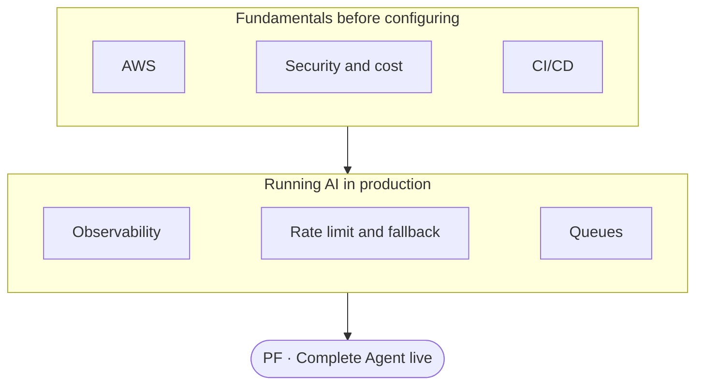

This level takes the final project to production. Here a coding agent is not enough: it may suggest a configuration that works and is still expensive or insecure, and you need to know how to review it.

## Why this level comes now

In the cloud, a wrong configuration does not just break the project: it can generate high costs even in a test project, such as a forgotten running instance, an exposed database or a key leaked on GitHub. That is why the level starts with fundamentals and only then moves to practice.

Going live also changes the questions: how much each answer costs, what happens when the provider goes down, how to find where a bad answer came from. That is what separates a demo from a system.

## How to study this level

Take a cloud fundamentals course before configuring any resource, follow the security and cost checklist and create the budget alert first. Then automate tests and evals in CI and, only then, deploy the PF.

Document the architecture in the README with a diagram and record the real monthly cost. Timelines are indicative and depend on your study routine.
