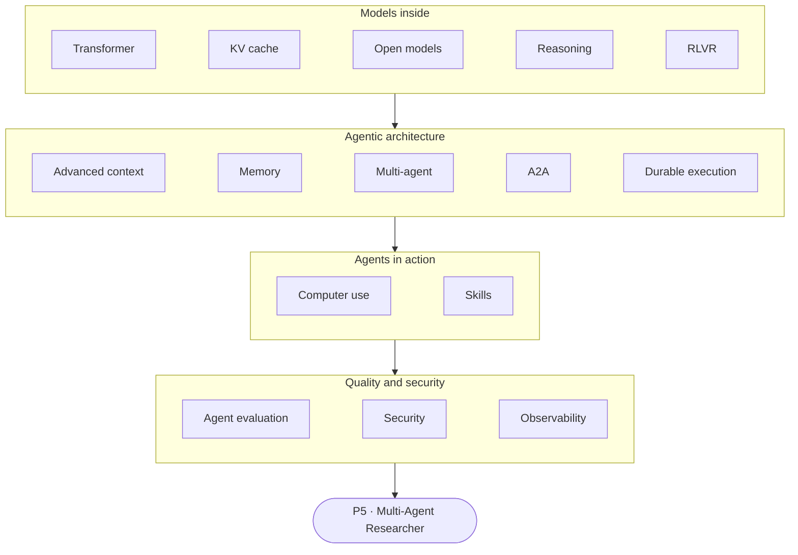

This level goes beyond what most job openings ask for. Levels 1 to 4 train an AI Engineer who ships and operates LLM systems. Level 5 trains someone who understands why those systems behave the way they do and can design the hard cases: agents that run for hours, several agents sharing work, models served on your own infrastructure.

## Why this level comes now

The topics here only make sense after you have put an agent in production and struggled with real problems: context that keeps growing, cost that spikes, a bad answer that is hard to explain. With that experience, studying attention, the KV cache or trajectory evaluation stops being loose theory and starts answering questions you have already had.

It is also what separates someone who uses the tool from someone who can choose, measure and defend an architecture in a senior-level interview or in an applied research team.

## How to study this level

Start with the group on how models work inside: it gives the vocabulary for everything else (tokens, attention, cache, cost per token). Then move on to agentic architecture and use the P5: Multi-Agent Researcher as your lab, building one layer at a time.

Read the primary sources (papers and official documentation) and reproduce at least one result from each group with your own numbers. Timelines are indicative and assume you study alongside a job in the field.
