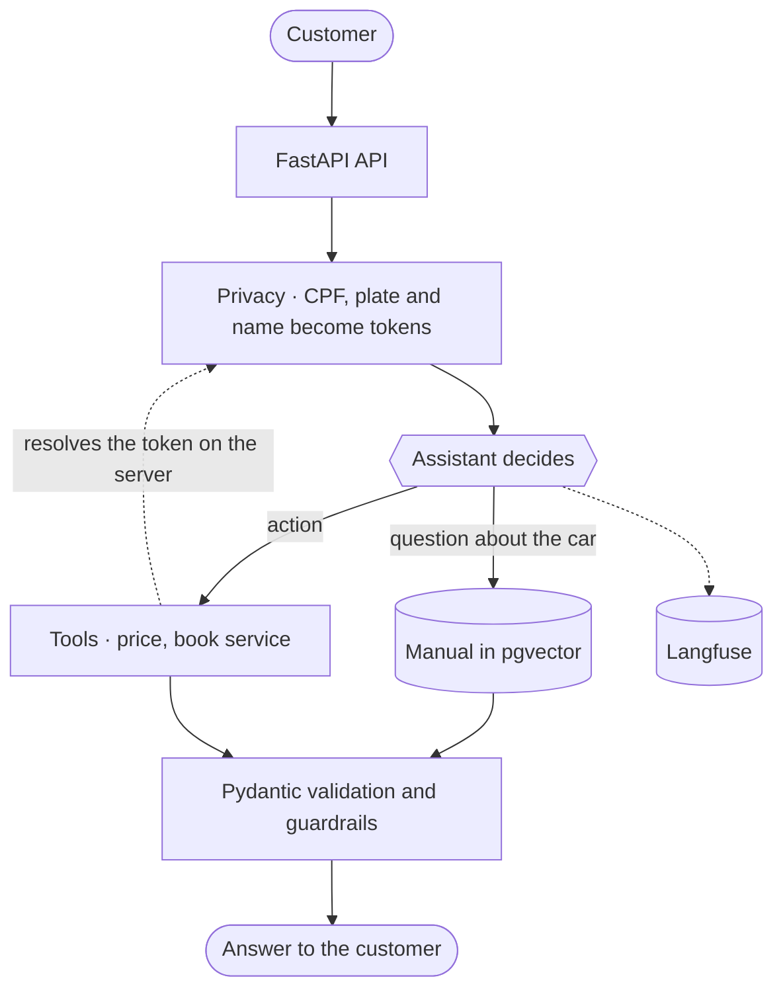

## The problem

A (fictional) car manufacturer wants to serve customers through chat: answer questions about models, servicing and warranty, and book service appointments. You build that assistant. The challenge is not making the chat respond, but making it respond correctly: without making up prices, without leaking personal data, without obeying malicious instructions and with measured quality.

This is the main project of Level 3 and it grows in layers. Each layer practices one topic of the roadmap, and in the end you have a system with the pieces of a real product.

## Architecture

The customer talks to a FastAPI API. Before any call to the model, a privacy layer replaces CPF (the Brazilian taxpayer ID), phone, license plate and name with tokens such as `<CPF_1>` (reversible pseudonymization). The token-to-value map stays only on the server: the model sees only the tokens, and a tool that needs the real data, such as booking a service, receives the token and resolves it on the server, without passing the value through the LLM or the log. Then the assistant decides whether to answer from the manual (RAG, retrieval-augmented generation: fetching passages from the documents and handing them to the LLM, here in PostgreSQL with pgvector) or to call a tool (check a price, book a service). The output is validated with Pydantic and goes through guardrails before reaching the customer. Every conversation is traced in Langfuse.

Use only synthetic data: an owner's manual written by you (or generated and reviewed by you), an invented catalog and fictional customers. Real automaker manuals are copyrighted, so do not publish them in the repository; if you want to test with one, check the license as in P2. Never use real data from a company or from people.

## Layered versions

Each layer is a version tagged in Git, from `v1` to `v7`, so anyone looking at the repository sees the evolution. With each version, rerun the tests from the previous ones. Evals are tests that measure answer quality, and the golden set is the fixed set of questions with expected answers. The study topics for each layer are: API and parameters (v1), structured output and tool use (v2), RAG (v3), LGPD and personal data (v4), guardrails and prompt injection (v5), evals (v6), observability and cost and latency (v7).

## Suggested stack

Python, FastAPI, PostgreSQL with pgvector, Pydantic, Presidio to detect personal data, Langfuse (traces every LLM call, with cost and latency; runs locally) and Docker Compose to start everything with one command. See the topics Postgres and pgvector, Local Docker and Observability.

## Acceptance criteria

- Runs locally with one command and has a README with instructions.
- Each layer has a Git tag (v1 to v7).
- RAG answers cite the source.
- Personal data is masked before the LLM and the logs.
- There is an eval report with the golden set (30 to 50 questions).
- At least five prompt injection tests are documented, with what passed and what failed.

## What to put in the README

- The problem and the audience, in one paragraph.
- An architecture diagram and the list of the seven layers, with each one's tag.
- How to run it (`docker compose up`) and how to run the tests.
- Technical decisions and the reason behind them, for example why mask before the model and not after.
- Eval results: the score per layer, the most frequent errors and what you changed after them.
- Average cost and latency per conversation (measure them in Langfuse).
- What you would do differently and the known limitations.

## How to present it in an interview

Tell the project in layers: the problem, the layer where you learned the most and one measured decision. Example of a decision: "the RAG answered warranty questions poorly, so I changed the text split to be by section and measured again on the golden set". Be ready to explain why the model can hallucinate, what masking solves and what it does not, and why there is no perfect filter against prompt injection. Show the eval report and the trace of a bad conversation in Langfuse. Say honestly what the assistant still does poorly.
