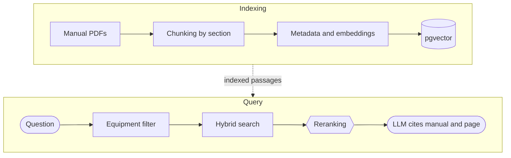

## The problem

Maintenance technicians lose time searching long PDFs for the meaning of a fault code, a procedure or a part number. You build an internal tool where the technician picks the equipment, asks in plain language and gets a short answer citing the manual and the page.

Use public manuals for industrial equipment, such as frequency inverters, PLCs and sensors. Many manufacturers distribute them as PDFs. Check each document's license before publishing any excerpt in the repository. If in doubt, do not publish the PDF: publish only the script that downloads it.

## Architecture

There are two flows. In indexing, the system reads each PDF, splits the text by section (chunking), stores the metadata (manufacturer, model, section, page) and generates the embeddings, vectors that represent meaning. In querying, it applies the equipment filter, runs hybrid search (by meaning and by keyword), reorders the best results with a reranking model and sends only the final passages to the LLM, with the instruction to cite manual and page. If you want the citation to come back structured, the Claude API has its own citations feature (see the Citations reference). If passages lose context when they are split, Anthropic's Contextual Retrieval article describes how to add a context sentence to each passage before indexing.

Search by meaning alone misses fault codes and part names, which have no meaning of their own. Keyword search solves that case. See the topics RAG, Hybrid search and reranking and Embeddings.

One detail decides quality: store, with each passage, the section text and the page number. Without them the citation is vague and the technician cannot check it in the PDF. Tables and figures usually come out badly from text extraction; test at least one manual with tables and note what was lost.

## Suggested stack

Python, FastAPI, PostgreSQL with pgvector (vectors and full-text search in the same database, which keeps things simple), a reranking model and Streamlit or a simple web interface. See the topics Postgres and pgvector, FastAPI and Frontend with AI.

## Acceptance criteria

- Several public manuals indexed, with manufacturer, model, section and page.
- Every answer cites manual and page, and answers "not found" when the passage does not exist.
- Filtering by equipment works.
- Retrieval metrics (recall@k and MRR) are in the README, measured on a set of questions with the right passage marked.
- The interface works well on a phone.

## What to put in the README

- The problem and a screenshot of the interface on a phone.
- Which manuals were indexed and the license of each one.
- A diagram of the two flows.
- A metrics table (recall@5 is the fraction of questions where the right passage is among the first five; MRR is the mean inverse position of the right passage): recall@5 and MRR with vector search, with hybrid search and with reranking.
- Three questions the system got wrong and what you concluded from each.
- How to reindex a new manual.
- Limitations, such as tables and figures inside the PDFs.

## How to present it in an interview

The strongest story is about measurement: "I started with vectors only and recall@5 was X; fault codes failed; I added keyword search and the result was Y; reranking changed Z". Explain recall@k and MRR in one sentence each. Be ready to talk about chunking, why metadata matters and how you would avoid made-up answers. Show the question the system still fails on and what you would try next.
