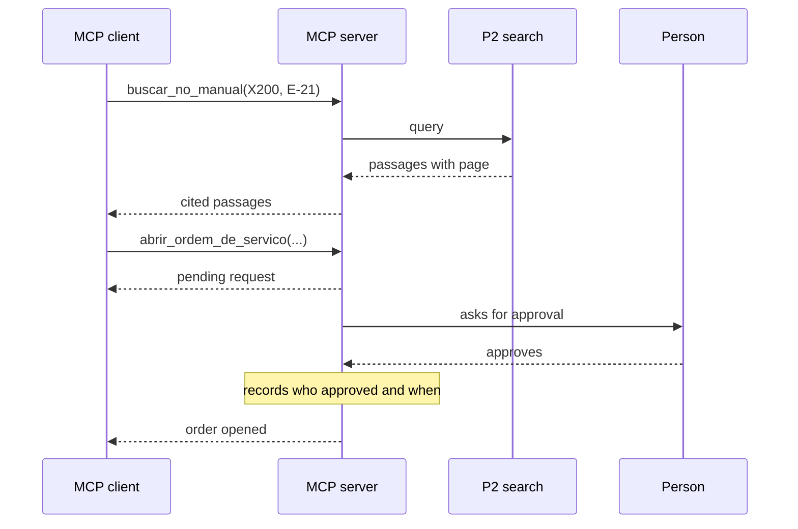

## The problem

The P2 search works inside your application. For tools like Claude Code or Claude Desktop to query the manuals too, you expose it as an MCP server (Model Context Protocol, an open protocol that standardizes how a model accesses tools and data). That way any compatible client uses the same search without its own integration.

The project is also about security: an action that changes the world, such as opening a work order, can only run after human approval, and a malicious manual cannot command the agent.

## Architecture

The MCP server, written with the official Python SDK, publishes two tools. The read tool, `buscar_no_manual(equipamento, pergunta)`, calls the P2 code and returns passages with citations; it writes nothing. The action tool, `abrir_ordem_de_servico(...)`, does not run immediately: it creates a pending request and only runs after a person approves, recording who approved and when. The client (Claude Code or Claude Desktop) connects to the server and decides when to call each tool.

See the topics MCP (which also covers authentication and permissions; if the server is remote, read the authorization part), Tool use, Human-in-the-loop and Prompt injection.

The client decides which tools to call based on the name and description you write, so treat that description as part of the product. Approval can be simple: a prompt in the terminal ("approve order 123? y/n") or a minimal page with approve and reject buttons. What matters is that the server does not execute before the yes. The approval record must store the tool, the arguments, who approved and the time, so that any opened order can be audited later.

## Suggested stack

Python, the official MCP SDK, the P2 code reused as a library and Claude Code or Claude Desktop as the client for testing. See the FastAPI topic if you also want to expose an HTTP API.

## Acceptance criteria

- The read tool returns manual passages with citations.
- The action tool only runs after a recorded human approval, with who approved and when.
- Permissions are minimal: the read tool writes nothing and has no access to the action.
- A test with a malicious instruction hidden in an indexed manual was done, and the fix is documented.
- The tool names and descriptions are clear enough for the client to pick the right one.

## What to put in the README

- What the server exposes, with the description of each tool and call examples.
- How to install it and how to connect it to Claude Code or Claude Desktop, step by step.
- The approval flow with a diagram and an example record.
- The permissions of each tool and why they are minimal.
- The attack test: the malicious text used, what the agent did before the fix and what it does after.
- Limitations, such as a defense that reduces risk but does not eliminate it.

## How to present it in an interview

Explain why you chose MCP instead of your own integration: one server serves several clients. Tell the story of the attack test, which is the most memorable part: "I hid an instruction in a manual, the agent tried to open an order, human approval stopped it, and then I reduced privileges and separated data from instructions". Be ready to say that there is no perfect defense against prompt injection, and that human approval and least privilege limit the damage. Show the record of an approval.
