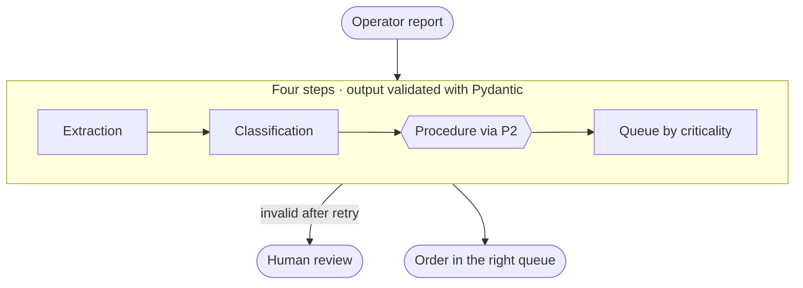

## The problem

Operators report failures in free text: "conveyor 3 is making noise and the motor is heating up". To turn that into a maintenance work order, someone has to extract equipment, symptom, criticality and sector, classify the type of failure and find the procedure. You automate this path with a workflow, not an agent: the steps are known and predictable, which makes the system cheaper, faster and easier to test.

The core of the project is comparing models by cost and quality.

## Architecture

The flow has four steps in sequence. (1) Extract structured data from the report. (2) Classify the type of failure. (3) Query the P2 search to suggest the procedure, with a citation. (4) Place the order in the right queue, based on criticality. Steps 1 and 2 use a small, cheap model, and only the procedure suggestion (step 3) uses a larger model. Each step's output is validated with Pydantic; if it is invalid, the system tries again and then flags the order for human review.

See the topics Structured output, Workflow or agent, Cost and latency and Evals.

Choose the criticality classification carefully: a critical order misclassified as low is a more serious error than the opposite. That is why you should measure error types separately, not just overall accuracy. Also define what happens when the report has no identifiable equipment.

## Suggested stack

Python, Pydantic for the schemas, two or more LLMs of different sizes, the P2 code for the procedure suggestion and Promptfoo (or your own evals) to compare the models. Use synthetic reports written by you, and never reports from a real company.

## Acceptance criteria

- The output is always valid JSON, validated by Pydantic.
- Extraction and classification use the smaller model, and the suggestion uses the larger one.
- There is a set of 30 to 50 synthetic reports with the expected answer.
- The README shows cost and quality before and after, measured with evals.
- The README explains why this is a workflow and not an agent.
- Ambiguous or incomplete reports go to human review, not to the queue.

## What to put in the README

- An example report and the generated order.
- A diagram of the four steps, with the model used in each one.
- A comparison table (for example, classification accuracy and cost per 1,000 reports) for: the large model everywhere, the small model everywhere and the mixed configuration (the numbers are yours, measured).
- The most common error types and what you did about them.
- The workflow versus agent explanation, in one paragraph.
- Limitations and what still requires human review.

## How to present it in an interview

Start with the decision: "I used the small model in the easy steps and the large one only where needed, and I measured that classification quality dropped a little while cost dropped a lot". Only say that with numbers from your report. Explain why it is not an agent: the steps are fixed, which gives predictability, and an agent only pays off when the path is not known. Be ready to talk about structured output, retrying when validation fails and what you would do with out-of-pattern reports.
