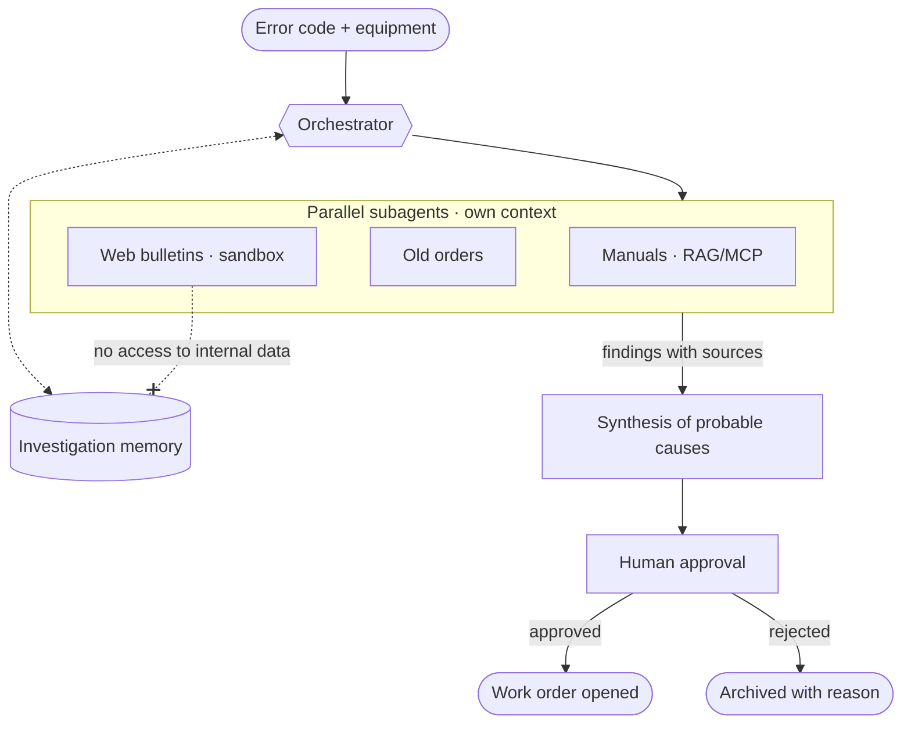

## The problem

When a piece of production-line equipment fails, an engineer spends hours cross-checking manuals, old maintenance work orders and technical bulletins to find the probable causes. P4: Maintenance Work Order Triage classified orders; PF: Complete Agent put an agent in production. P5 solves a more open and longer task: investigating a failure end to end, searching several sources at the same time, and proposing a work order that is only opened after a person approves it.

This is the project where you apply, with numbers, everything level 5 covers: models inside, agentic architecture, evaluation and security.

## Architecture

An orchestrator receives the error code and the equipment, plans the investigation and launches subagents in parallel: one searches the manuals (with the code from P2: Technical Manuals RAG or P3: Manuals MCP Server), another searches old work orders, another searches public bulletins on the web. Each subagent has its own context and tools and returns only its findings with sources. The orchestrator synthesizes the probable causes, checks the memory of previous investigations and proposes a work order.

Execution is durable: every step is recorded, and the wait for human approval survives restarts. The web subagent has no access to internal data, which breaks the lethal trifecta. A simple classification subagent runs on an open model you serve. The whole flow produces a single trace, and bad traces become evaluation cases.

See the topics Multi-agent systems and orchestration, Advanced context engineering, Agent memory, Durable execution, Serving open models, Agent evaluation, Agent security and Agent observability.

## Layered versions

Each layer is a version tagged in Git, with that version's evaluation report. Start with the measured single agent: without that baseline, you cannot prove that the multi-agent version is worth the extra cost. The open-model layer can use a GPU rented for a few hours, with a cost alert turned on.

## Suggested stack

Python, an agent framework (or your own code, if you prefer to understand each part), Postgres with pgvector for search and memory, vLLM or llama.cpp for the open model, a durable execution engine (Temporal, DBOS or LangGraph checkpoints), OpenTelemetry with Langfuse for traces and Docker to isolate the web subagent.

## Acceptance criteria

- The multi-agent version was compared with the single-agent one on the same evaluation, with accuracy, cost and time.
- The evaluation measures trajectory and consistency (pass^3), not only the final answer.
- The system resumes an investigation after a crash without repeating actions with external effects.
- No work order is opened without a recorded human approval.
- The lethal trifecta was analyzed and broken, and the test attacks are documented.
- The open-model subagent has its memory math and API comparison published.

## What to put in the README

An architecture diagram with the orchestrator, the subagents, the sources and the approval points. The comparison table between single agent and multi-agent. The evaluation report with pass^3 and examples of good and bad trajectories. The threat table with the defenses and the results of the attacks. The KV cache memory math for the open model. A short video showing an investigation, a crash and the resume.

## How to present it in an interview

Tell the story in decisions: why you started with a single agent, what the numbers showed, why you split into subagents and how much it cost. Show a bad trajectory the evaluation caught and how you fixed it. Explain the security analysis in one sentence per tool. Be ready to answer when you would not use several agents and when you would not serve your own model.
