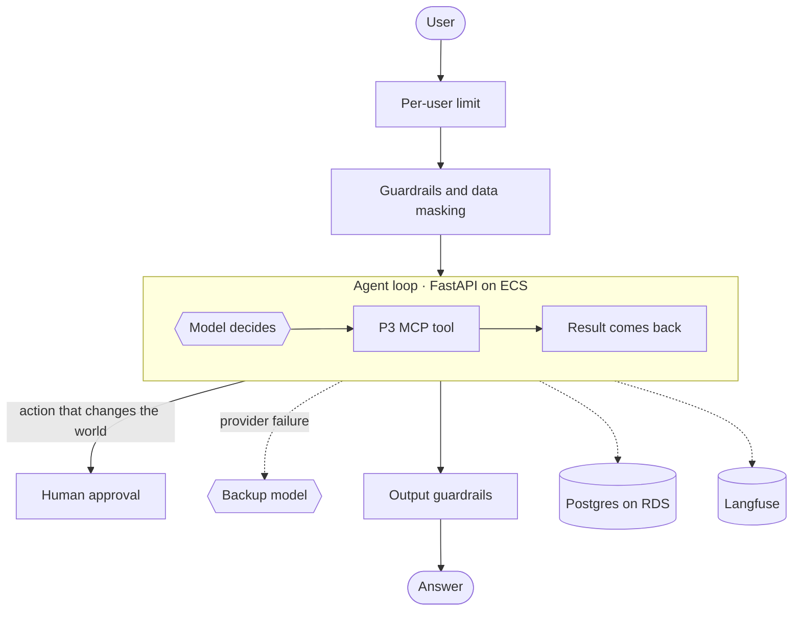

## The problem

This is the final project: an industrial maintenance agent that brings together everything you have built. It talks to the technician, uses the P3 MCP servers as tools, reads and writes the work order history in Postgres, remembers the conversation context, asks for approval before irreversible actions and applies guardrails and anonymization. And it stays live, at a public address, with a known cost.

If you prefer another domain, that is fine, as long as it uses all the layers. Use only public or synthetic data.

## Architecture

A FastAPI service receives the message and runs the agent loop: the model decides which tool to call, the system executes it, returns the result and repeats until done. The tools come from the P3 MCP servers; actions that change the world go through human approval. Guardrails and personal data masking act before and after the model. A per-user request limit and a model fallback protect against spikes and provider failures. Every step is traced in Langfuse, which you can use as Langfuse Cloud (simpler, the traces leave your account; use only synthetic data) or self-host (more control, more infrastructure and cost); in P1 it ran locally in Docker, and here you decide and document the switch. PostgreSQL stores orders and history and runs on RDS (the AWS managed database).

The P3 MCP servers were built for a local client. For an agent running in a container to use them, the server needs to expose an HTTP transport and the agent needs an MCP client; see the MCP topic and the protocol's transport documentation.

The deployment uses a Docker container on ECS (Elastic Container Service, the AWS container service) with Fargate (you do not manage servers), the image stored in ECR (the AWS image registry) and an ALB (Application Load Balancer) in front. These items have a fixed cost even without use, and AWS Budgets, created before the other resources, only alerts by default and does not block spending (Budget Actions can apply restrictions, but it requires configuration). That is why you should also set a spending limit at the model provider. The public endpoint requires authentication (for example, a key or a test login) and has a usage limit, because without it anyone can spend your model budget. CI/CD, in GitHub Actions, runs tests and evals on every change and publishes the image.

See the topics Agent frameworks, Rate limit and fallback, Observability, CI/CD, AWS fundamentals and Cloud security and cost.

## Suggested stack

Python, FastAPI, PostgreSQL (RDS), the P3 MCP servers, Langfuse, GitHub Actions, Docker and AWS (ECS with Fargate, ECR and ALB). Take an introductory AWS course first and set up MFA and minimal permissions before any resource.

## Acceptance criteria

- It is live, with a working link.
- CI/CD runs tests and evals on every change.
- There is a cost alert and a spending limit at the model provider, and the monthly cost is known.
- The README has the complete architecture with a diagram.
- A bad answer can be diagnosed through the observability traces.
- Irreversible actions require human approval and are recorded.
- The public endpoint has authentication, a usage limit and model fallback, all tested.

## What to put in the README

- Demo link, a test credential (change it after sharing) and a short video.
- The complete architecture diagram.
- The measured monthly cost, separating fixed infrastructure and the model, and the configured alert and limit, with the values.
- Eval results and how they run in CI.
- A real bad answer and the diagnosis path, from the trace to the fix and the new case in the golden set.
- Decisions and known risks: prompt injection, personal data, provider failure.
- How to shut everything down so it does not generate charges.

## How to present it in an interview

This is the project that carries the system design interview. Walk through the design end to end and, at each box, state the decision and why: why an agent here and a workflow in P4, where human approval comes in, how you control cost. Tell a real incident: "an answer came out wrong, I found the cause in the trace, fixed it and added the case to the evals". Show the live link and the measured cost. Say what is not covered and what you would do with more time.
