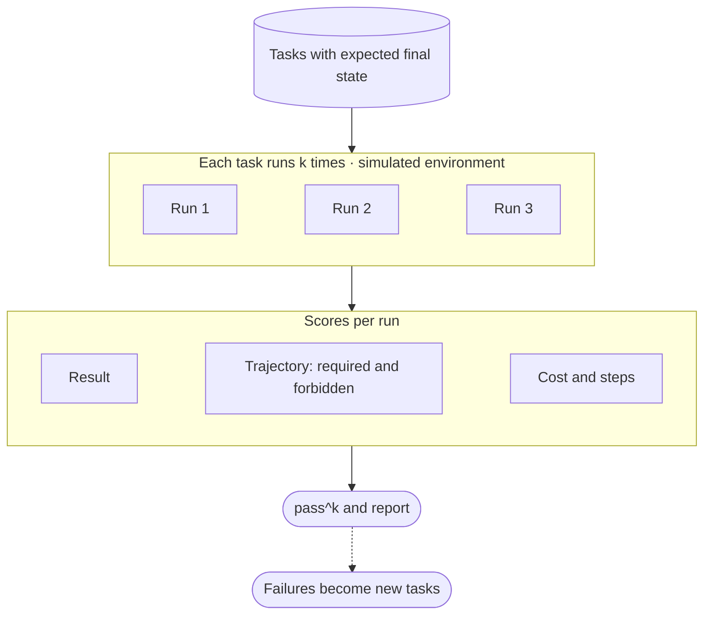

## What it is

Evaluating an agent is different from evaluating an answer. The agent makes a sequence of decisions, the trajectory: which tools it called, with which arguments, in which order, how much it spent and how it ended. Two runs of the same task can reach the same result through very different paths, or get it right once and wrong the next time. Agent evaluation measures the result, the trajectory and the consistency.

## Why it matters for an AI Engineer

An agent that gets 80% right in a single run can get much less right when you require it to succeed on every attempt, and that is what the user feels. Without evaluating the trajectory, you do not see the costly problems: tools called for nothing, risky actions that by luck did not go wrong, loops. And without automated evaluation, every prompt or model change becomes a bet. Teams that build serious agents spend a good part of their effort here.

## How it works

Three layers of measurement:

- **Result:** is the final state right? The best way is to check it with a program: the record was created in the database, the tests passed, the answer contains the expected data.
- **Trajectory:** did it call the necessary tools, avoid the forbidden ones, respect the step and cost limits?
- **Consistency:** run each task k times. The pass^k metric (proposed in τ-bench) is the chance of getting it right in all k runs, and it drops quickly when the agent is unstable.

```python
def evaluate(trajectory, expected):
    tools = [s["tool"] for s in trajectory["steps"]]
    return {
        "result": trajectory["final_state"] == expected["final_state"],
        "used_required": set(expected["required"]) <= set(tools),
        "avoided_forbidden": not set(expected["forbidden"]) & set(tools),
        "steps": len(tools),
        "cost": sum(s["cost"] for s in trajectory["steps"]),
    }

def pass_k(results_per_task):
    """Fraction of tasks where all k runs got it right."""
    return sum(all(r) for r in results_per_task) / len(results_per_task)

print(pass_k([[True, True, True], [True, False, True]]))  # 0.5
```

For tasks with interaction, use a simulated environment: fake tools with their own state and, if needed, a user simulated by another model. For subjective criteria, an LLM as judge with a clear rubric, calibrated against a few human ratings. Frameworks such as Inspect organize tasks, execution and scoring.



## In practice

Public benchmarks such as SWE-bench (fixing real issues in repositories) and τ-bench (customer service with tools and rules) show the method, but what matters is your own task set. In P5: Multi-Agent Researcher, the evaluation covers 30 investigations with a known answer, forbidden tools (such as opening an order without approval) and pass^3.

## Common mistakes

- **Evaluating only the final answer.** It hides cost, risk and luck.
- **Running each task once.** Agents vary; without repetition you measure noise.
- **An uncalibrated judge.** Check the LLM judge against human ratings before trusting it.
- **A test environment that leaks into production.** Test tools cannot have real effects.
- **A set that never changes.** Add every failure found in production as a new case.

## How to study

1. Read the τ-bench paper and understand pass^k (1 day).
2. See how SWE-bench defines task, environment and verification (2 hours).
3. Put together 20 tasks with a verifiable final state and fake tools with state (3 days).
4. Implement the metrics above, run each task 3 times and build the report (3 days).
5. Reproduce the same set in Inspect or another evaluation framework (3 days).

## How to show it

Show the report per task (result, trajectory, cost, pass^k) and an example of a bad trajectory the metric caught that the final answer did not show. In the interview, explain why pass^k matters more than the accuracy of a single run.
