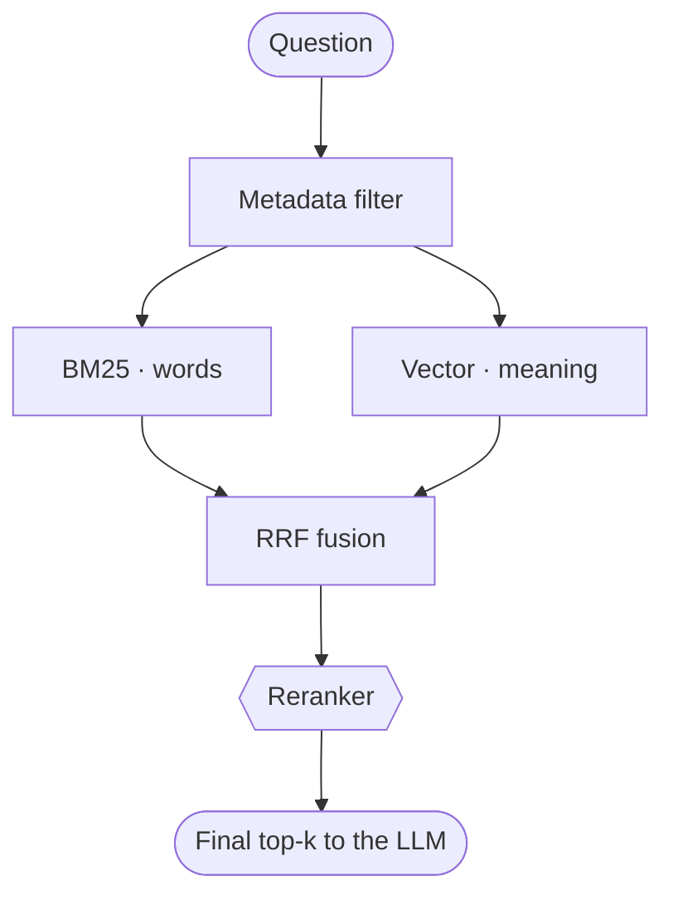

## What it is

Hybrid search combines two ways of finding passages: vector search (by meaning, using embeddings, numeric vectors that represent the meaning of the text) and keyword search, usually with the BM25 algorithm. Reranking is a second step: a model reassesses the candidates found and puts the best ones at the top.

## Why it matters for an AI Engineer

Vector search understands that "the compressor won't start" and "start-up failure" are about the same thing. But it usually misses what has no "meaning" to generalize from: a code like `E-21`, an acronym, a proper name, a part number. In technical manuals, that is half the questions. If the right passage does not reach the prompt, the LLM (language model) answers wrong, and no prompt tweak fixes it.

## How it works

BM25 scores each passage by the question's words: it counts how many times they appear, gives more weight to rare words (`E-21` is worth more than "error") and compensates for passage length. It finds the exact term, but does not understand synonyms.

The typical pipeline has three steps:

1. **Two searches in parallel**: BM25 and vector, each returning its best passages (top-k, the first k).
2. **Fusion** of the two rankings. The scores have different scales, so the most used fusion looks only at position: RRF (reciprocal rank fusion) adds `1 / (60 + position)` from each ranking. The 60 is the constant from the original paper.
3. **Reranking** of the best candidates with a cross-encoder: a model that reads question and passage together and gives a score. It is more precise than comparing vectors, but slower, so you apply it only to a few dozen candidates and keep the few best for the prompt.



```python
def rrf(rankings, k=60):
    scores = {}
    for ranking in rankings:
        for pos, doc in enumerate(ranking, start=1):
            scores[doc] = scores.get(doc, 0) + 1 / (k + pos)
    return sorted(scores, key=scores.get, reverse=True)

bm25 = ["c3", "c1", "c7"]        # illustrative example: keyword ranking
vector = ["c1", "c5", "c3"]      # illustrative example: vector ranking
print(rrf([bm25, vector]))       # ['c1', 'c3', 'c5', 'c7']
```

`c1` wins because it ranks well in both lists. Finally, **metadata filters** (manual, machine model, date) narrow the search before ranking, which also improves precision.

## In practice

In P2: Technical Manuals RAG, the question "what is error E-21?" is the classic case: BM25 finds the exact code and vector search finds the paragraph that explains the cause. In PostgreSQL, keyword search comes from full-text search (its ranking is similar to BM25, not identical) and vector search comes from pgvector, in the same database. Anthropic's Contextual Retrieval article shows that combining embeddings, BM25 and reranking reduces retrieval failures compared to embeddings alone; check the method and numbers there.

## Common mistakes

- **Adding scores from different scales.** A BM25 score and a cosine similarity are not comparable; fuse by position or normalize first.
- **Reranking the whole base.** The cross-encoder is slow; use it only on the first stage's candidates.
- **Applying everything without measuring.** Hybrid search and reranking cost latency and complexity. Compare recall@k (is the right passage among the first k?) before and after, on the same set of questions.
- **Ignoring metadata.** Without a filter, the manual for a different machine model enters the results.

## How to study

1. Read the search section of Contextual Retrieval (1 hour).
2. Implement the `rrf` above and replace the example rankings with those from two real searches, one BM25 (the `rank_bm25` library works) and one vector (1 day).
3. Put together 20 questions, half with codes and acronyms, and compare recall@5 for BM25, vector and hybrid (2 days).
4. Test a Sentence Transformers cross-encoder on the first 30 candidates (1 day).
5. Read the RRF paper and the PostgreSQL full-text search chapter (half a day each).

## How to show it

In the P2 README, include a table with recall@5 for each strategy on your questions and two examples of fault codes that only hybrid search got right. In the interview, explain why vector search misses `E-21` and why fusion uses position instead of score.
