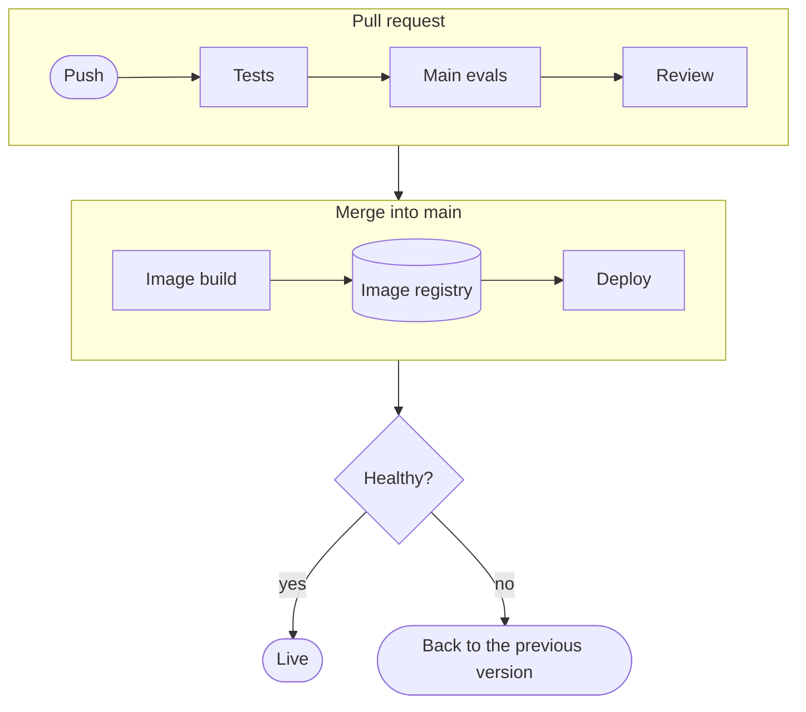

## What it is

CI/CD stands for continuous integration and continuous delivery (or deployment). In CI, every change to the code automatically triggers the build and the tests. In CD, what passed the tests is published to an environment (staging, for testing, or production). GitHub Actions is the GitHub service that runs these flows, written in YAML files inside the repository.

## Why it matters for an AI Engineer

In an LLM system, code is not the only thing that changes: the prompt, the model and the chunking do too. Any of them can make answers worse without an ordinary test noticing. If evals run in the pipeline, a change that drops quality fails before it reaches the user. That turns "I think it improved" into "the result went to X, against Y before".

## How it works

A workflow has **triggers** (the event that starts it, such as opening a pull request), **jobs** (blocks of work) and **steps** (the steps of each job). The example runs tests and evals on every pull request:

```yaml
on: pull_request
permissions:
  contents: read
jobs:
  tests:
    runs-on: ubuntu-latest
    steps:
      - uses: actions/checkout@v4
      - uses: actions/setup-python@v5
        with: {python-version: "3.12"}
      - run: pip install -r requirements.txt
      - run: pytest
      - run: npx promptfoo@0.126.0 eval
        env:
          ANTHROPIC_API_KEY: ${{ secrets.ANTHROPIC_API_KEY }}
```

The file lives in `.github/workflows/`. Action versions (`@v4`, `@v5`) change; check the current ones in each action's repository. `eval` exits with an error when a check fails, and the pull request is marked as failed.

**Secrets.** The model key comes from `secrets`, registered in the repository settings, never written in the YAML. Pull requests from forks do not receive secrets, for security, so evals that need the key fail or are skipped there; handle that in the workflow. `permissions: contents: read` limits the workflow token to the minimum, and the pinned Promptfoo version keeps an update from changing results without warning (check the current version with `npm view promptfoo version`).

**Cost of evals.** Evals call the model and cost money. Run the main cases on every pull request and the large set on a schedule, or when merging into the main branch.

**Build and deploy.** A second workflow, triggered when merging into `main`, builds the Docker image, publishes it to an image registry and updates the service in the cloud. The cloud credentials also live in secrets, with minimal permissions (see cloud security and cost).



**Environments.** GitHub supports environments (staging and production), each with its own secrets and, if you want, a manual approval before deploying to production (required reviewers depend on repository visibility and plan). A common sequence: a pull request runs tests and evals; merging into `main` deploys to staging; approval takes it to production.

## In practice

In PF: Complete Agent, the pipeline runs the tests and evals on every pull request, builds the image and deploys to AWS. You can reuse the evals from P2: Technical Manuals RAG and P4: Work Order Triage as part of the pipeline, and the same `Dockerfile` from local Docker is what the pipeline builds.

## Common mistakes

- **A secret in the YAML or in the log.** Use `secrets` and never print the value.
- **Expensive evals on every commit.** Set a budget and a subset for pull requests.
- **A pipeline that is too slow.** Developers start ignoring it; use dependency caching and split into jobs.
- **Deploying straight to production** without a test environment and without a way back.
- **An eval that never fails.** If the threshold is loose, the pipeline becomes decoration.

## How to study

1. Follow the GitHub Actions introduction and create a workflow that runs `pytest` (1 day).
2. Register a secret and use it in a step (half a day).
3. Add Promptfoo to the workflow and cause a failure with a worse prompt (1 day).
4. Build the Docker image in the pipeline (1 day).
5. Create staging and production environments with manual approval (1 day).

## How to show it

In your portfolio, the workflow status badge at the top of the README and a pull request that was failed by an eval show that the pipeline works. In the interview, tell how the pipeline blocked a prompt change, with the numbers before and after.
