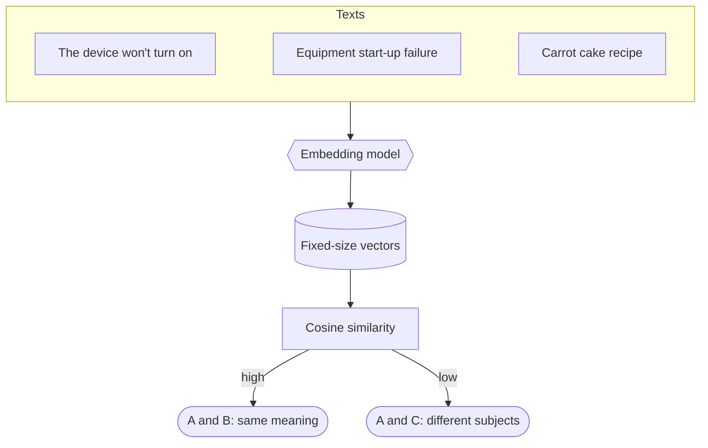

## What it is

An embedding is a list of numbers (a vector) that represents the meaning of a text. Texts with similar meaning get nearby vectors; unrelated texts end up far apart. Imagine a map where each sentence is a point and sentences about the same subject live in the same neighborhood. In practice, this map has hundreds or thousands of dimensions, but the idea is the same.

## Why it matters for an AI Engineer

Searching for exact words fails when the user writes "the device won't turn on" and the manual says "equipment start-up failure". With embeddings, search compares meanings. That is why they are at the base of semantic search, recommendation, grouping similar texts, classifying without training a model and RAG, which you study in level 2.

## How it works

An **embedding model** (different from the chat LLM) receives a text and returns a fixed-size vector. To compare two texts, you measure the **cosine similarity**: a number between -1 and 1 that says how much the vectors point in the same direction. Close to 1, similar meanings. You do not need to calculate it by hand: the library does it.



```python
from sentence_transformers import SentenceTransformer, util

model = SentenceTransformer("paraphrase-multilingual-MiniLM-L12-v2")
sentences = ["The device won't turn on", "Equipment start-up failure", "Carrot cake recipe"]
vectors = model.encode(sentences)

print(float(util.cos_sim(vectors[0], vectors[1])))  # high
print(float(util.cos_sim(vectors[0], vectors[2])))  # low
```

Install with `pip install sentence-transformers`; the model is downloaded on first run. The first pair is expected to score much higher than the second, even without words in common.

Main uses:

- **Search:** vectorize the documents once and, for each question, find the closest ones.
- **Clustering:** nearby texts form groups (for example, similar complaints).
- **Classification:** compare a text with examples of each category.

Choosing the model: check whether it supports your language (multilingual ones support many), the vector size (bigger costs more storage and time) and the token limit per text. Always use the same model for indexing and for searching, because vectors from different models are not comparable.

**Limits:** an embedding captures the general subject, but is weak with codes, acronyms and numbers ("error E-21" and "error E-12" may look the same); it also does not distinguish negation well ("turns on" and "won't turn on" end up close). That is why hybrid search, which mixes vectors and keywords, exists.

## In practice

In P2: Technical Manuals RAG, each manual passage becomes a vector stored in PostgreSQL with pgvector, and the technician's question becomes another vector to find the closest passages. You measure whether the right passage appears among the first results and, when codes fail, you add keyword search.

## Common mistakes

- **Mixing embedding models.** Indexing with one and searching with another returns meaningless results.
- **Expecting "close" to mean "correct".** The most similar passage may be about the subject and still not answer the question.
- **Using embeddings for codes and identifiers.** For "E-21", keyword search works better.
- **Vectorizing a huge text at once.** Beyond the model's limit, the end gets cut; split it into pieces.
- **Never re-evaluating.** Switching the embedding model requires reindexing everything and measuring again.

## How to study

1. Read "The Illustrated Word2vec" to build the intuition of the meaning map (2 hours).
2. Run the example with ten sentences of your own and look at the scores (2 hours).
3. Build a semantic search over 50 paragraphs of a text you know (1 day).
4. Test a query with an acronym or code and note where the search fails (2 hours).
5. Read the Sentence Transformers documentation section on semantic search, and the embeddings page of the Claude documentation, which explains that Anthropic has no embedding model of its own and recommends Voyage AI (3 hours).

## How to show it

In your portfolio, a notebook or script with semantic search and examples of hits and misses, with explanations. In the interview, explain in your own words what an embedding is, how similarity is used and why acronyms and negations are problems.
