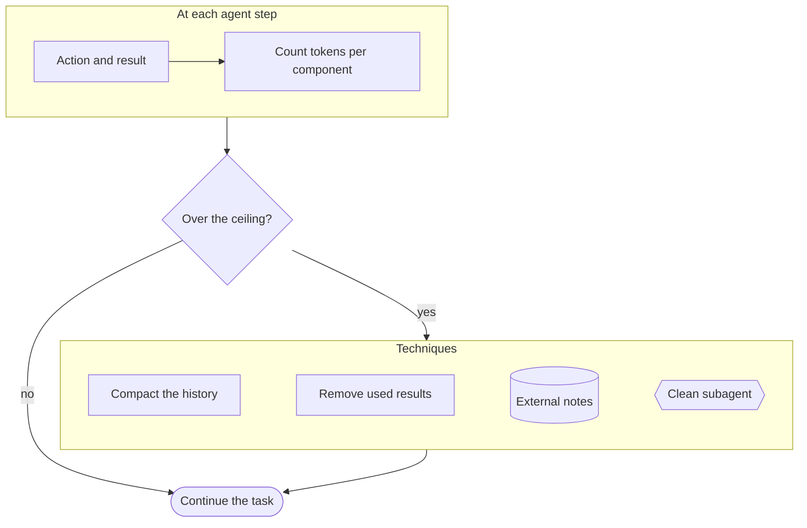

## What it is

In level 2 you learned to assemble the context for one call. Here the problem is different: an agent that runs for dozens or hundreds of steps, calling tools, reading files and accumulating results. The context grows on every turn, and quality drops even before the window fills up, a phenomenon that became known as context rot. Advanced context engineering is the set of techniques to keep that agent focused for the whole task.

## Why it matters for an AI Engineer

Long-running agents are where current systems fail the most: they repeat actions, forget the goal, follow old instructions or get too expensive. The context rot study showed that the performance of several models drops as the input grows, even on simple tasks. Million-token windows do not solve this on their own. Whoever knows how to design a long agent's context solves the most common problem of agents in production.

## How it works

Treat the context as a budget. Set a ceiling per component and an action for when it is exceeded:

```python
BUDGET = {"instructions": 3_000, "notes": 2_000, "tools": 20_000, "conversation": 15_000}

def adjust(parts, count):
    for name, ceiling in BUDGET.items():
        while count(parts[name]) > ceiling and len(parts[name]) > 1:
            if name == "tools":
                parts[name].pop(0)               # remove the oldest result
            elif name == "conversation":
                parts[name] = [summarize(parts[name][:-4])] + parts[name][-4:]
                break                            # summarize once per step
            else:
                break                            # instructions and notes: review by hand
    return parts

summarize = lambda msgs: "Summary: " + " | ".join(m[:40] for m in msgs)
```

The main techniques:

- **Compaction:** summarize the old history when it goes over the ceiling, keeping decisions, open items and mistakes already made.
- **Context editing:** remove tool results that were already used. Some APIs do this automatically.
- **External notes:** the agent writes a progress file (goal, done, to do) and rereads it, instead of depending on the history.
- **On-demand retrieval:** instead of loading everything at the start, give the agent tools to fetch only what it needs, when it needs it.
- **Subagents:** delegate a subtask to another agent with a clean context, which returns only a short summary.
- **Lean tools:** paginated, filtered tool responses with clear errors spend less context.



## In practice

Coding agents use all these techniques: they read files on demand, keep a task file and compact the conversation. In P5: Multi-Agent Researcher, the orchestrator keeps a research notes file and each subagent works with its own context, returning only findings with citations.

## Common mistakes

- **Trusting the large window.** Fitting is not the same as being used well.
- **Compacting without testing.** Check that the agent still knows the goal and the decisions after the summary.
- **Tools that return everything.** A search that returns 50 whole documents fills the context in a few turns.
- **Not measuring.** Log tokens per component at each step; without that, you do not know what to cut.

## How to study

1. Reread Anthropic's context engineering article, now focusing on the sections about long tasks (2 hours).
2. Read the context rot study and reproduce a simple test with the model you use (2 days).
3. Instrument an agent of yours to log tokens per component at each step (1 day).
4. Implement compaction and external notes and compare success rate and cost on a long task (3 days).
5. Read the article on writing tools for agents and rewrite one of your tools (1 day).

## How to show it

Show the chart of tokens per step before and after the techniques, with the success rate on the same task. In the interview, explain what context rot is and which technique you would apply first to an agent that gets lost after 50 steps.
