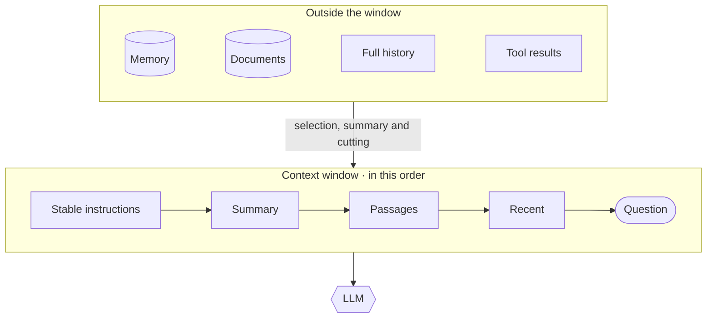

## What it is

Context engineering is deciding, for each call to the model, what goes into the context window (the total text the model reads at once): instructions, history, memory, retrieved documents and tool results. It is the evolution of prompt engineering: instead of writing one good instruction, you assemble the right set of information.

## Why it matters for an AI Engineer

The model only knows what is in the context. Missing information leads to invention; too much information leads to noise, cost and slowness. Anthropic's article on the subject treats context as a limited resource: more tokens (the units of text) do not guarantee a better answer, and the model may make worse use of what sits in the middle of a long text, as the "Lost in the Middle" study shows. In agents that run for many turns, the context grows with every tool call, and controlling it is what keeps the agent working.

## How it works

Think of five decisions:

1. **What goes in.** Only what this call needs: the role instructions, the latest messages and the passages the question asks for (RAG). Every extra item has to justify itself.
2. **A summarized history.** Long conversations do not fit. Keep the latest messages in full and turn the rest into a summary, which is called compaction.
3. **Memory outside the window.** Lasting facts, such as user preferences or decisions, live in a file or database and come back into the context only when relevant.
4. **Lean tool results.** Return the field that matters, not the whole table. Old results that were already used can be removed.
5. **The order.** Stable instructions at the beginning (this also favors prompt caching, which reuses an identical prompt prefix), long material after and the question at the end. Test the order in your case; the effect varies.



```python
def build_context(system, summary, recent, passages, question):
    parts = [system]                         # stable: stays at the beginning
    if summary:
        parts.append("Summary of the conversation so far:\n" + summary)
    parts.append("Retrieved passages:\n" + "\n".join(passages))
    parts += recent[-6:]                     # only the latest messages
    parts.append("Question: " + question)    # the question last
    return "\n\n".join(parts)

print(build_context("You help technicians.", "", ["Hi"], ["[X200, p. 47] Error E-21..."], "What is E-21?"))
```

This is a simple assembly function; in a real system you also count tokens to respect a budget per part. Another technique is splitting the work into subagents, each with its own clean context, that return only a summary to the main agent.

## In practice

In P1: Automaker Assistant, the conversation history grows each turn; summarizing old messages and keeping the recent ones avoids cost and loss of focus. In P2: Technical Manuals RAG, the decision is how many passages go into the prompt. In PF: Complete Agent, MCP tool results enter the context on every turn, so you need a rule to discard or summarize them.

## Common mistakes

- **Sending everything "just in case".** More context increases cost and latency and can make the answer worse.
- **Resending the whole history forever.** Long conversations overflow the window or dilute attention.
- **A summary that loses the essentials.** Compaction erases details; test with questions about what was summarized.
- **Instructions in the middle of a long text.** Put what is critical at the beginning or the end.
- **Mixing instructions and untrusted data.** Retrieved documents are data, not orders.

## How to study

1. Read Anthropic's context engineering article (2 hours).
2. Read the context windows page of the API you use (1 hour).
3. Run the function above with a 30-message history and summarize the old part (1 day).
4. Measure the number of tokens before and after compaction and check whether the answer is still correct (1 day).
5. Read Lost in the Middle and test the position of a key piece of information in 10 questions (1 day).

## How to show it

In the README, show a diagram of what goes into each call and a table with tokens per component before and after compaction, alongside the measured quality. In the interview, explain how you decide what leaves the context and how you check that the summary lost nothing important.
