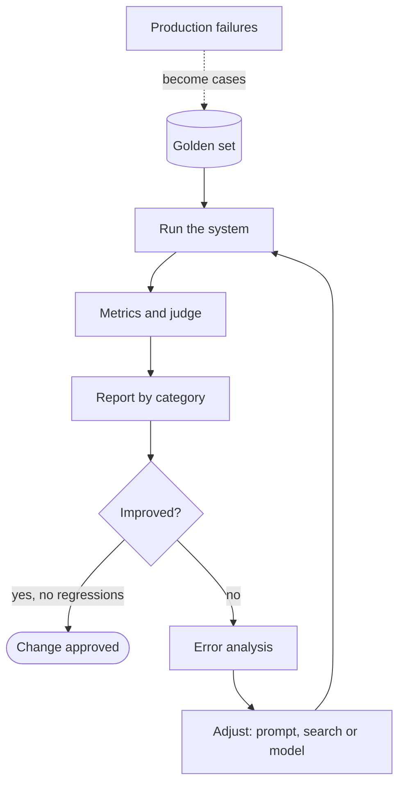

## What it is

Evals (evaluations) are automated tests of the quality of an LLM (language model) system. Instead of looking at a few answers and deciding it got better, you run the system on a fixed list of cases and compute metrics. The output is a number you compare before and after each change.

## Why it matters for an AI Engineer

Prompts, models, chunking and tools change all the time. Without evals, every change is a bet: a tweak fixes one case and breaks three you did not see. With evals, you answer "did it improve?" with data, and you block what gets worse.

## How it works

**Golden set.** A fixed list of real cases with the expected answer (or source). Start with 30 to 50, taken from real questions, and include every error that has already happened. It grows over time.

**Error analysis.** Before choosing metrics, read the failures and classify them (retrieved the wrong passage, ignored the instruction, made up the source). The most frequent categories tell you where to improve and which evals to write.



**Retrieval metrics.** For RAG (searching passages for the prompt), measure search separately from generation. Recall@k is the fraction of questions where the right passage is among the first k. MRR (mean reciprocal rank) is the average of `1 / position` of the right passage, which rewards putting it at the top.

```python
def recall_at_k(cases, k=5):
    return sum(c["right"] in c["retrieved"][:k] for c in cases) / len(cases)

def mrr(cases):
    total = 0
    for c in cases:
        if c["right"] in c["retrieved"]:
            total += 1 / (c["retrieved"].index(c["right"]) + 1)
    return total / len(cases)

cases = [{"right": "c1", "retrieved": ["c1", "c4"]},   # illustrative data
         {"right": "c2", "retrieved": ["c9", "c2"]},
         {"right": "c3", "retrieved": ["c5", "c6"]}]
print(recall_at_k(cases, 2), mrr(cases))   # 0.666... 0.5
```

**Rubrics.** Break "is the answer good?" into objective yes-or-no criteria: does it cite the source? does it answer what was asked? does it avoid making up data? Binary criteria are easier to score than 1-to-10 ratings.

**LLM-as-judge.** For criteria code cannot check, a second model evaluates the answer with the rubric. It makes mistakes, so calibrate it: a human labels 30 to 50 answers, you compare the judge's verdict with the human's (percentage of agreement) and adjust the rubric until they agree enough. Judges have known biases, such as preferring long answers, and the Zheng et al. paper describes them.

**Evals in CI.** CI (continuous integration) runs on every change. Run the golden set and block the change if the metric drops beyond a tolerance. Since the LLM varies, use a tolerance and, if needed, repeat the runs.

## In practice

In P2: Technical Manuals RAG, you measure recall@5 and MRR for each search strategy. In P4: Maintenance Work Order Triage, evals compare small and large models on cost and quality. In PF: Complete Agent, evals run in CI on every change. Tools like Promptfoo help organize the cases; see also the topic on tests and evals in the project.

## Common mistakes

- **Evals with only easy cases.** The golden set needs hard cases and questions outside the base, where the right answer is "I don't know".
- **Changing the golden set on every test.** Always compare on the same set.
- **An uncalibrated judge.** An LLM-as-judge not checked against humans is just another opinion.
- **Measuring only the final answer.** If retrieval fails, generation has no way to get it right.
- **Evals too heavy to run.** If it is slow, nobody runs it; carve out a quick subset.

## How to study

1. Read "Your AI product needs evals" (2 hours).
2. Write 30 cases from your project, with the expected source (1 day).
3. Implement recall@k and MRR and calculate them for your search (1 day).
4. Read the 20 worst answers and classify the errors (half a day).
5. Create a judge with a rubric, label 30 answers by hand and compare (2 days).
6. Run the golden set in a simple CI pipeline (1 day).

## How to show it

In the README, include a table with the metric per version, the list of error categories and the result of the judge calibration. In the interview, tell about a change that looked better and that the evals showed was worse.
