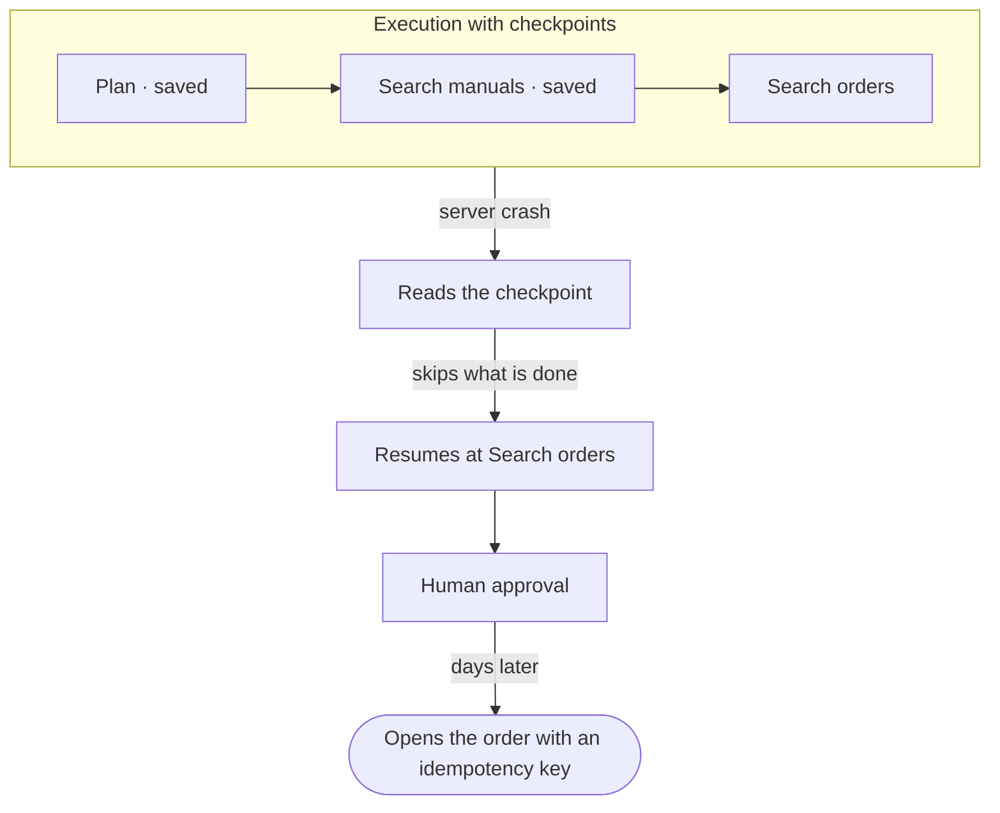

## What it is

Durable execution is the guarantee that a long process continues from where it stopped after a failure. The state of each step is saved (a checkpoint); if the server restarts, the model API goes down or the process waits three days for an approval, execution resumes without repeating what was already done. Engines such as Temporal and DBOS offer this for any code, and agent frameworks such as LangGraph have their own checkpoints.

## Why it matters for an AI Engineer

An agent that runs for 40 minutes and makes 200 calls will sooner or later hit a failure: a rate limit, a timeout, a deploy in the middle, a restarted machine. Without durable execution, everything starts from scratch, the cost doubles and actions already taken (an email, a work order) may be repeated. Agents with human approval make the problem worse, because the wait can last days. This is the point where a prototype becomes a system you can operate.

## How it works

The central idea: each step with an effect (calling the model, calling a tool) is recorded with its input and result. On resuming, steps already recorded return the saved result instead of running again.

```python
import json, os

FILE = "checkpoint.json"
state = json.load(open(FILE)) if os.path.exists(FILE) else {}

def step(name, function, *args):
    if name in state:                  # already done: do not repeat
        return state[name]
    result = function(*args)
    state[name] = result
    json.dump(state, open(FILE, "w"))  # save before moving on
    return result

plan = step("plan", lambda p: ["manuals", "orders"], "E-21 failure")
findings = [step(f"search-{f}", lambda f: f"findings in {f}", f) for f in plan]
print(findings)
```

Workflow engines do this robustly, with queues, retries, timers and waiting for external signals (such as an approval). Three rules hold for any tool:

- **Idempotency:** an action with an external effect gets a unique key, so repeating it does not duplicate the effect.
- **Deterministic flow:** the code that decides the next step cannot depend on something that changes when re-executed, such as the current time; that goes inside a recorded step.
- **Retries with a limit:** temporary errors are retried with increasing waits; permanent errors stop and alert.



## In practice

Long research agents, agents that open tickets and wait for an answer and document processing pipelines use durable execution. In P5: Multi-Agent Researcher, an investigation may wait for an engineer's approval before opening the work order, and the system needs to survive a restart in the meantime.

## Common mistakes

- **Saving only the final state.** If it crashes in the middle, you lose everything that came before.
- **Actions without an idempotency key.** Resuming sends the same email twice.
- **Decisions outside the recorded steps.** The flow takes another path when resuming.
- **Retrying forever.** Without a limit, a permanent error becomes infinite cost.

## How to study

1. Read LangGraph's durable execution concepts and the Temporal introduction (1 day).
2. Run the example above, interrupt it with Ctrl+C in the middle and run it again (1 hour).
3. Implement an agent with checkpoints in an engine of your choice and simulate crashes (1 week).
4. Add a wait for human approval that survives a restart (2 days).
5. Add an idempotency key to the tool with an external effect and test resuming (1 day).

## How to show it

Record a short video killing the process in the middle of a task and showing the resume without repeating actions. In the README, explain the retry and idempotency policy. In the interview, describe what happens to your agent if the server restarts during an approval.
