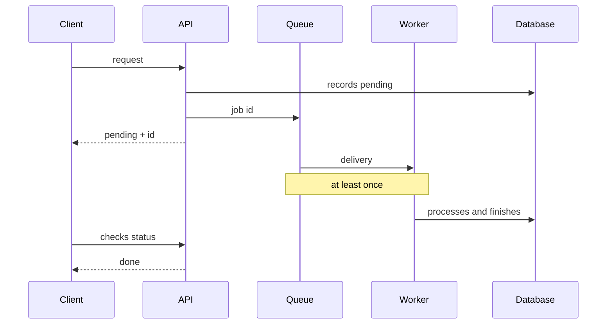

## What it is

An asynchronous task runs outside the request path: the API receives the request, records the work in a queue and answers right away, and another process, the worker, executes it later. The queue is a list of messages that keeps track of what remains to be done, even if a process goes down.

## Why it matters for an AI Engineer

Many AI tasks are slow: indexing hundreds of pages (extracting text, generating embeddings, writing), transcribing audio, running a large set of evals. If that stays inside the request, the user waits minutes, the connection times out and a usage spike takes the API down. With a queue, the API answers "received, job number", the worker processes at the pace the provider and the database can handle, and you control cost and limits (see rate limit and fallback).

## How it works

1. **Enqueue.** The route validates the request, writes a message with the job identifier and returns the "pending" status.
2. **Process.** The worker reads the message, executes it and records the result.
3. **Check.** The client asks for the status through a query route, or receives a notification at the end.



There are options by size: FastAPI background tasks (`BackgroundTasks`) are simple, but they die with the process and do not retry on their own, so they are for light work. For work that cannot be lost, use a real queue: Amazon SQS (managed by AWS) or others, such as Redis with a task library. The format changes with the tool; follow the documentation.

**Repeated delivery.** Queues usually guarantee "at least once": the same message can arrive twice, or the worker can crash in the middle and the task gets repeated. That is why the task needs to be idempotent, meaning repeating it has the same effect as running it once. One way is to record the job identifier in the database, in the same transaction:

```python
def process(job_id: str, doc_id: str):
    with connection.transaction():  # connection: psycopg 3
        new = connection.execute(
            "INSERT INTO done_jobs (job_id) VALUES (%s) ON CONFLICT DO NOTHING",
            (job_id,)).rowcount
        if not new:
            return  # repetition: ignore
        index(doc_id)  # writes with upsert, inside the transaction
```

If `index` fails, the transaction rolls back the record and the retry reprocesses it. If the job includes an external call that is not part of the transaction, make it idempotent too (for example, with an idempotency key).

**SQS in practice.** The visibility timeout hides the message from other workers while one processes it; it must be longer than the processing time, or the message reappears and becomes a duplicate. FIFO queues offer ordering and deduplication for a short interval, but they do not replace idempotency.

**Reprocessing and failures.** Define how many times to try and, after that, send the message to a dead-letter queue, where it is kept for you to inspect. Also allow reprocessing a job manually, without creating duplicates, which idempotency guarantees.

## In practice

In P2: Technical Manuals RAG, uploading a manual enqueues the indexing instead of blocking the request. In PF: Complete Agent, the queue absorbs indexing and heavy evals, and the worker respects the provider's limit. If a manual is sent twice or the worker restarts in the middle, the index cannot have duplicate chunks.

## Common mistakes

- **Processing something that takes minutes inside the request.**
- **A task without idempotency.** A repetition duplicates chunks, emails or charges.
- **Relying on `BackgroundTasks` for what cannot be lost.** If the process crashes, the task disappears.
- **Failures without an attempt limit or a dead-letter queue.** A failing message reappears forever.
- **No job status.** The user does not know whether it finished, failed or is still in the queue.

## How to study

1. Read the SQS introduction and the dead-letter queue concept (2 hours).
2. Build a route that enqueues and a status query route, with `BackgroundTasks` (1 day).
3. Replace it with a real queue and a separate worker, running in the compose (2 days).
4. Make the task idempotent by recording the identifier and test it by sending the same message twice (1 day).
5. Cause a failure in the middle and check that reprocessing duplicates nothing (1 day).

## How to show it

In your portfolio, the PF README has a diagram with API, queue and worker, and explains how idempotency avoids duplicates. In the interview, describe what happens if the worker crashes in the middle of an indexing job and how you tested it.
