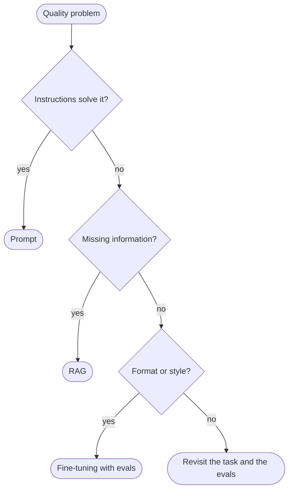

## What it is

Fine-tuning is continuing the training of an existing model with your own examples, to change the way it answers. Instead of writing instructions in the prompt every time, you "record" the behavior in the model's weights, the internal numbers it learned.

## Why it matters for an AI Engineer

Fine-tuning is many people's first idea ("I will train the model on my documents") and almost always the wrong one. Knowing what it solves, and what it does not, saves weeks of work and cost. It is also a classic interview question.

## How it works

The central idea: fine-tuning changes **behavior and format**, it does not reliably teach **facts**. Training on a manual does not make the model "know" the manual like a database; it learns the style and may keep inventing details. For knowledge that changes or needs to be cited, use RAG.

The practical decision order:

1. **Prompt:** clear instructions, examples and format. Cheap, quick to test, and it solves most cases.
2. **RAG:** if the model lacks information (internal documents, recent data), fetch it and put it in the prompt.
3. **Fine-tuning:** only if a well-made, measured prompt and RAG still are not enough, usually for one of these reasons: keeping a very specific tone or format, teaching a narrow, repetitive task to a smaller and cheaper model, or shrinking the prompt at very high volume.



Analogy: the prompt is giving an employee a script; RAG is giving them access to the company library; fine-tuning is a training that changes their habits.

**LoRA in one sentence:** instead of rewriting all of the model's weights, you train a small set of extra weights added to the originals, which greatly reduces the cost and memory required. It is the technique behind most tuning done by small teams, with libraries such as PEFT.

**How much a wrong decision costs.** The cost is not just the training bill. There is the work of preparing and reviewing hundreds of examples, GPU time, the evals to prove it improved and the rework every time the base model changes. In illustrative numbers, weeks of one person's time to gain what a better prompt delivered in a day. It is worth it when prompt and RAG are already measured and exhausted and the gain (tone, format, cost per call at high volume) justifies that recurring cost.

What fine-tuning requires: hundreds or thousands of good-quality examples (input and desired output), a way to measure the result (evals) before and after, training time (on GPUs) and maintenance every time the base model changes.

A sketch of how examples are usually prepared, in message format (JSONL, one JSON per line):

```python
import json

examples = [
    {"messages": [
        {"role": "user", "content": "Error E-21 on the compressor."},
        {"role": "assistant", "content": "Cause: sensor disconnected. Action: reconnect the cable."},
    ]},
]
with open("train.jsonl", "w", encoding="utf-8") as f:
    for ex in examples:
        f.write(json.dumps(ex, ensure_ascii=False) + "\n")
```

## In practice

In this roadmap, no project requires fine-tuning, and that is on purpose: in P2: Technical Manuals RAG, knowledge comes from search, and in P4: Maintenance Work Order Triage a good prompt with examples and structured output is usually enough. If you try fine-tuning in one of them, treat it as an experiment: compare it with the prompt version, in numbers.

## Common mistakes

- **Trying to teach facts.** For facts, use RAG; tuning does not replace the source.
- **Skipping prompt and RAG.** Many people find out later that a better prompt already solved it.
- **Few or bad examples.** The model also learns the errors and inconsistencies of your training set.
- **Not measuring before and after.** Without evals, you do not know whether it improved.
- **Ignoring maintenance.** When the base model is updated, the tuning needs to be redone.

## How to study

1. Read a provider's fine-tuning guide, paying attention to when it recommends tuning and when not (1 hour).
2. Read the abstract and introduction of the LoRA paper, skipping the formulas (1 hour).
3. Read the PEFT quickstart guide (2 hours).
4. Write one paragraph, for a case of yours, on why prompt or RAG are or are not enough (1 hour).
5. Prepare 50 examples in the format above for a narrow task, even without training (1 day).

## How to show it

In your portfolio, record an honest comparison between prompt, RAG and, if you did it, a tuning, with the same metric. In the interview, answer "when would you use fine-tuning?" with the order prompt, RAG, tuning, and with a measurable criterion for why the first two were not enough.
