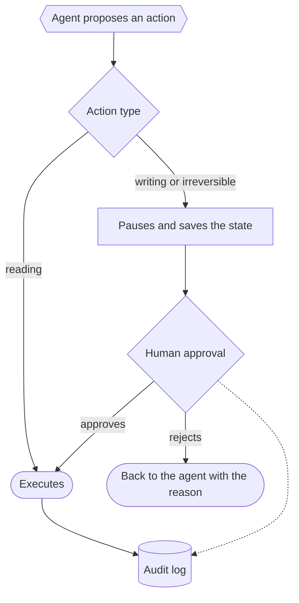

## What it is

Human-in-the-loop is the design in which the system stops before a risky action and waits for a person's decision: approve or reject. The agent proposes, the human decides, and only then does your code execute.

## Why it matters for an AI Engineer

The model makes mistakes, and makes them confidently. It can also be fooled by a malicious text in a document (prompt injection). If it can pay, delete or send, a mistake becomes real damage. OWASP calls this risk excessive agency: too many tools, too many permissions and no human check. Human approval is the simplest defense and one of the most effective, because it does not depend on the model getting it right.

## How it works

**Which actions need approval.** Classify each tool: reading (free), reversible writing (approval depending on the risk) and irreversible or external actions, such as paying, deleting, sending an email or opening a ticket with another company (always approval). Asking for approval for everything wears people out; the user starts approving on reflex and the protection disappears.

**Where the approval point goes.** Between the model's decision and the execution. The flow pauses, saves its state and resumes when the answer arrives, which can take hours. Frameworks such as LangGraph have a pause-and-resume mechanism for this; in the simplest code, your tool loop asks before executing:



```python
from datetime import datetime, timezone

DANGEROUS = {"delete_order", "send_email"}

def execute(name, args, tools, audit_log, user):
    if name in DANGEROUS:
        answer = input(f"Approve {name}({args})? [y/N] ").strip().lower()
        audit_log.append({"who": user, "when": datetime.now(timezone.utc).isoformat(),
                          "action": name, "args": args, "approved": answer == "y"})
        if answer != "y":
            return "Action rejected by the human."
    return tools[name](**args)
```

**The decision screen.** Show what will be done, with which exact values, the reason the agent gave, the impact and whether it can be undone. Offer approve and reject (editing the arguments is a possible extension, but it requires revalidating everything). What the human approves must be exactly what gets executed: store the approved arguments and execute those, without recalculating.

**The record.** Store who approved, when, the action, the arguments and the decision, somewhere the agent cannot change. When something goes wrong, that is how you reconstruct what happened.

## In practice

In P3: Manuals MCP Server, the action tool only runs after a recorded human approval, and P3 also tests a malicious instruction hidden in a manual. In PF: Complete Agent, write actions go through the same approval point. Combine it with least privilege: approval is the last barrier, not the only one.

## Common mistakes

- **Approving without showing the arguments.** "Confirm action?" without details is not informed approval.
- **Executing something different from what was approved.** Recalculating the arguments after approval opens a loophole.
- **Approval for everything.** It causes fatigue and automatic approval; reserve it for what matters.
- **No record.** Without an audit trail, there is no way to investigate an incident.
- **Forgetting the rejection.** The flow needs to handle the "no" and return it to the model as a result.

## How to study

1. Read the OWASP page on excessive agency (1 hour).
2. Classify your project's tools into reading, reversible writing and irreversible (1 hour).
3. Implement the gate above on the command line and test approving and rejecting (1 day).
4. Move the approval to a pausable state and resume later (2 days; the LangGraph page shows the pattern).

## How to show it

In the README, include the table of tools with each one's approval level, a screenshot of the decision screen and an excerpt of the audit log. In the interview, explain how you avoided approval fatigue and what guarantees that what is executed is what was approved.
