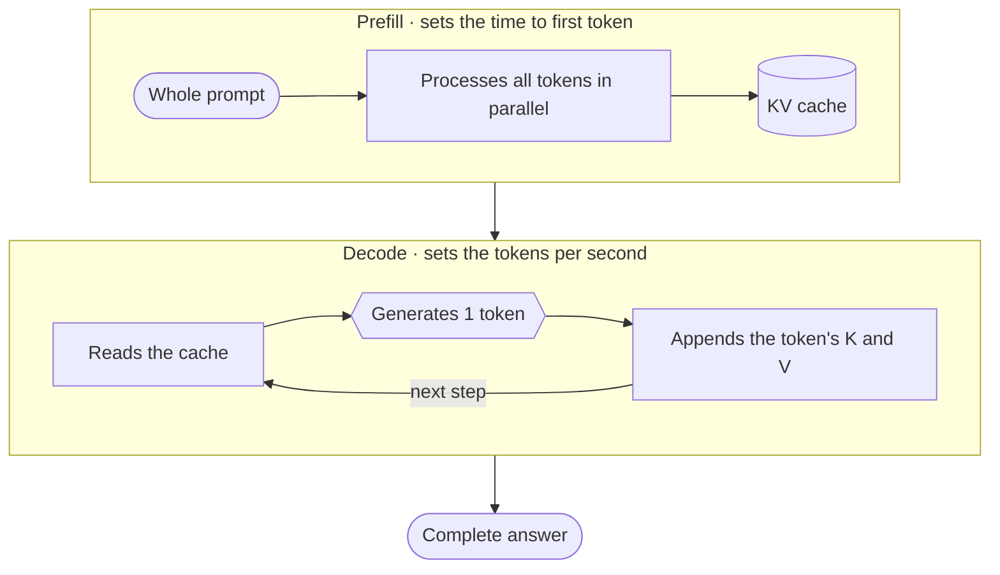

## What it is

Inference is running the model to generate text. It has two phases. In prefill, the model reads the whole prompt at once, in parallel. In decode, it generates one token at a time, and each new token depends on all the previous ones. The KV cache stores the attention keys (K) and values (V) of every token already processed, so the model does not need to recompute them at each decode step.



## Why it matters for an AI Engineer

Almost every conversation about LLM cost and latency goes through here. Time to first token depends on prefill, that is, on the prompt size. Generation speed depends on decode, limited by reading GPU memory. Providers' prompt caching is, in practice, reusing the KV cache of an identical prompt prefix. And the KV cache takes memory that grows with context and with the number of simultaneous users: often it is the cache, not the weights, that limits how many requests a GPU can serve.

## How it works

The cache size per token is: 2 (K and V) times the number of layers, times the number of K/V heads, times the dimension of each head, times the bytes per number. The math below uses a typical configuration for an 8-billion-parameter model with GQA (grouped-query attention, where several query heads share the same keys and values).

```python
layers, kv_heads, head_dim, bytes_fp16 = 32, 8, 128, 2
per_token = 2 * layers * kv_heads * head_dim * bytes_fp16
print(per_token / 1024, "KiB per token")                 # 128.0 KiB

context, users = 32_000, 10
total = per_token * context * users
print(round(total / 1024**3, 1), "GiB of KV cache alone") # 39.1 GiB
```

Without GQA (32 K/V heads instead of 8), it would be four times more. That is why inference techniques attack this memory and the decode phase:

- **PagedAttention:** stores the cache in blocks, like an operating system's virtual memory, and nearly eliminates waste. It is the base of vLLM.
- **Continuous batching:** groups requests from different users into the same decode step.
- **Speculative decoding:** a small model proposes several tokens and the large one checks them all at once, keeping the same output distribution.
- **FlashAttention:** reorganizes the attention computation to read and write less GPU memory.
- **Quantizing the cache:** storing K and V in 8 bits instead of 16.

## In practice

Prompts with a fixed beginning (instructions, tools) get cheaper with prompt caching. Very long contexts increase time to first token and memory cost. In P5: Multi-Agent Researcher, you measure time to first token and tokens per second for the locally served subagent and explain the numbers with this math.

## Common mistakes

- **Measuring only total time.** Separate time to first token and tokens per second; the causes are different.
- **Calculating memory only from the weights.** With long context and several users, the cache exceeds the weights.
- **Varying the start of the prompt.** A timestamp at the beginning invalidates the cache on every call.
- **Expecting speculative decoding to always help.** If the small model is often wrong, the gain disappears.

## How to study

1. Read the Hugging Face article on the KV cache (2 hours).
2. Redo the math above for two open models, reading each one's configuration file (1 day).
3. Generate text with Transformers with and without the cache and compare the time (1 day).
4. Read the abstract and figures of the PagedAttention and speculative decoding papers (2 days).
5. Measure an API's time to first token with and without prompt caching (1 day).

## How to show it

In the P5 README, include the KV cache memory table by context and number of users and the measured times. In the interview, explain the difference between prefill and decode and why decode is limited by memory, not computation.
