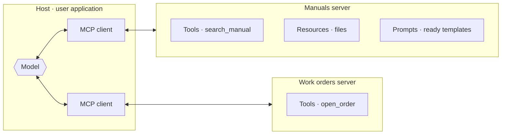

## What it is

MCP (Model Context Protocol) is an open protocol that defines how an LLM (language model) application connects to tools and data. You write an MCP server once, and any compatible client, such as Claude Code or Claude Desktop, can use it, without a custom integration for each application.

## Why it matters for an AI Engineer

Without a standard, every application reimplements the same integration with the same system. With MCP, the integration becomes a reusable service. It is also the format in which many third-party tools arrive, so you will use other people's servers and need to know how to assess them.

## How it works

There are three roles. The **host** is the application the user uses (Claude Code, for example). Inside it, an MCP **client** keeps the connection with a server. The **server** is the program that exposes capabilities. The conversation between them uses JSON-RPC messages (function calls in JSON).

The server can expose three types of capability:

- **Tools:** actions the model can request, such as `search_manual`. It is the same tool use, but standardized.
- **Resources:** data the application can read and offer as context, such as a file or a record.
- **Prompts:** reusable instruction templates the user chooses, for example "diagnose a failure".



On connection, the client asks the server what it offers; that is why a new server works without changing the client. In terms of transport (how messages travel), the concept is: in local mode (stdio), the client starts the server as a process on your machine; in remote mode, the server runs on the network and answers over HTTP. The details change between versions of the specification, so check it.

A minimal server with the official Python SDK (`pip install mcp`). The SDK's API changes between versions: this example was tested with the 2.x series; in 1.x, the class is called `FastMCP` and comes from `mcp.server.fastmcp`. Check the quickstart guide for the version you install:

```python
from mcp.server.mcpserver import MCPServer

mcp = MCPServer("manuals")

@mcp.tool()
def search_manual(question: str) -> str:
    """Searches the manuals and returns passages with manual and page."""
    return "[Compressor X200, p. 47] Error E-21: pressure sensor disconnected."

if __name__ == "__main__":
    mcp.run()   # by default, talks over stdio
```

The function returns a fixed example; in a real server it would call your RAG search.

**Authentication and permissions.** A local stdio server runs with your user's permissions, so give it only the access it needs (least privilege). For a remote server, the authorization specification relies on OAuth (a standard in which the user authorizes access without handing over the password). In any case, treat a third-party server's descriptions and results as untrusted text: see prompt injection.

**When to create a server.** It is worth it when more than one application needs the same system or when you want to use ready-made clients. If only your application uses the tool, a function with tool use is simpler.

## In practice

In P3: Manuals MCP Server, the P2 search becomes a server with a read tool and an action tool, which only runs after human approval. You test it by connecting Claude Code or Claude Desktop and asking a real query.

## Common mistakes

- **Exposing too many tools.** Each tool is attack surface; expose only the ones the task requires.
- **Mixing reading and writing in the same tool.** Separate them so you can ask for approval only on writes.
- **Trusting third-party servers.** Read the code, limit the access and distrust the tool descriptions.
- **Secrets in the server code.** Use environment variables.
- **Creating a server for everything.** For single use, direct tool use is enough.

## How to study

1. Read the introduction and the architecture page (2 hours).
2. Connect a ready-made server to Claude Desktop or Claude Code and look at the tools it lists (half a day).
3. Run the minimal server above and call the tool (half a day).
4. Replace the fixed answer with your RAG search (2 days).
5. Read the authorization page and list what would change for a remote server (half a day).

## How to show it

In the P3 README, include the host, client and server diagram, the list of tools with each one's permission level and a short video of Claude Code using the server. In the interview, explain the difference between tools, resources and prompts and when you would not create a server.
