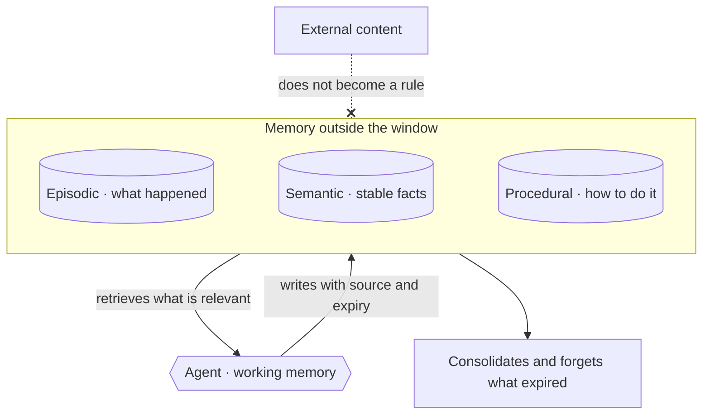

## What it is

An LLM remembers nothing between calls: everything it knows about the conversation is in the context. Agent memory is the part of the system that stores information outside the context and brings it back when useful. It is usually divided into four types:

- **Working:** what is in the context now (the task, the latest messages, the notes).
- **Episodic:** what happened in previous sessions ("last week the technician asked about the X200").
- **Semantic:** stable facts ("this user works on the engine line").
- **Procedural:** how to do things: instructions and procedures the agent learned or that you refined.

## Why it matters for an AI Engineer

Assistants that remember preferences and decisions are more useful, and agents that learn from previous mistakes become more reliable. But memory is also a new source of failure: a wrong fact saved once shows up in every later answer, personal data stays stored with no expiry and a malicious instruction can be recorded and become a command in the future. Designing memory means deciding what to store, for how long, with what confidence and under what user control.

## How it works

The cycle has three decisions: when to write, how to retrieve and when to forget. A simple way is to give the agent explicit memory tools, so writing is a recorded, auditable decision:

```python
from datetime import datetime, timedelta

MEMORY = []

def remember(user, fact, source, valid_days=90):
    MEMORY.append({"user": user, "fact": fact, "source": source,
                   "expires": datetime.now() + timedelta(days=valid_days)})

def recall(user, term):
    now = datetime.now()
    return [m["fact"] for m in MEMORY
            if m["user"] == user and m["expires"] > now and term.lower() in m["fact"].lower()]

remember("tech-12", "Works on the X200 engine line", source="conversation 2026-11-20")
print(recall("tech-12", "x200"))
```

In a real system, the search uses embeddings in a database such as Postgres with pgvector, each memory keeps its source and date, and a routine consolidates repeated memories and deletes expired ones. MemGPT proposed treating the context as main memory and the database as disk, with the model itself moving information between the two.



## In practice

Assistants with preference memory, coding agents with project instruction files and support agents that remember the customer's history use these ideas. In P5: Multi-Agent Researcher, memory stores what has already been researched and the validated conclusions, so that a similar question reuses the work with a citation of the original session.

## Common mistakes

- **Saving everything automatically.** Memory fills with noise and wrong facts; prefer selective writing.
- **Memory without a source.** Without knowing where a fact came from, nobody can correct it.
- **Storing personal data with no expiry and no way to delete it.** See the personal data topic.
- **Treating memory as trustworthy.** It is data, not instructions; content from external documents should not become a rule.
- **Mixing users.** Isolate memory per user and per organization.

## How to study

1. Read the MemGPT paper, focusing on the architecture (1 day).
2. Read LangGraph's memory concepts to see the types applied (2 hours).
3. Implement the remember and recall tools with pgvector, with source and expiry (3 days).
4. Create tests: an outdated fact, a request to forget and a malicious instruction in a document (2 days).
5. Measure whether memory improves answers to repeated questions and how much it costs (1 day).

## How to show it

Show the memory schema (fields, source, expiry), the writing and forgetting policy and the failure tests. In the interview, explain how you would stop a wrong or malicious memory from spreading.
