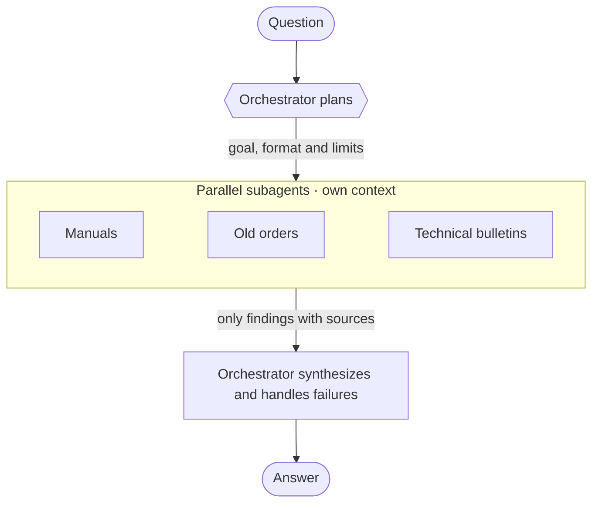

## What it is

A multi-agent system splits a task among several agents, each with its own context, instructions and tools. The most used pattern is the orchestrator with subagents: a main agent plans, hands out subtasks, receives the results and assembles the answer. Other patterns are the chain of specialists (each passes its result to the next) and debate or review (one agent produces and another critiques).

## Why it matters for an AI Engineer

Multi-agent systems became fashionable, and the decision to use them or not is among the most discussed in architecture interviews. The two reference articles in this topic reach recommendations that look opposite. One reports a large gain on a broad research task, where parallel subagents explore independent paths, at a much higher token cost than a single agent. The other argues that, in tasks where decisions depend on each other, such as writing code, splitting the context produces conflicting decisions. Knowing which case you are in is what matters.

## How it works

The rule of thumb: several agents help when the subtasks are independent, can run in parallel and each needs a lot of its own context. They get in the way when the parts need to share fine-grained decisions.

```python
import asyncio

async def subagent(task: str) -> str:
    await asyncio.sleep(0.1)                     # the real agent goes here
    return f"findings on: {task} [source]"

async def orchestrator(question: str) -> str:
    plan = [f"{question} — manuals", f"{question} — old orders",
            f"{question} — technical bulletins"]  # the model would plan this
    findings = await asyncio.gather(*(subagent(t) for t in plan))
    return "\n".join(findings)                    # the model would synthesize this

print(asyncio.run(orchestrator("E-21 failure on the X200")))
```

The hard parts are in the details:

- **Delegation instructions:** each subagent needs a goal, an output format, limits and when to stop. Vague instructions produce duplicated work.
- **What comes back:** only the summary of findings, with sources, so the orchestrator's context does not fill up.
- **Proportional effort:** a simple question, one subagent; a broad question, several.
- **Partial failures:** a failing subagent cannot bring everything down; the orchestrator decides whether to redo it or move on without it.



## In practice

Deep research systems, which search many sources at the same time, are the clearest success case. Coding agents generally keep one main agent and use subagents only for isolated tasks, such as searching something in the repository. In P5: Multi-Agent Researcher, the orchestrator splits a failure investigation into parallel searches in the manuals, the maintenance orders and the bulletins.

## Common mistakes

- **Starting with several agents.** Build the single agent first and measure; split only if the data shows a gain.
- **Agents talking freely to each other.** Cost and unpredictability explode; prefer a clear flow.
- **Dependent subtasks in parallel.** They produce results that do not fit together.
- **Evaluating only the final answer.** Look at the plan, the delegation and each subagent's findings.

## How to study

1. Read the two main articles and note when each one recommends several agents (1 day).
2. Build a single agent for a research task and measure accuracy, tokens and time (3 days).
3. Turn it into an orchestrator with parallel subagents and measure again (1 week).
4. Test a task with dependent parts and observe the failures (2 days).
5. Write a decision page: when to use each approach, with your numbers (1 day).

## How to show it

Show the comparison between single agent and multi-agent on the same task: accuracy, cost, time and failure examples for each. In the interview, defend the choice with that data and say when you would not use several agents.
