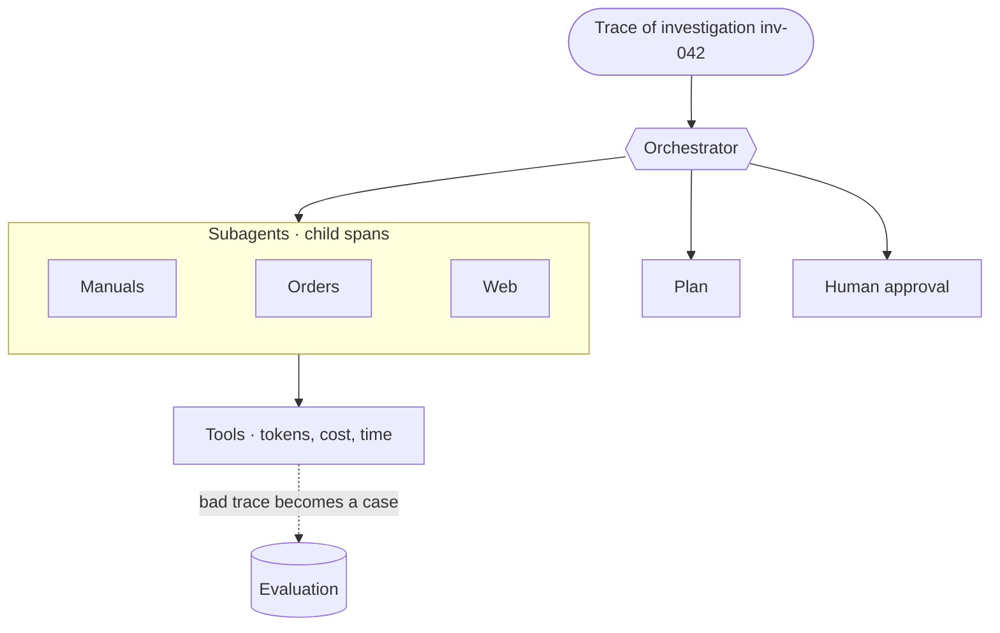

## What it is

In level 4 you traced the calls of an LLM system. In an agent, a single task becomes dozens of calls to the model, tools and sometimes other agents, over minutes or hours. Agent observability is organizing all of this into a single trace per task, with nested spans: the task contains the steps, each step contains the model call and the tools, and each subagent has its own tree inside the orchestrator's.

## Why it matters for an AI Engineer

When an agent gets something wrong, the question is always "at which step and why?". Without a trace, you do not know whether the problem was the plan, a tool that returned garbage, a subagent that got lost or a context that overflowed. Agents are also non-deterministic, so the error may not repeat. And cost per task varies a lot: an investigation can cost cents or dollars. Observability is what lets you debug, control cost and feed evaluation with real cases.

## How it works

OpenTelemetry has semantic conventions for generative AI: standard attribute names for model, input and output tokens, tool calls and agents. Following the standard lets you switch visualization tools without rewriting the instrumentation.

```python
from opentelemetry import trace
from opentelemetry.sdk.trace import TracerProvider
from opentelemetry.sdk.trace.export import ConsoleSpanExporter, SimpleSpanProcessor

provider = TracerProvider()
provider.add_span_processor(SimpleSpanProcessor(ConsoleSpanExporter()))
trace.set_tracer_provider(provider)
tracer = trace.get_tracer("researcher")

with tracer.start_as_current_span("invoke_agent orchestrator") as task:
    task.set_attribute("task.id", "inv-042")
    with tracer.start_as_current_span("execute_tool search_manual") as span:
        span.set_attribute("gen_ai.tool.name", "search_manual")
        span.set_attribute("gen_ai.usage.input_tokens", 1840)
```

What to record in each task:

- **Structure:** plan, steps, subagents and tools, with the time of each.
- **Cost:** tokens and amount per step, summed per task and per user.
- **Decisions:** which tool was chosen and with which arguments (with personal data masked).
- **Outcome:** success, failure, abandonment, human approval requested and granted.
- **Link to evaluation:** a bad trace becomes, with one click or a script, a new case in the test set.

In multi-agent systems, propagate the trace identifier between agents, including via A2A, so everything shows up in a single tree.



## In practice

Tools such as Langfuse and other LLM observability platforms read these traces and show the tree, the cost and the evaluation scores side by side. In P5: Multi-Agent Researcher, each investigation has a trace with the orchestrator, the parallel subagents and the human approval, and a dashboard of cost per investigation.

## Common mistakes

- **Separate traces per subagent.** Without context propagation, you lose sight of the task.
- **Logging whole prompts with personal data.** Mask before sending.
- **Measuring only latency.** For agents, cost and number of steps per task say more.
- **Traces nobody looks at.** Set up alerts (cost above normal, too many steps) and review failures every week.

## How to study

1. Read the OpenTelemetry semantic conventions for generative AI (2 hours).
2. Run the example above and look at the nested spans in the console (1 hour).
3. Instrument an agent with an orchestrator and subagents, sending to Langfuse or another tool (3 days).
4. Create a dashboard of cost and steps per task and a simple alert (1 day).
5. Write the script that turns a trace marked as bad into an evaluation case (1 day).

## How to show it

Show a screenshot of an investigation's tree, the cost-per-task dashboard and a real case that came out of a bad trace and became a test. In the interview, explain how you find the step where a multi-agent system went wrong.
