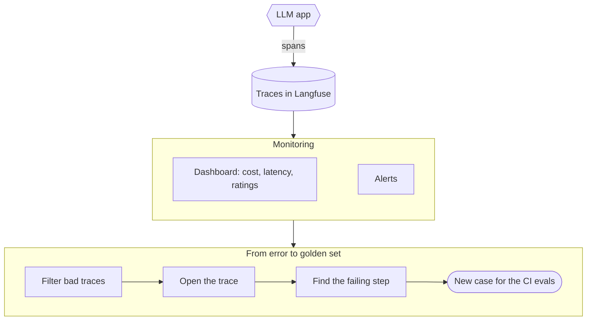

## What it is

Observability is the ability to understand, by looking at a system's records, what happened inside it. For an LLM application, that means storing, for each answer, the full path: the question, the retrieved passages, the prompt sent, the answer, the tools called, the tokens, the cost and the time of each step. That record is called a trace.

## Why it matters for an AI Engineer

In production, a user complains: "the answer was wrong". Without a trace, you guess. With one, you see whether the right chunk was retrieved, whether the prompt was right, whether the tool failed. The error becomes data: you copy it into the golden set (the evals' set of test cases), fix it and confirm it does not come back. It is the cycle that closes the link between production and evals. Observability also shows where the cost and the slowness are.

## How it works

A trace is the tree of one request. Each step is a span (a segment with a start, an end and data). An illustrative example, with made-up values:

```text
trace "What does E-21 mean?"   user u42   total 2.4 s
├─ span retrieval     180 ms   5 chunks (manual X200)
├─ span llm           2.1 s    1,850 input tokens, 120 output
└─ span answer        citation [Compressor X200, p. 47]
```

What to record in each span: input and output, model and prompt version, tokens, cost calculated from the provider's price table, latency and errors. Also store a session identifier and the code version, to compare before and after.

**Tools.** Langfuse is an open source observability platform for LLMs that you can run locally (see local Docker) or use in the cloud. It shows traces and cost, and lets you evaluate answers. OpenTelemetry is an open instrumentation standard, for any kind of application, that sends data to several tools. The SDKs change between versions, so follow the current documentation: in general you mark the function with a decorator or wrap the model call, and the SDK creates the span.

**From the error to the golden set.** The workflow: filter bad traces (low user rating, error, high cost), open the trace, find the step that failed, turn the case into a test and run the evals (see tests and evals in the project).



**Privacy.** Traces store users' questions, which may contain personal data. Mask what is sensitive, define how long you keep it and who has access (see LGPD and personal data).

## In practice

In PF: Complete Agent, every API call produces a trace with retrieval, tool calls and the answer, and it is the base for proving you can diagnose a bad answer. In P1: Automaker Assistant and P2: Technical Manuals RAG, a local Langfuse, started with the compose, already helps you see what the model received. The cost per question you calculate here feeds the cost and latency decisions.

## Common mistakes

- **Recording only the final answer.** Without retrieval and tools, you cannot find the cause.
- **Storing personal data carelessly.** Traces are user data; treat them as such.
- **Not versioning the prompt.** You cannot compare before and after.
- **Looking only at the average.** Latency and cost weigh on the extreme cases; look at percentiles and the worst cases.
- **Collecting everything and never looking.** Define a review routine and alerts.

## How to study

1. Read the OpenTelemetry introduction to traces and spans (2 hours).
2. Start Langfuse locally and send a test trace (1 day).
3. Instrument your project's LLM call and look at tokens and latency (1 day).
4. Add spans for retrieval and tools (1 day).
5. Take a bad answer, find the cause in the trace and add the case to the golden set (1 day).

## How to show it

In your portfolio, include in the PF README a screenshot of a trace, with the spans, tokens and latency. In the interview, tell a diagnosis story: the bad answer, what the trace showed, the fix and the new case in the golden set.
