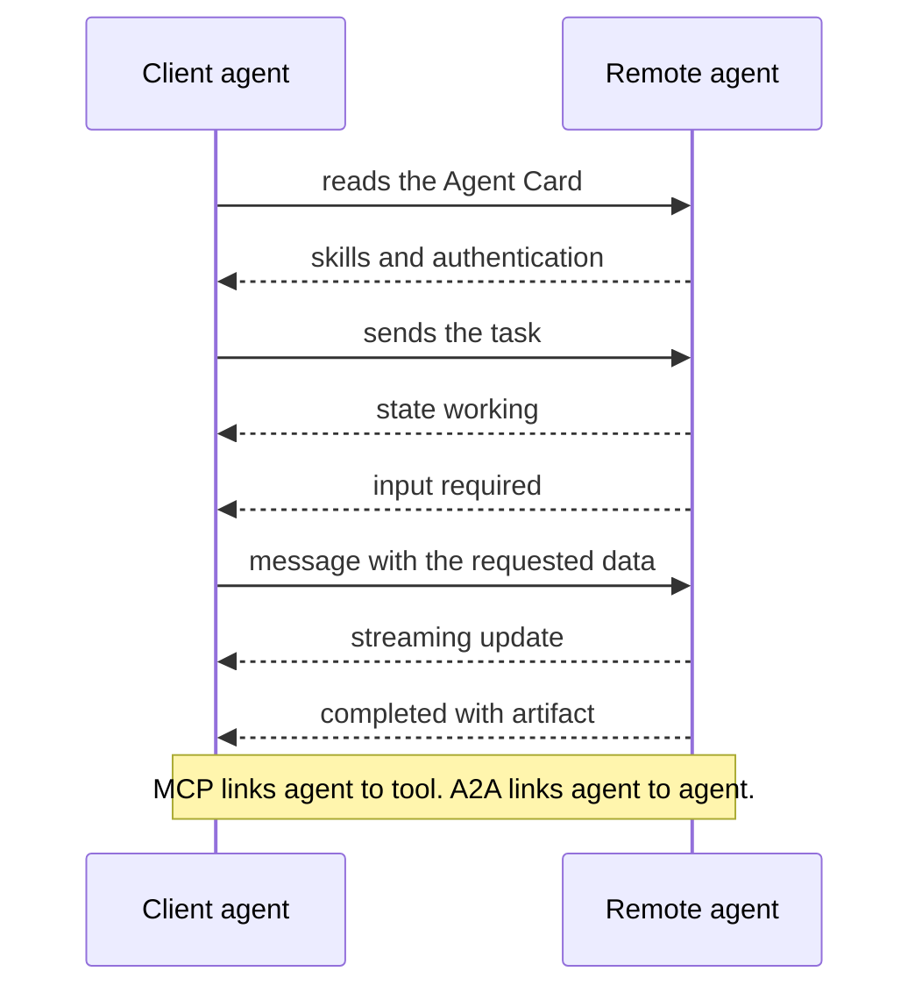

## What it is

Agent2Agent (A2A) is an open protocol so that agents built by different teams, companies or frameworks can talk to each other. An agent publishes what it can do in an Agent Card (a JSON document with name, description, skills, address and authentication method), and another agent can send it a task, follow its progress and receive the result. The project is maintained in the open, with a public specification and SDKs.

## Why it matters for an AI Engineer

MCP standardized how an agent uses tools and data. A2A tries to standardize something else: how an agent delegates work to another agent it does not control. In large companies, different teams build different agents (one for purchasing, one for support, one for maintenance), and integrating them one by one does not scale. Understanding the protocol, and telling it apart from MCP, is useful in architecture conversations, even though the standard is still maturing.

## How it works

The difference from MCP is what sits on the other side. In MCP, the other side is a tool: it receives arguments and returns a result, with no autonomy. In A2A, the other side is an agent: it receives a task in natural language and decides how to carry it out, may ask for more information, take a while and send updates.

The main concepts:

- **Agent Card:** the agent's public description, usually served at a well-known address on the domain.
- **Task:** the unit of work, with states such as submitted, working, input required, completed or failed.
- **Messages and artifacts:** the conversation during the task and the results produced (text, files, data).
- **Transport:** HTTP requests with JSON-RPC, with optional streaming for long tasks and notifications when it finishes.

```python
import json

agent_card = {
    "name": "Maintenance Agent",
    "description": "Investigates equipment failures from manuals and work orders.",
    "url": "https://agents.example.com/maintenance",
    "version": "1.0.0",
    "capabilities": {"streaming": True},
    "skills": [{"id": "investigate-failure", "name": "Investigate failure",
                "description": "Receives an error code and equipment; returns probable causes with sources."}],
}
print(json.dumps(agent_card, indent=2))
```

The exact field names change between versions; check the current specification before implementing.



## In practice

A2A makes sense when agents belong to different owners or run on different platforms. Inside a single system of yours, calling subagents directly is usually simpler. In P5: Multi-Agent Researcher, one layer exposes the researcher as an A2A agent, so that another agent (for example, one that opens work orders) can delegate investigations to it.

## Common mistakes

- **Using A2A where a function would do.** An agent-to-agent protocol adds latency and complexity.
- **Confusing it with MCP.** MCP is agent to tool; A2A is agent to agent. Many systems use both.
- **Trusting the Agent Card.** It is a declaration, not a guarantee; authenticate and limit what the other agent can ask for.
- **Ignoring long tasks.** Without streaming or notifications, the client waits without knowing the state.

## How to study

1. Read the overview and main concepts in the A2A documentation (2 hours).
2. Compare it with MCP in a table: what is on the other side, state, autonomy, use cases (2 hours).
3. Run one of the official repository's examples with two agents talking (2 days).
4. Expose an agent of yours with an Agent Card and one skill, and call it from another process (2 days).
5. Add authentication and a per-client task limit (1 day).

## How to show it

Show the Agent Card, a diagram of who talks to whom (MCP for tools, A2A between agents) and a log of a task changing state. In the interview, explain the difference between the two protocols and when you would use neither.
