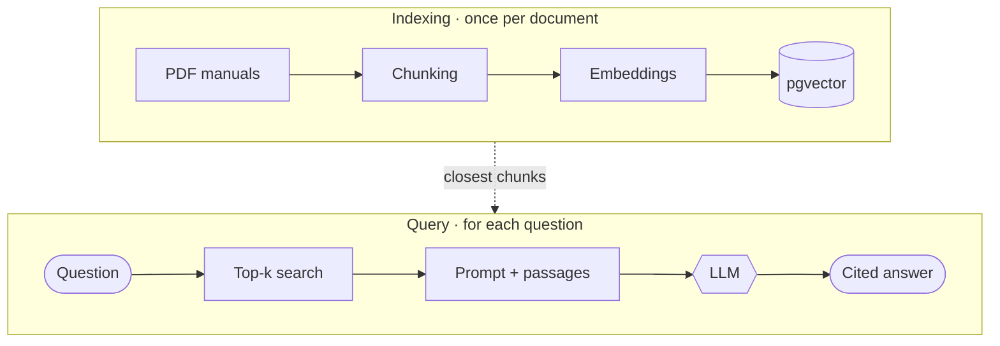

## What it is

RAG (retrieval-augmented generation) is a way of answering questions about documents the model never saw in training. Before calling the LLM (large language model), the system searches your documents for the relevant passages and puts them in the prompt, the text sent to the model. The model answers based on them and cites the source.

## Why it matters for an AI Engineer

LLM systems in companies almost always answer about internal data: manuals, contracts, tickets. That data changes, is private and is not in the training. RAG solves this without fine-tuning (retraining the model with your data): to update the knowledge, you reindex the document.

It also reduces hallucination: with the source cited, the user can check the answer.

## How it works

1. **Indexing**, done once per document. You split the text into pieces, the chunks (hence the name chunking), generate an embedding (a numeric vector that represents the meaning of the text) for each one and store the vector, text and metadata: document, section, page.
2. **Retrieval**, for each question. The question's embedding looks for the closest chunks.
3. **Generation**. You build the prompt with the chunks, the question and the instruction to cite the source or say "I don't know".



```python
from sentence_transformers import SentenceTransformer

model = SentenceTransformer("paraphrase-multilingual-MiniLM-L12-v2")
chunks = [  # (text, manual, page)
    ("Error E-21: pressure sensor disconnected.", "Compressor X200", 47),
    ("Replace the oil filter every 500 hours.", "Compressor X200", 63),
]
index = model.encode([c[0] for c in chunks], normalize_embeddings=True)

question = "What does error E-21 mean?"
q = model.encode(question, normalize_embeddings=True)
top = (index @ q).argsort()[::-1][:3]
passages = "\n".join(f"[{chunks[i][1]}, p. {chunks[i][2]}] {chunks[i][0]}" for i in top)
prompt = ("Use only the passages and cite [manual, p.]. If there is no answer, say you don't know.\n"
          f"{passages}\n\nQuestion: {question}")
```

In generation, this `prompt` goes to the LLM. In a real system, the vectors live in PostgreSQL with pgvector, not in a list. The Claude API has native citations: it points to the passage used in each sentence, and you check that passage against the chunk.

Chunk size is a trade-off. A small chunk finds the exact sentence, but loses context. A large chunk carries context, but mixes subjects and makes search worse. Split along the document's structure (section, paragraph, step) and adjust by measuring.

Metadata filters the search (only the chosen manual, for example) and builds the citation.

RAG is not always necessary. If the material fits in the context window (a few hundred pages in current models) and changes little, putting everything in the prompt is simpler. RAG pays off when the base is large, changes a lot or when cost and latency matter.

## In practice

In P2: Technical Manuals RAG, maintenance technicians ask about a fault, procedure or part and get an answer with manual and page. There you add hybrid search (vector plus keyword, which finds codes like "E-21") and reranking (a second model reorders the passages found). In P3: Manuals MCP Server, the same search becomes an MCP (Model Context Protocol) tool that any compatible application, such as Claude Code, can call.

## Common mistakes

- **Splitting text into fixed sizes without looking at the structure.** A table cut in half or a step separated from its safety warning produces wrong answers.
- **Not evaluating retrieval.** If the right chunk does not reach the prompt, no prompt tweak fixes it. Measure recall@k (is the right passage among the first k?) before touching generation.
- **Putting too many passages in the prompt.** More chunks increase cost and latency, and models use information in the middle of long contexts worse.
- **Having no path to "I don't know".** Without that instruction and without tests using questions outside the base, the model answers with the most similar passage, even if irrelevant.

## How to study

1. Read the method section of the Lewis et al. paper (2 hours).
2. Run the example with two or three public PDFs, extracting the text by page (1 day).
3. Replace the list with PostgreSQL with pgvector and add a filter by document (2 to 3 days).
4. Write 30 questions with the correct page and calculate recall@5 (2 days).
5. Test two chunk sizes and record the difference (1 day).
6. Read Contextual Retrieval and test one measured improvement (2 to 3 days).

## How to show it

In your portfolio, the P2 README has the diagram of the three stages, recall@k per configuration and answers with citations, including an "I don't know". In the interview, explain a decision with a number, something like: "section-based chunks raised recall@5 from 0.62 to 0.81 on my 30 questions". Be able to say when you would not use RAG.
