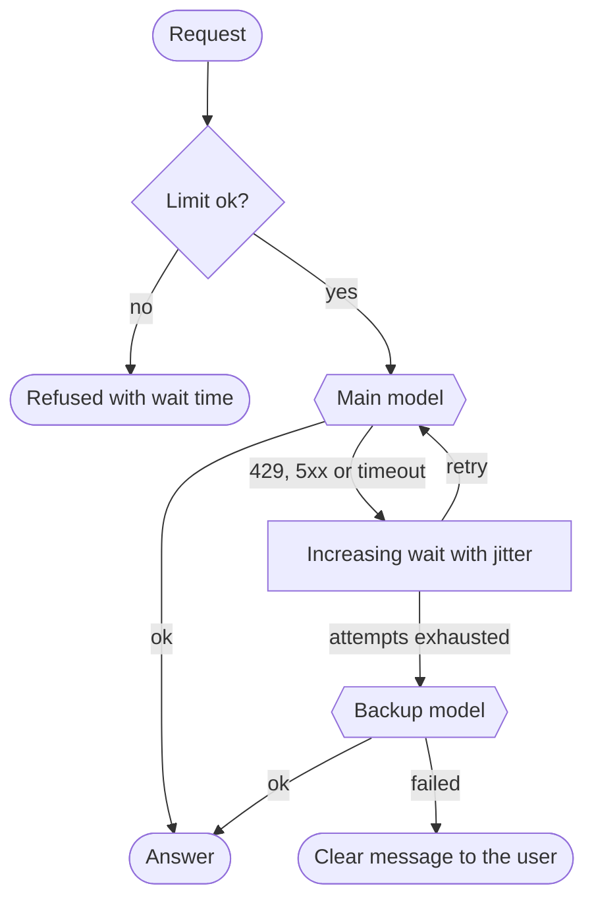

## What it is

A rate limit is the ceiling of requests a service accepts in a period. There are two sides: the model provider limits you, and you limit your users. Fallback is plan B when something fails: try again, use another model or provider, or answer in a reduced way.

## Why it matters for an AI Engineer

LLM providers have limits on requests and tokens per minute, and sometimes they go down or get slow. Without handling, the error reaches the user. Without a per-user limit, a single user can exhaust your quota (or generate a big bill) and take the service down for everyone else. Handling this is what separates a demo from a live service.

## How it works

**Per-user limit.** Give each user (or API key) a maximum number of requests per time window. A common technique is the token bucket: each request spends a token, and tokens come back at a fixed rate. The counter lives in shared storage, such as Redis, so it holds across several API instances. When exceeded, return the HTTP 429 code (Too Many Requests) with the wait time. Also limit the input size and output tokens, because that is where the cost comes from.

**The provider's 429 error.** It means you exceeded the provider's limit. Read the header that says how long to wait (the Claude API sends `retry-after`) and respect it. 5xx errors, 529 (service overloaded, in the Anthropic API) and timeouts are also temporary.

**Retry with backoff.** Retrying immediately makes the overload worse. Use increasing waits (exponential backoff) plus a random value (jitter), so many clients do not all retry together, and a maximum number of attempts. Only repeat what is temporary and idempotent (repeating it has the same effect as doing it once; see tool use). Provider SDKs already have automatic retries, so check what yours does before adding another layer on top.

**Timeouts.** Set a maximum wait time on every call. Without it, a stuck request ties up your API.

**Fallback.** If the attempts run out, switch paths:

```python
import random, time
def with_retry(call, attempts=4):
    for i in range(attempts):
        try:
            return call()
        except TemporaryError:  # 429, 5xx, 529, timeout (your class)
            if i == attempts - 1:
                raise
            time.sleep(min(2 ** i, 20) + random.random())  # backoff + jitter
def answer(question):
    try:
        return with_retry(lambda: main_model(question))
    except TemporaryError:
        return with_retry(lambda: backup_model(question))
```

`TemporaryError`, `main_model` and `backup_model` are yours: they group the SDK errors and the calls. The backup model can be smaller and cheaper, from another provider, or even a "try again in a moment" message. Test the backup with the same evals: the prompt and the output format may behave differently. Also compare the cost, so the fallback does not blow up the bill.



## In practice

In PF: Complete Agent, the API applies a per-user limit, retries temporary errors with backoff and switches to a backup model when the main one fails, and all of that shows up in the traces (see observability). Long calls, such as batch indexing, go to queues (see queues and async tasks), which control the pace of sending to the provider. The cost numbers come from cost and latency.

## Common mistakes

- **Retrying without a limit or a wait.** It becomes a storm of requests against an already overloaded service.
- **Repeating a write action without idempotency.** It duplicates the effect.
- **No timeout.** A stuck call ties up your API.
- **A fallback never tested.** When the problem comes, it fails too.
- **Stacking SDK retries and yours** without noticing: it multiplies the attempts.

## How to study

1. Read the rate limits page of the provider you use (1 hour).
2. Read the Builders' Library article on backoff with jitter (1 hour).
3. Implement `with_retry` and test it with a double that fails twice (1 day).
4. Add a per-user limit to the API, in memory and then with Redis (1 to 2 days).
5. Implement the backup model and run the evals on both (1 day).

## How to show it

In your portfolio, the PF README describes the policy: per-user limit, number of attempts, timeouts and what the fallback is, with a test that simulates the provider failing. In the interview, explain why jitter exists and how you kept the fallback from increasing cost.
