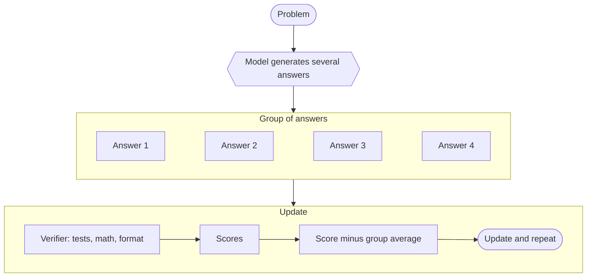

## What it is

Reinforcement learning (RL) tunes a model by the reward its answers receive, not by ready-made examples. In RL with verifiable rewards (RLVR), the reward comes from a program that checks the answer: the code passed the tests, the calculation matched, the JSON has the right format. Before this, the most common approach was RLHF, where the reward comes from a model trained on human preferences.

## Why it matters for an AI Engineer

This is how labs teach models to reason and use tools, and more and more companies use the same idea to specialize open models on a task of their own. Even if you do not train a large model, understanding RLVR changes how you think about evaluation: if you have a reliable automatic verifier, it serves both to measure and to train. It also helps you read the technical reports of new models.

## How it works

In GRPO (group relative policy optimization), a popular algorithm for this, the model generates several answers to the same problem. Each one receives the verifier's reward. Each answer's advantage is its reward compared to the group average: answers above average become more likely, those below, less. There is no need to train a separate reward model.



The heart of the work is the reward function. In TRL, it is a Python function that receives the answers and returns a score for each one:

```python
import json

def json_reward(completions, **kwargs):
    """1.0 if the answer is JSON with the right fields, 0.0 if not."""
    scores = []
    for text in completions:
        try:
            data = json.loads(text)
            scores.append(1.0 if {"code", "severity"} <= data.keys() else 0.3)
        except (json.JSONDecodeError, AttributeError):
            scores.append(0.0)
    return scores

print(json_reward(['{"code": "E-21", "severity": "high"}', "no idea"]))
```

This function goes into TRL's GRPO trainer along with the model and the problems. A small model (under 1 billion parameters) already shows the effect on a modest GPU.

## In practice

The most common uses outside labs are teaching a small model to follow a strict format, to call your system's tools or to solve a task with a checkable answer. In P5: Multi-Agent Researcher, it is an optional layer: tuning the classification subagent's open model with a reward that checks format and label, and comparing it with the original model on the evals.

## Common mistakes

- **A reward that can be gamed.** The model finds shortcuts (reward hacking); if the reward only checks format, it learns only the format.
- **Training without a separate eval.** Measure on a set that was not part of training.
- **Starting big.** Test the reward on a small model with few steps before spending GPU time.
- **Using RL when a good prompt or supervised fine-tuning would do.** RL is more expensive and unstable.

## How to study

1. Do the first units of the Hugging Face RL course for the concepts of policy and reward (1 week).
2. Read the GRPO Trainer page in TRL and run the documentation example (2 days).
3. Write a reward function for a task of yours and test it with good and bad answers before training (1 day).
4. Train a small model for a few steps and compare it with the original on your evals (3 to 5 days, with a cost alert).
5. Read the RLVR section of the Tulu 3 report (1 day).

## How to show it

Publish the reward function, the charts of average reward during training and the before-and-after comparison on a separate eval, including a reward hacking case you found and fixed. In the interview, explain the difference between RLHF and RLVR.
