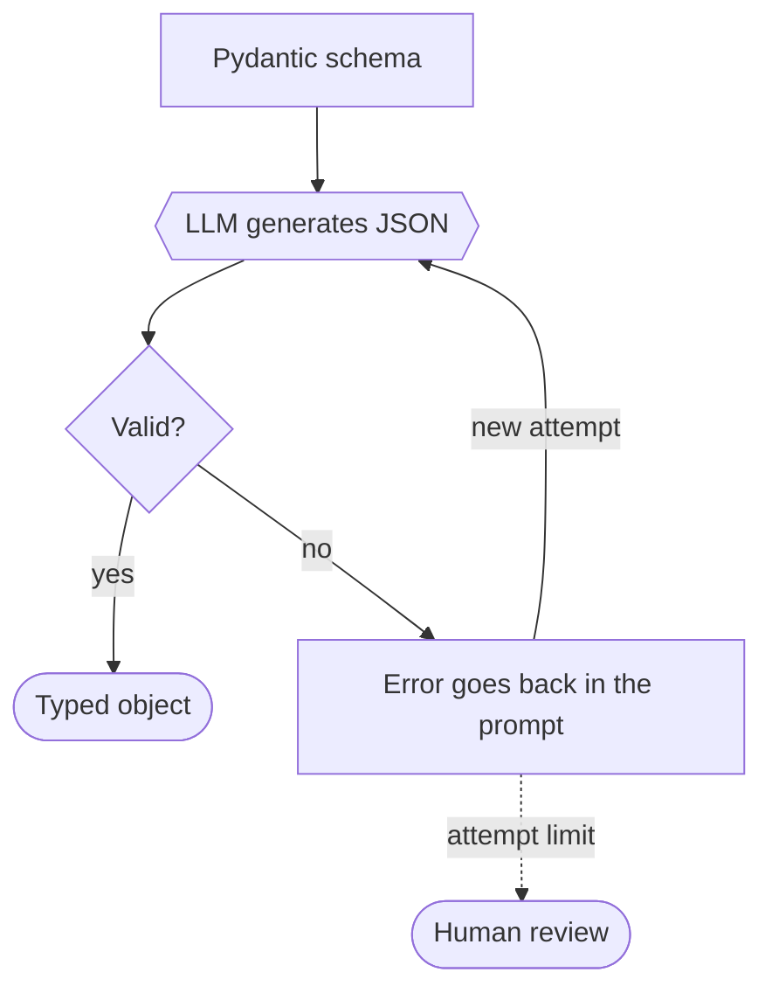

## What it is

Structured output is forcing the LLM to answer in a format your code understands, almost always JSON (a data format with keys and values), instead of free text. You describe the format with a JSON Schema (a description of the fields, their types and allowed values) or with a Pydantic model, and you validate the answer before using it.

## Why it matters for an AI Engineer

Code cannot read "The priority seems high, I would say". It needs `{"priority": "high"}`. When the answer has a guaranteed format, the LLM stops being a text generator and becomes a function with a contract: text goes in, an object with known fields comes out that the rest of the system consumes. It also reduces hallucination, since the space of answers is limited to valid values.

## How it works

There are three layers, from weakest to strongest:

1. **Asking in the prompt:** "answer only with JSON in this format". It works almost always, but not always.
2. **Using the provider's feature:** several APIs (see the provider's structured outputs documentation) accept a schema and constrain generation so the answer follows it. Features and names vary by provider.
3. **Validating in your code:** even with the previous layers, validate. If it fails, try again, sending the error back to the model.

The most common cycle is "generate, validate, try again". The example below uses Pydantic and a function that simulates the LLM (replace it with the real API call):

```python
import json
from typing import Literal
from pydantic import BaseModel, ValidationError
class Triage(BaseModel):
    priority: Literal["low", "medium", "high"]
answers = iter(['{"priority": "urgent"}', '{"priority": "high"}'])
def call_llm(prompt):              # simulation: replace with the real call
    return next(answers)
prompt = "Classify the work order."
for _ in range(3):
    try:
        print(Triage(**json.loads(call_llm(prompt)))); break
    except (ValidationError, json.JSONDecodeError) as error:
        prompt += f"\nFailed: {error}. Fix it."
```

The first answer has `"urgent"`, which is not among the allowed values; Pydantic rejects it, the error goes back in the prompt and the second attempt passes. Limit the number of attempts and decide what to do if all of them fail (log it and route it to a person).



Modeling tip: use `Literal` or enumerations for category fields, describe each field in one sentence (the model reads the schema's descriptions) and include an option such as `"undetermined"` for cases where it has no way of knowing.

## In practice

In P4: Maintenance Work Order Triage, each free-text order becomes an object with priority, machine and failure type, validated before entering the database. The same idea underpins tool use (the model calls tools passing arguments as JSON) and the responses of a FastAPI API.

## Common mistakes

- **Trusting without validating.** The format almost always comes back right, and the day it does not, the system breaks in production.
- **Retrying without a limit.** Set a maximum and a plan B.
- **An overly complicated schema.** Nested fields and too many options increase errors. Start simple.
- **Leaving no way out for "I don't know".** The model picks any value to satisfy the schema.
- **Thinking a correct format means correct content.** The JSON can be valid and the priority wrong; evaluate the content with a set of labeled examples.

## How to study

1. Read the JSON Schema introduction and write the schema of a work order by hand (2 hours).
2. Do the same with a Pydantic model and generate the schema with `Triage.model_json_schema()` (2 hours).
3. Run the example and add a new field (2 hours).
4. Replace the simulation with a real call and use the provider's structured output feature (1 day).
5. See how Instructor automates the validate-and-retry cycle (2 hours).

## How to show it

In your portfolio, show the schema, examples of valid output and the rate of answers that needed a retry, something like "3 in 100 orders" (an illustrative number). In the interview, explain why you validate even with the provider's feature and how you handle the final failure.
