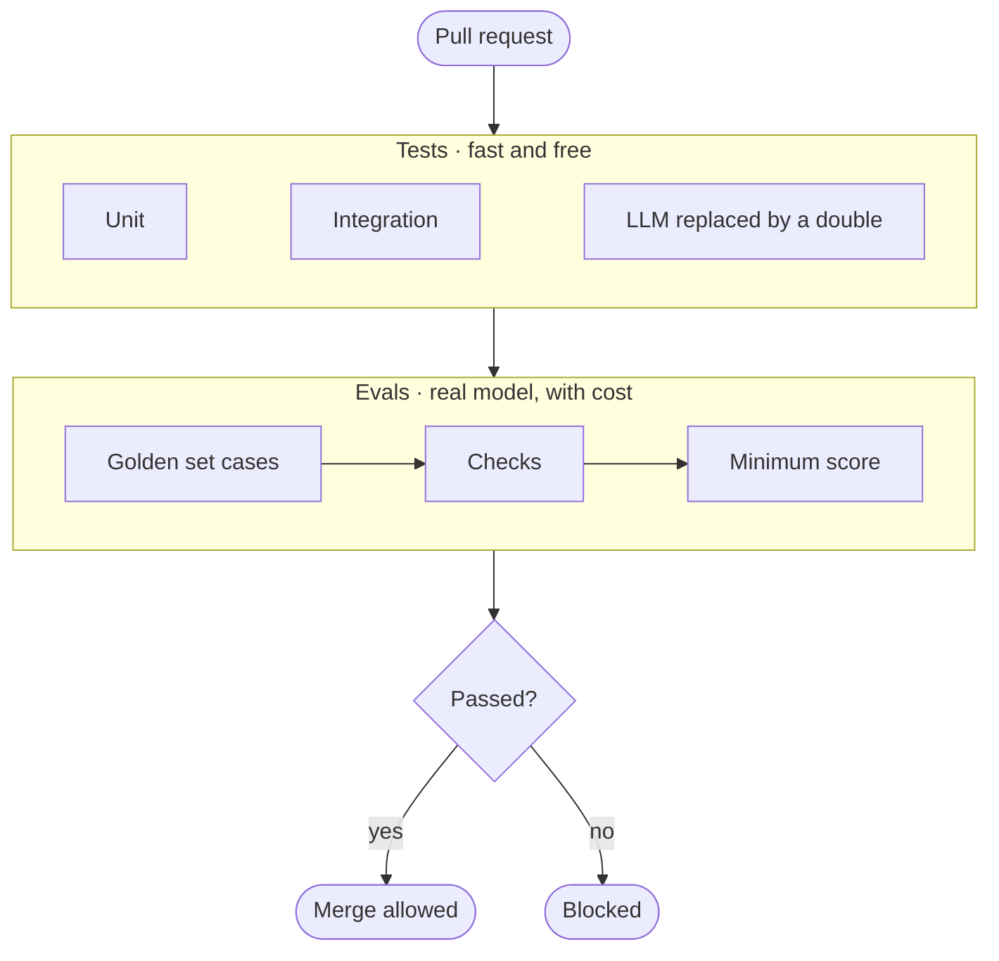

## What it is

In an LLM project there are two kinds of checks, and they answer different questions. Automated **tests** (with pytest, Python's testing library) check your code: whether it reads the input, validates the data and handles errors. **Evals** (evaluations) measure the quality of the model's answers on a set of cases, the golden set. The first is exact and repeatable; the second is statistical, because the model can vary.

## Why it matters for an AI Engineer

Someone who changes the prompt, switches the model or changes chunking without running anything finds the regression (the drop in quality) in production. Tests give you confidence to refactor code; evals give you confidence to touch prompts and models. Together they run in CI (continuous integration, automatic runs on every change; see the CI/CD topic) and block what makes the result worse. This topic is the application, inside the projects, of what you saw in evals.

## How it works

**Unit and integration.** A unit test checks one isolated function. An integration test checks several pieces together, such as the API route with a test database.

**A double instead of the LLM.** A test should not call the real model: it is slow, costs money and the answer varies. You replace the client with a test double (a fake object with a fixed answer) and test what is yours. For that, the function receives the client as a parameter:

```python
import pytest
from triage import classify  # P4: (text, llm) -> order
class FakeLLM:
    def __init__(self, output):
        self.output = output
    def generate(self, text):
        return self.output
def test_urgency():
    llm = FakeLLM('{"equipment": "X200", "urgency": "high"}')
    assert classify("Stopped, error E-21", llm=llm).urgency == "high"
def test_invalid_json():
    with pytest.raises(ValueError):
        classify("text", llm=FakeLLM("not JSON"))
```

Run `pytest`. The second test checks the error path, which is what breaks the most.



**Evals with Promptfoo.** You describe cases and checks in a YAML file and Promptfoo calls the real model:

```yaml
prompts: ["Classify the urgency of the report: {{report}}"]
providers: ["anthropic:messages:MODEL-NAME"]
tests:
  - vars: {report: "Compressor stopped with error E-21"}
    assert:
      - type: contains
        value: "high"
```

Replace `MODEL-NAME` with the provider's current identifier; the format changes, so follow the documentation. Run it with `npx promptfoo eval`. When a check fails, the command exits with an error, and that is what makes CI block the change.

Since the output varies, set a threshold: for example, pass if at least 90% of the cases are right. The 90% is illustrative; choose yours based on the use case's risk. That threshold is not automatic: configure it (Promptfoo has a pass threshold in its evaluation options; see the documentation), otherwise a single failure may block nothing, or block everything.

## In practice

In P4: Work Order Triage, tests cover the validation of the structured order and the error path, and evals compare two or more models on the same set of cases. In P2: Technical Manuals RAG, evals measure retrieval with questions and correct pages. In P1: Automaker Assistant, "I don't know" and out-of-scope cases go into the golden set.

## Common mistakes

- **Calling the real LLM in unit tests.** Slow, expensive and unstable.
- **Evals with few or overly easy cases.** Always passing proves nothing; include hard and edge cases.
- **Testing only the happy path.** Provider errors and invalid output need tests.
- **Using the same example in the prompt and in the eval.** The result gets inflated.
- **Not keeping the results.** Without history, there is no before-and-after comparison.

## How to study

1. Write three unit tests for a function of yours (1 day).
2. Replace the LLM client with a double and test the error (1 day).
3. Put together 20 cases in a Promptfoo YAML and run it (2 days).
4. Change the prompt and compare the results before and after (1 day).
5. Put pytest and Promptfoo into CI (1 day).

## How to show it

In your portfolio, the README shows the test command, the eval results table and the green CI badge. In the interview, explain why the test uses a double, what evals measure that tests do not, and how a prompt regression would be blocked.
