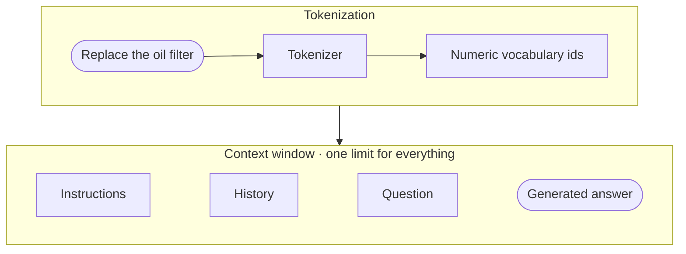

## What it is

A token is the piece of text the model processes: it can be a short word, part of a word, a punctuation mark or a space. The context window is the limit of tokens the model can consider in a single call, adding up what you send and what it answers.

## Why it matters for an AI Engineer

Everything in LLMs is measured in tokens. The provider charges per input and output token. The window limit decides how much text fits in the prompt. And latency (the wait for the answer) grows with the number of generated tokens. People who do not think in tokens get two surprises: the bill at the end of the month and a "context exceeded" error in the middle of a test.

## How it works

The text goes through a **tokenizer**, which breaks it into pieces from a fixed list, the model's vocabulary. Common words become a single token; rare or long words become several.



Because tokenizers were designed with a lot of English text, English usually packs more characters per token. Languages like Portuguese have accents, long conjugations and compound words, and tend to spend more tokens to say the same thing. In the example below, the English sentence takes 5 tokens and the Portuguese equivalent takes 8 (the result of this tokenizer; other models give different numbers). Code and numbers also use more tokens than they seem to.

You can see this by running a tokenizer. The example uses the `tiktoken` library (`pip install tiktoken`), which downloads the vocabulary on first run. This encoding is OpenAI's and is used here only to illustrate tokenization; the model you use has its own.

```python
import tiktoken

enc = tiktoken.get_encoding("cl100k_base")
for sentence in ["Replace the oil filter.", "Troque o filtro de óleo."]:
    tokens = enc.encode(sentence)
    print(len(tokens), [enc.decode([t]) for t in tokens])
```

Each model has its own tokenizer, so the exact number varies. For the official value, use the provider's token counting tool, which the documentation points to.

To estimate cost, multiply tokens by the price per token. With illustrative numbers: if the prompt has 2,000 tokens, the answer 500, and the provider charges 3 per million input tokens and 15 per million output tokens, the call costs 0.006 + 0.0075 = 0.0135 in the price's currency. Real prices are on the provider's page.

For the **context window**, think of a desk: you can only look at what fits on the desk at the same time. It holds the system prompt, the conversation history, the documents you attach and the answer. There is also an **output limit**, smaller than the window, for the size of the answer.

A large window does not mean uniform attention. Research such as "Lost in the Middle" shows that information in the middle of a long text is used worse than at the beginning and the end, and quality can drop before the window fills up. Window sizes change from model to model and month to month, so check the provider's documentation instead of memorizing a number.

## In practice

In P1: Automaker Assistant, the conversation history grows with each message, and you decide when to summarize or cut it. In P2: Technical Manuals RAG, the number of retrieved passages (the top-k) is limited by the token budget. Before sending, estimate the size; afterwards, record the input and output tokens the API returns with each answer, to calculate the cost per request.

## Common mistakes

- **Counting characters or words as if they were tokens.** The ratio varies by language and by model.
- **Sending the whole document "because it fits".** It fits, but it costs more, takes longer and can make the answer worse.
- **Forgetting the output.** If you ask for a long answer and the output limit is short, the text gets cut in the middle.
- **Ignoring the history.** In a long conversation, you pay again for all the old messages on every call.
- **Quoting prices or window sizes from memory.** Values change; check the provider.

## How to study

1. Run the example with ten sentences of your own in different languages and compare (2 hours).
2. Read the token counting page in the documentation and count a real prompt (2 hours).
3. Read the context windows page (1 hour).
4. Read the summary of "Lost in the Middle" (1 hour).
5. Write a function that cuts the history to fit a token limit (1 day).

## How to show it

In your portfolio, show in the README the average cost per request of your project, in tokens and in money, with the math explained. In the interview, explain why some languages cost more and how you would reduce tokens (history summary, fewer passages, a leaner prompt).
