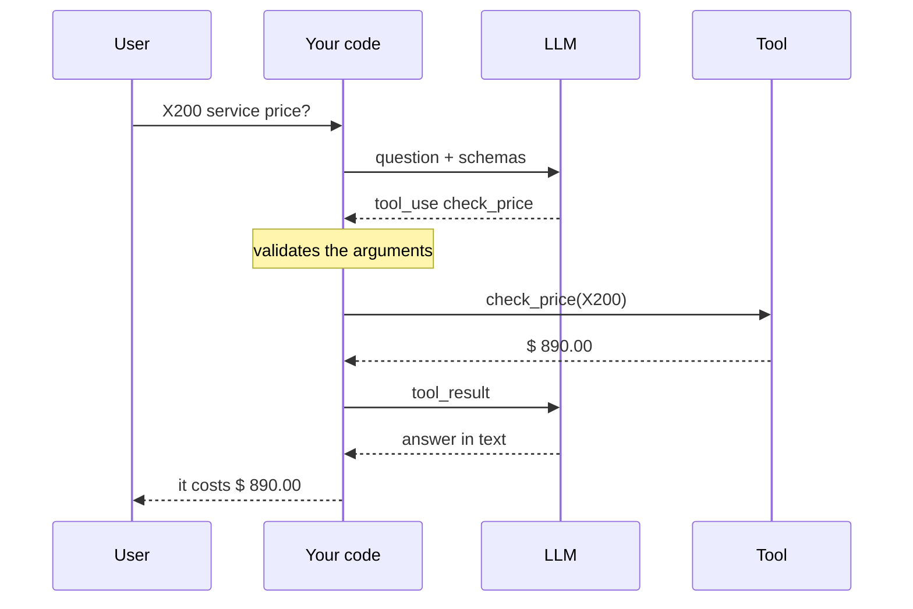

## What it is

Tool use (also called function calling) is the mechanism in which the model executes nothing: it returns the name of a tool and the arguments, in a structured format. Your code is what executes it, returning the result to the model so it can continue. A tool is a function of yours, such as `get_order(number)`.

## Why it matters for an AI Engineer

This loop is the base of every agent. Without it, the model only generates text; with it, it queries systems, opens tickets and reads files. It is also where the risks live: what the model asks for goes through your code, and that is where you validate, limit and log.

## How it works

1. You describe each tool with a name, a description and a schema (the definition of the arguments, in JSON Schema: types and required fields).
2. The model decides whether it needs a tool and answers with the call (name and arguments) instead of a final text.
3. Your code validates the arguments, runs the function and returns the result in a tool result message.
4. The model reads the result and answers, or asks for another tool. The cycle repeats until there is a final answer.



```python
import anthropic
client = anthropic.Anthropic()
tools = [{"name": "get_order", "description": "Fetches a maintenance work order by number.",
    "input_schema": {"type": "object", "properties": {"number": {"type": "string"}}, "required": ["number"]}}]
msgs = [{"role": "user", "content": "What is the status of order WO-1042?"}]
for _ in range(5):                                   # cap on turns
    r = client.messages.create(model="MODEL-NAME", max_tokens=500, tools=tools, messages=msgs)
    if r.stop_reason != "tool_use":
        break
    msgs.append({"role": "assistant", "content": r.content})
    use = next(b for b in r.content if b.type == "tool_use")    # there may be more than one
    result = f"Order {use.input['number']}: in progress"       # your code runs here
    msgs.append({"role": "user", "content": [{"type": "tool_result", "tool_use_id": use.id, "content": result}]})
print(r.content[0].text)
```

The field names (`input_schema`, `tool_use`, `tool_result`) are those of the Anthropic API; other providers use other names, such as `parameters` and `tool_calls`, but the structure of the loop is the same. Check the provider's documentation (OpenAI's function calling page shows its format) and the current model name.

**Errors.** If the tool fails, return the error message to the model (the Anthropic API has an `is_error` field in the result): it can fix the argument or try another path. Temporary failures, such as timeouts, you retry in your code, with increasing waits between attempts.

**Idempotency.** An operation is idempotent when repeating it has the same effect as doing it once. Querying is idempotent; "create ticket" is not, and a retry can create two. For actions that write, send an idempotency key (a unique identifier of the operation) and let the system ignore the repetition.

## In practice

In P1: Automaker Assistant, the tools layer lets the assistant query systems, such as maintenance orders, instead of only chatting. In P3: Manuals MCP Server, the same tools come to be served through a standard protocol. Clear descriptions are worth a lot: the model chooses by the description, so say when to use and when not to use each tool, and return only what it needs to read.

## Common mistakes

- **Trusting the arguments.** The model can invent or get a value wrong. Validate type and range, and check permission in your code.
- **A loop without a cap.** Without a maximum number of turns, a repeated error becomes infinite cost.
- **Too many or similar tools.** The model gets confused; prefer a few, with distinct names.
- **Huge results.** Returning the whole table fills the context; filter and summarize.
- **A write action without idempotency or approval.** See human-in-the-loop.

## How to study

1. Read the tool use overview of the provider you use (2 hours).
2. Run the example with a tool that reads from a dictionary (half a day).
3. Add a second tool and a deliberate error, and watch the model react (1 day).
4. Make a write tool idempotent with a key (1 day).
5. Read "Writing effective tools for AI agents" and rewrite your descriptions (half a day).

## How to show it

In your portfolio, show the loop with a log of each call: tool, arguments, result, time. In the interview, explain who runs the tool, what you validate before running it and why idempotency matters on a retry.
