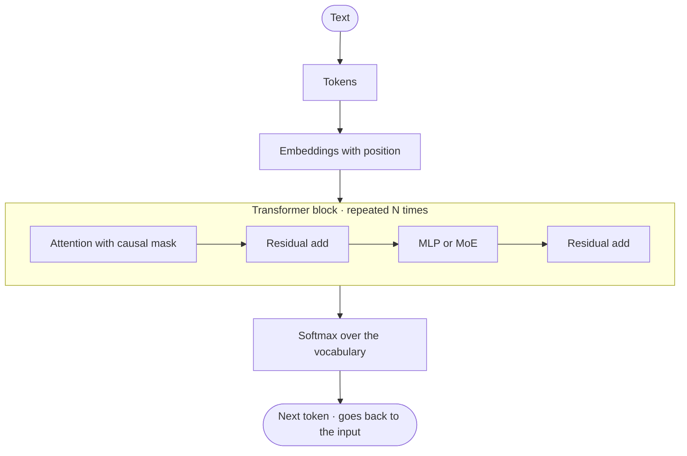

## What it is

The transformer is the neural network architecture behind today's LLMs. Text becomes tokens, each token becomes a vector (embedding), and the model passes these vectors through dozens of identical blocks. Each block has two parts: attention, which lets each token look at the previous ones and pull information from them, and a feed-forward network (MLP), which processes each token on its own. At the end, the last token's vector becomes a probability distribution over the vocabulary, and the model picks the next token.



## Why it matters for an AI Engineer

Without this mental model, many decisions become superstition. Attention compares each token with all the previous ones, which is why cost grows with context size. The model generates one token at a time, which is why output costs more and takes longer than input. Token position is encoded in the vector, which is why the order of the prompt changes the answer. Knowing this helps you read new papers, talk to research teams and explain in an interview why an architecture choice makes sense.

## How it works

In attention, each token produces three vectors: a query (Q), a key (K) and a value (V). A token's query is compared with the others' keys by dot product; the result, normalized by softmax, says how much of each value goes into the mix. A causal mask keeps a token from seeing the ones that come after it.

```python
import torch

def attention(x, Wq, Wk, Wv):
    Q, K, V = x @ Wq, x @ Wk, x @ Wv            # (tokens, d)
    scores = Q @ K.T / K.shape[-1] ** 0.5        # similarity between tokens
    mask = torch.triu(torch.ones_like(scores), 1).bool()
    scores = scores.masked_fill(mask, float("-inf"))   # do not look ahead
    weights = torch.softmax(scores, dim=-1)
    return weights @ V                           # mix of the values

x = torch.randn(5, 16)                           # 5 tokens, dimension 16
W = [torch.randn(16, 16) for _ in range(3)]
print(attention(x, *W).shape)                    # torch.Size([5, 16])
```

Real models use several attention heads in parallel (multi-head), residual connections, normalization and a position encoding such as RoPE. Many recent models also replace the dense MLP with a mixture of experts (MoE), where only part of the weights is used per token.

## In practice

When a model "forgets" something in the middle of a long context, when cost grows more than expected or when a large MoE model runs faster than a smaller dense one, the explanation is here. In P5: Multi-Agent Researcher, you use this knowledge to choose which model serves each subagent and to estimate memory and latency.

## Common mistakes

- **Thinking the model "reads" text like a person.** It processes token vectors; rare words become several tokens.
- **Confusing parameters with useful knowledge.** An MoE model has many parameters, but uses only part of them per token.
- **Ignoring the causal mask.** It explains why the model cannot "go back" and fix a token it already generated.
- **Studying only the formula.** Without implementing it, the details of dimensions and masks do not stick.

## How to study

1. Read the illustrated transformer article and watch the step-by-step attention video (1 day).
2. Run the code above, print the weight matrix and check the mask (1 day).
3. Follow the build-a-GPT-from-scratch video, typing the code (1 to 2 weeks).
4. Train nanoGPT on a small text and vary the number of layers and heads (1 week).
5. Read the original paper and note what changed in current models: RoPE, MoE and normalization (2 days).

## How to show it

Publish a repository with your trained mini-GPT, a loss chart and a visualization of the attention weights for a sentence. In the interview, draw a transformer block and explain where the quadratic cost of attention comes from.
