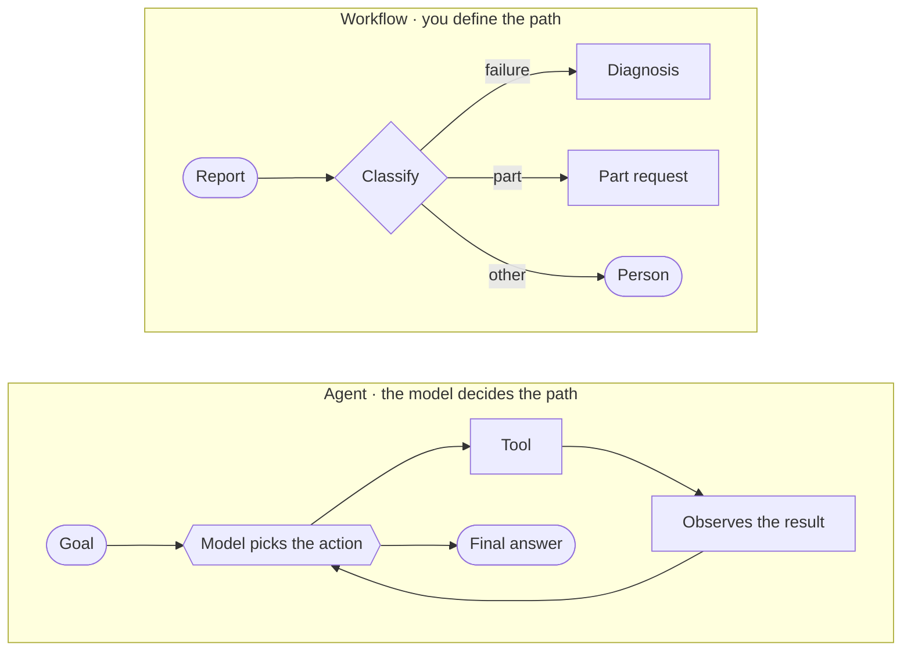

## What it is

A workflow is a flow in which the code defines the steps and the LLM (language model) is called at fixed points. An agent is a system in which the model itself decides the next step, in a loop, using tools, until it finishes. The distinction is about who controls the path: your code or the model.

## Why it matters for an AI Engineer

Choosing an agent by default is an expensive mistake. An agent costs more tokens (the units of text the model reads and writes), takes longer, is hard to test and can fail in unpredictable ways. Anthropic's "Building effective agents" article recommends starting with the simplest solution and only increasing complexity when it improves the result. Being able to say "a workflow is enough here" shows maturity.

## How it works

The article describes five workflow patterns, from simplest to most complex:

- **Prompt chaining:** one call feeds the next. Example: extract fields from the operator's report and then draft the work order.
- **Routing:** a first call classifies the input and sends it to the right handler (failure, part or other), each with its own prompt.
- **Parallelization:** independent tasks run at the same time, or the same task runs several times to vote.
- **Orchestrator-workers:** a model splits the task into parts it only discovers when reading the input and delegates each one to another call.
- **Evaluator-optimizer:** one call produces, another critiques, and the cycle repeats until it meets the criterion.

The example below is routing pseudocode; `llm` stands for your call to the model:

```python
def llm(prompt): ...   # pseudocode: call to the model, returns text

def handle(report):
    kind = llm(f"Answer only 'failure', 'part' or 'other': {report}")
    if kind == "failure":
        return llm(f"Suggest the diagnosis: {report}")
    if kind == "part":
        return llm(f"List the parts mentioned: {report}")
    return "Route to a human"
```

The steps are known and each one can be tested on its own. Compare with an agent: you give it tools and a goal, and the model chooses what to call, in which order and when to stop. That gains flexibility and loses predictability.



**When an agent pays off:** when the number and order of steps depend on what shows up along the way, such as investigating a failure that needs different searches each time, and when an error has an acceptable cost or goes through human approval. Even then, set limits: a maximum number of turns, a token budget and tools with only the access needed. Anthropic's multi-agent research article reports that agents use many more tokens than a chat and that multi-agent systems use even more, which is why they are only worth it for high-value tasks with a parallelizable part.

## In practice

P4: Maintenance Work Order Triage is a workflow on purpose: it extracts, classifies and suggests a procedure in fixed steps, and the README explains why it is not an agent. PF: Complete Agent, on the other hand, uses an agent with MCP tools and human approval, because investigating a failure has no fixed script. A good habit is to start each project as a workflow and promote it to an agent only where a fixed step does not solve it.

## Common mistakes

- **An agent for everything.** If you can write the steps, write them.
- **Multi-agent too early.** It splits the context and multiplies the cost; use it only for truly parallel work.
- **No stopping condition.** Loops without a cap on turns or spending.
- **Not measuring.** Compare workflow and agent on the same test set, in quality, cost and time.
- **A framework before understanding.** See the loop by hand first.

## How to study

1. Read "Building effective agents" in full (2 hours).
2. Implement the routing above with a real API and 10 sample reports (1 day).
3. Rewrite the same task as an agent with two tools and compare token cost and time (2 days).
4. Read the multi-agent system article and note what justified that cost (2 hours).

## How to show it

In the README, include a table comparing workflow and agent on the same task: quality, tokens and time, with the measurement method. In the interview, defend a choice with those numbers and explain when you would switch sides.
