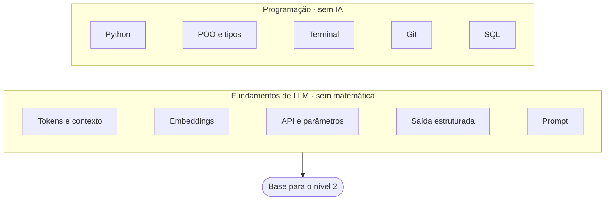

Este é o nível de base. Ele tem duas frentes que andam em paralelo: programar sem apoio de IA e entender, sem matemática, como um modelo de linguagem funciona por dentro.

## Por que este nível vem agora

Quem pula direto para agentes aprende a montar peças sem saber o que elas fazem. Quando algo dá errado, não sabe onde procurar. Escrever o código você mesmo constrói a lógica e o vocabulário que, mais adiante, permitem revisar com senso crítico o que um agente de programação gera.

A frente de LLM tem um objetivo prático: responder com segurança a perguntas de entrevista como "por que o modelo inventou essa resposta?" ou "por que trocar de modelo mudou o custo?". Não é preciso entrar na matemática dos modelos para isso.

## Como estudar este nível

Nas duas frentes a regra é a mesma: faça você mesmo. Na programação, evite pedir à IA que escreva o exercício; use-a, no máximo, para tirar uma dúvida conceitual. Na frente de LLM, não se contente em ler: chame uma API, varie parâmetros e anote o que mudou.

Reserve de 10 a 15 horas por semana. Os prazos são indicativos e variam com a sua rotina e a sua experiência anterior; a calculadora de trilha ajusta o prazo ao seu ponto de partida. Comece versionando tudo no Git desde o primeiro script e mantenha as chaves de API fora do repositório.
