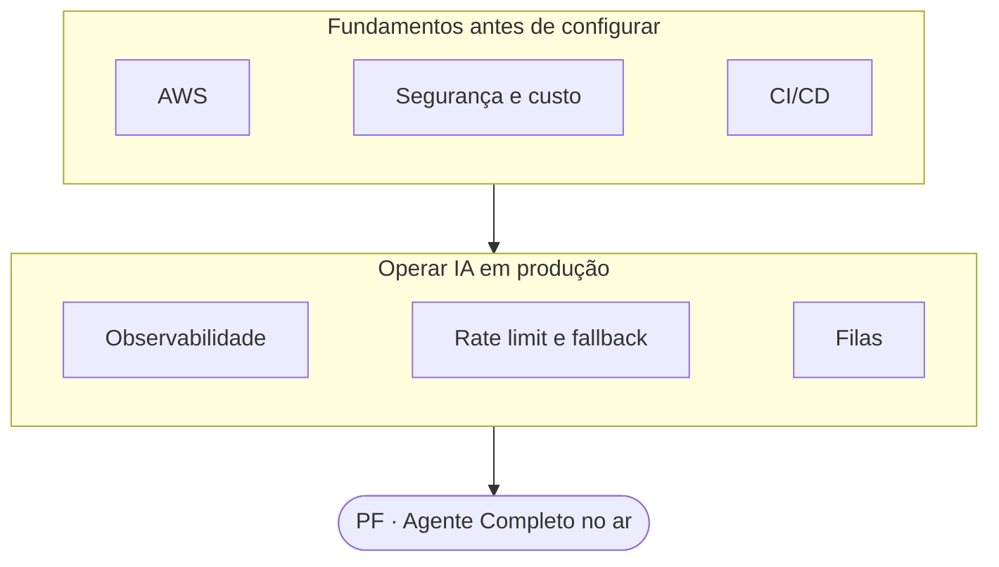

Este nível leva o projeto final para produção. Aqui o agente de programação não basta: ele pode sugerir uma configuração que funciona e ainda assim é cara ou insegura, e você precisa saber revisar.

## Por que este nível vem agora

Na nuvem, uma configuração errada não só quebra o projeto: pode gerar custo alto mesmo num projeto de teste, como uma instância esquecida ligada, um banco exposto ou uma chave vazada no GitHub. Por isso o nível começa por fundamentos, e só depois passa à prática.

Colocar no ar também muda as perguntas: quanto custa cada resposta, o que acontece quando o provedor cai, como descobrir de onde veio uma resposta ruim. É isso que separa uma demonstração de um sistema.

## Como estudar este nível

Faça um curso de fundamentos de nuvem antes de configurar qualquer recurso, siga o checklist de segurança e custo e crie o alerta de orçamento primeiro. Depois automatize testes e evals no CI e, só então, faça o deploy do PF.

Documente a arquitetura no README com um diagrama e registre o custo mensal real. Os prazos são indicativos e dependem da sua rotina de estudo.
