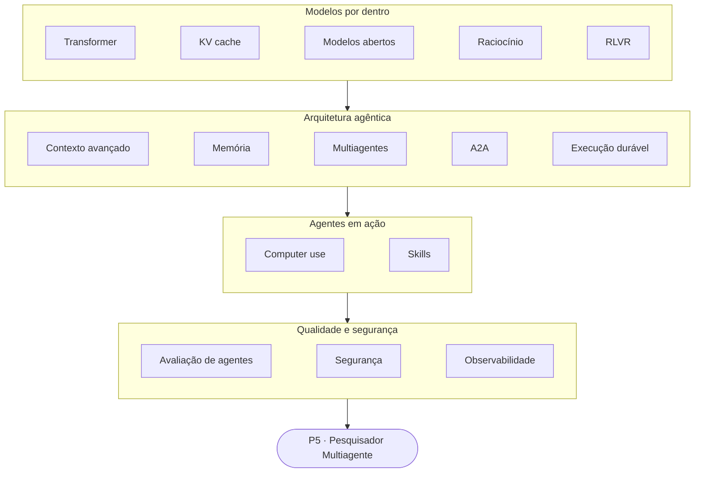

Este nível vai além do que a maioria das vagas pede. Os níveis 1 a 4 formam um AI Engineer que entrega e opera sistemas com LLM. O nível 5 forma quem entende por que esses sistemas se comportam como se comportam e consegue projetar os casos difíceis: agentes que rodam por horas, vários agentes que dividem trabalho, modelos servidos na própria infraestrutura.

## Por que este nível vem agora

Os temas daqui só fazem sentido depois de você ter colocado um agente em produção e sofrido com os problemas reais: contexto que cresce sem parar, custo que dispara, resposta ruim difícil de explicar. Com essa experiência, estudar atenção, KV cache ou avaliação de trajetória deixa de ser teoria solta e passa a responder perguntas que você já teve.

É também o que separa quem usa a ferramenta de quem consegue escolher, medir e defender uma arquitetura numa entrevista de nível sênior ou num time de pesquisa aplicada.

## Como estudar este nível

Comece pelo grupo dos modelos por dentro: ele dá o vocabulário para o resto (tokens, atenção, cache, custo por token). Depois passe à arquitetura agêntica e use o P5: Pesquisador Multiagente como laboratório, construindo uma camada por vez.

Leia as fontes primárias (artigos e documentação oficial) e reproduza pelo menos um resultado de cada grupo com seus próprios números. Os prazos são indicativos e assumem que você estuda em paralelo com um trabalho na área.
