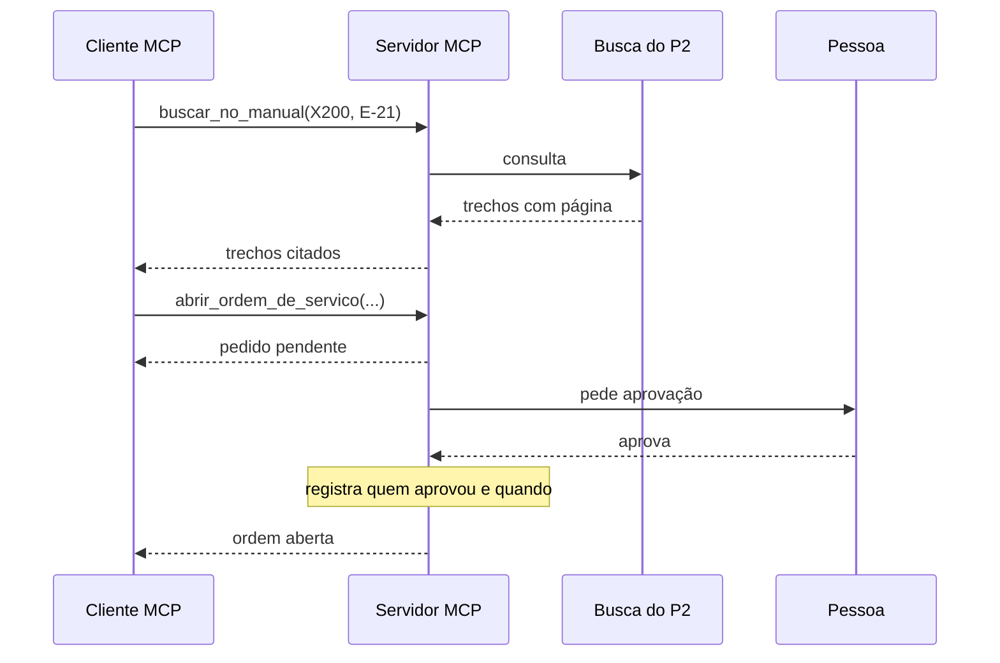

## O problema

A busca do projeto P2 funciona dentro da sua aplicação. Para que ferramentas como o Claude Code ou o Claude Desktop também consultem os manuais, você a expõe como um servidor MCP (Model Context Protocol, um protocolo aberto que padroniza como um modelo acessa ferramentas e dados). Assim, qualquer cliente compatível usa a mesma busca sem integração própria.

O projeto também trata de segurança: uma ação que muda o mundo, como abrir uma ordem de serviço, só pode rodar depois de aprovação humana, e um manual malicioso não pode comandar o agente.

## Arquitetura

O servidor MCP, escrito com o SDK oficial em Python, publica duas ferramentas. A de leitura, `buscar_no_manual(equipamento, pergunta)`, chama o código do P2 e devolve trechos com citação; não escreve nada. A de ação, `abrir_ordem_de_servico(...)`, não executa de imediato: cria um pedido pendente e só roda depois que uma pessoa aprova, com o registro de quem aprovou e quando. O cliente (Claude Code ou Claude Desktop) conecta ao servidor e decide quando chamar cada ferramenta.

Veja os tópicos MCP (que também trata de autenticação e permissões; se o servidor for remoto, leia a parte de autorização), Tool use, Human-in-the-loop e Prompt injection.

O cliente decide quais ferramentas chamar a partir do nome e da descrição que você escreve, então trate essa descrição como parte do produto. A aprovação pode ser simples: um prompt no terminal ("aprovar a ordem 123? s/n") ou uma página mínima com os botões aprovar e recusar. O que importa é o servidor não executar antes do sim. O registro de aprovação deve guardar a ferramenta, os argumentos, quem aprovou e a hora, para que qualquer ordem aberta possa ser auditada depois.

## Stack sugerida

Python, o SDK oficial do MCP, o código do P2 reaproveitado como biblioteca e Claude Code ou Claude Desktop como cliente para testar. Veja o tópico FastAPI se quiser expor também uma API HTTP.

## Critérios de aceite

- A ferramenta de leitura devolve trechos de manual com citação.
- A ferramenta de ação só executa após aprovação humana registrada, com quem aprovou e quando.
- As permissões são mínimas: a ferramenta de leitura não escreve nada e não tem acesso à ação.
- Um teste com instrução maliciosa escondida num manual indexado foi feito, e a correção está documentada.
- Os nomes e as descrições das ferramentas são claros o bastante para o cliente escolher a certa.

## O que colocar no README

- O que o servidor expõe, com a descrição de cada ferramenta e exemplos de chamada.
- Como instalar e como conectar no Claude Code ou Claude Desktop, passo a passo.
- O fluxo de aprovação com um diagrama e um exemplo de registro.
- Permissões de cada ferramenta e por que são mínimas.
- O teste de ataque: o texto malicioso usado, o que o agente fez antes da correção e o que faz depois.
- Limitações, como defesa que reduz o risco mas não elimina.

## Como apresentar na entrevista

Explique por que escolheu MCP em vez de uma integração própria: um servidor atende vários clientes. Conte o teste de ataque, que é a parte mais memorável: "escondi uma instrução num manual, o agente tentou abrir uma ordem, a aprovação humana barrou, e depois reduzi o privilégio e separei dados de instruções". Esteja pronto para dizer que não existe defesa perfeita contra prompt injection, e que a aprovação humana e o privilégio mínimo limitam o dano. Mostre o registro de uma aprovação.
