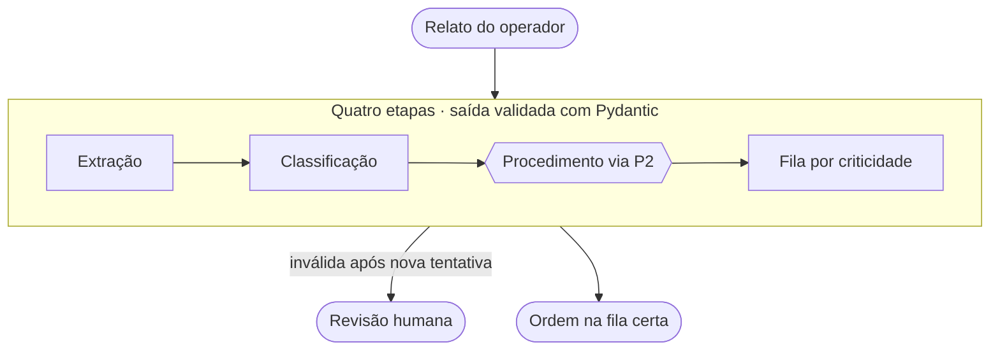

## O problema

Operadores relatam falhas em texto livre: "a esteira 3 está fazendo barulho e o motor esquentando". Para virar uma ordem de manutenção, alguém precisa extrair equipamento, sintoma, criticidade e setor, classificar o tipo de falha e achar o procedimento. Você automatiza esse caminho com um workflow, e não com um agente: os passos são conhecidos e previsíveis, e isso torna o sistema mais barato, rápido e fácil de testar.

O ponto central do projeto é comparar modelos por custo e qualidade.

## Arquitetura

O fluxo tem quatro etapas em sequência. (1) Extração dos dados estruturados do relato. (2) Classificação do tipo de falha. (3) Consulta à busca do P2 para sugerir o procedimento, com citação. (4) Colocação da ordem na fila certa, com base na criticidade. As etapas 1 e 2 usam um modelo pequeno e barato, e só a sugestão de procedimento (etapa 3) usa um modelo maior. A saída de cada etapa é validada com Pydantic; se for inválida, o sistema tenta de novo e, depois, marca a ordem para revisão humana.

Veja os tópicos Saída estruturada, Workflow ou agente, Custo e latência e Evals.

Escolha a classificação de criticidade com cuidado: uma ordem crítica mal classificada como baixa é um erro mais grave do que o contrário. Por isso, meça os tipos de erro separadamente, e não só o acerto geral. Defina também o que acontece quando o relato não traz equipamento identificável.

## Stack sugerida

Python, Pydantic para os esquemas, dois ou mais modelos de LLM de tamanhos diferentes, o código do P2 para a sugestão de procedimento e Promptfoo (ou evals próprios) para comparar os modelos. Use relatos sintéticos, escritos por você, e nunca relatos de uma empresa real.

## Critérios de aceite

- A saída é sempre JSON válido, validado por Pydantic.
- Extração e classificação usam o modelo menor, e a sugestão usa o maior.
- Há um conjunto de 30 a 50 relatos sintéticos com a resposta esperada.
- O README mostra custo e qualidade antes e depois, medidos com evals.
- O README explica por que isto é um workflow e não um agente.
- Relatos ambíguos ou incompletos vão para revisão humana, e não para a fila.

## O que colocar no README

- Um exemplo de relato e da ordem gerada.
- Diagrama das quatro etapas, com o modelo usado em cada uma.
- Tabela de comparação (por exemplo, acerto da classificação e custo por 1.000 relatos) para: modelo grande em tudo, modelo pequeno em tudo e a configuração mista (os números são seus, medidos).
- Os tipos de erro mais comuns e o que você fez a respeito.
- A explicação de workflow versus agente, em um parágrafo.
- Limitações e o que ainda exige revisão humana.

## Como apresentar na entrevista

Comece pela decisão: "usei o modelo pequeno nas etapas fáceis e o grande só onde precisa, e medi que a qualidade da classificação caiu pouco enquanto o custo caiu bastante". Só diga isso com números do seu relatório. Explique por que não é um agente: os passos são fixos, o que dá previsibilidade, e um agente só compensa quando o caminho não é conhecido. Esteja pronto para falar de saída estruturada, de nova tentativa quando a validação falha e do que você faria com relatos fora do padrão.
