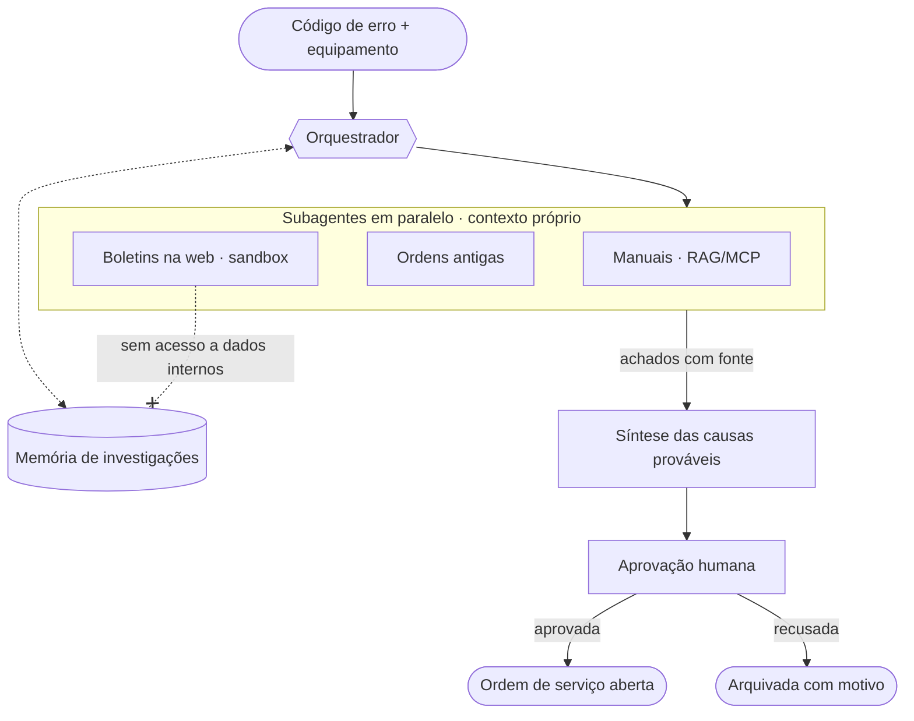

## O problema

Quando um equipamento da linha de produção falha, um engenheiro gasta horas cruzando manuais, ordens de manutenção antigas e boletins técnicos para chegar às causas prováveis. O P4: Triagem de Ordens de Manutenção classificou ordens; o PF: Agente Completo colocou um agente em produção. O P5 resolve uma tarefa mais aberta e longa: investigar uma falha de ponta a ponta, buscando em várias fontes ao mesmo tempo, e propor uma ordem de serviço que só é aberta depois da aprovação de uma pessoa.

É o projeto em que você aplica, com números, tudo o que o nível 5 trata: modelos por dentro, arquitetura agêntica, avaliação e segurança.

## Arquitetura

Um orquestrador recebe o código de erro e o equipamento, planeja a investigação e dispara subagentes em paralelo: um busca nos manuais (com o código do P2: RAG de Manuais Técnicos ou do P3: Servidor MCP de Manuais), outro nas ordens antigas, outro nos boletins públicos na web. Cada subagente tem contexto e ferramentas próprios e devolve só os achados com fonte. O orquestrador sintetiza as causas prováveis, consulta a memória de investigações anteriores e propõe uma ordem de serviço.

A execução é durável: cada passo fica registrado, e a espera pela aprovação humana sobrevive a reinícios. O subagente da web não tem acesso aos dados internos, o que quebra a tríade letal. Um subagente de classificação simples roda num modelo aberto servido por você. Todo o fluxo gera um rastro único, e os rastros ruins viram casos de avaliação.

Veja os tópicos Multiagentes e orquestração, Engenharia de contexto avançada, Memória de agentes, Execução durável, Servir modelos abertos, Avaliação de agentes, Segurança de agentes e Observabilidade de agentes.

## Versões em camadas

Cada camada é uma versão marcada no Git, com o relatório de avaliação daquela versão. Comece pelo agente único medido: sem essa linha de base, não dá para provar que a versão multiagente vale o custo extra. A camada do modelo aberto pode usar uma GPU alugada por poucas horas, com alerta de custo ligado.

## Stack sugerida

Python, um framework de agentes (ou código próprio, se preferir entender cada parte), Postgres com pgvector para busca e memória, vLLM ou llama.cpp para o modelo aberto, um motor de execução durável (Temporal, DBOS ou checkpoints do LangGraph), OpenTelemetry com Langfuse para rastros e Docker para isolar o subagente da web.

## Critérios de aceite

- A versão multiagente foi comparada com a de agente único na mesma avaliação, com acerto, custo e tempo.
- A avaliação mede trajetória e consistência (pass^3), não só a resposta final.
- O sistema retoma uma investigação depois de uma queda sem repetir ações com efeito externo.
- Nenhuma ordem de serviço é aberta sem aprovação humana registrada.
- A tríade letal foi analisada e quebrada, e os ataques de teste estão documentados.
- O subagente com modelo aberto tem a conta de memória e a comparação com a API publicadas.

## O que colocar no README

Um diagrama da arquitetura com o orquestrador, os subagentes, as fontes e os pontos de aprovação. A tabela de comparação entre agente único e multiagente. O relatório de avaliação com pass^3 e exemplos de trajetórias boas e ruins. A tabela de ameaças com as defesas e o resultado dos ataques. A conta de memória do KV cache do modelo aberto. Um vídeo curto mostrando uma investigação, uma queda e a retomada.

## Como apresentar na entrevista

Conte a história em decisões: por que começou com um agente único, o que os números mostraram, por que dividiu em subagentes e quanto isso custou. Mostre uma trajetória ruim que a avaliação pegou e como você corrigiu. Explique a análise de segurança em uma frase por ferramenta. Esteja pronto para responder quando você não usaria vários agentes e quando não serviria um modelo próprio.
