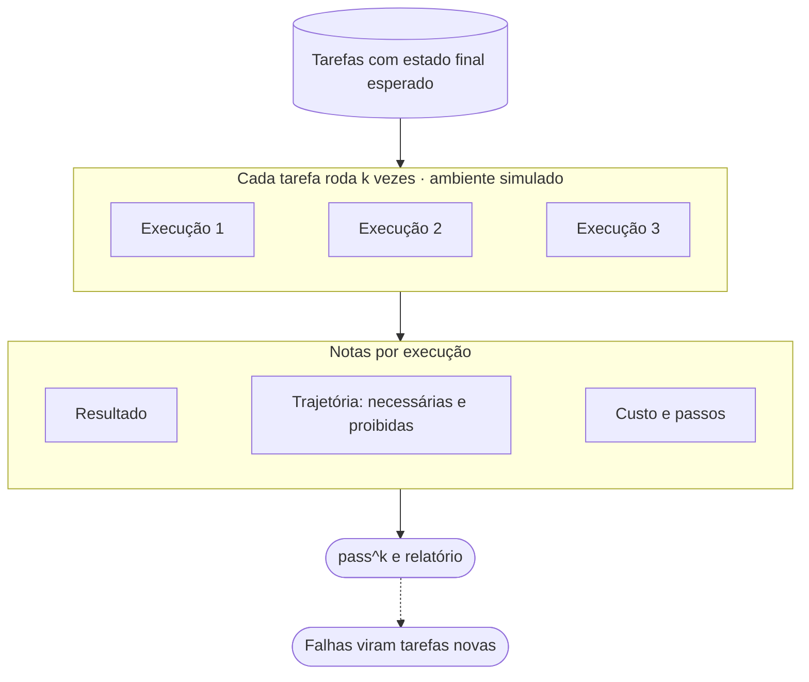

## O que é

Avaliar um agente é diferente de avaliar uma resposta. O agente toma uma sequência de decisões, a trajetória: quais ferramentas chamou, com quais argumentos, em que ordem, quanto gastou e como terminou. Duas execuções da mesma tarefa podem chegar ao mesmo resultado por caminhos muito diferentes, ou chegar ao certo uma vez e ao errado na outra. Avaliação de agentes mede o resultado, a trajetória e a consistência.

## Por que importa para um AI Engineer

Um agente que acerta 80% das vezes numa execução pode acertar bem menos quando você exige que acerte em todas as tentativas, e é isso que o usuário sente. Sem avaliar a trajetória, você não vê os problemas caros: ferramentas chamadas à toa, ações perigosas que por sorte não deram errado, loops. E sem avaliação automatizada, cada mudança de prompt ou de modelo vira aposta. Times que constroem agentes sérios gastam boa parte do esforço aqui.

## Como funciona

Três camadas de medida:

- **Resultado:** o estado final está certo? O melhor é conferir por programa: o registro foi criado no banco, os testes passaram, a resposta contém o dado esperado.
- **Trajetória:** chamou as ferramentas necessárias, evitou as proibidas, respeitou o limite de passos e de custo?
- **Consistência:** rode cada tarefa k vezes. A métrica pass^k (proposta no τ-bench) é a chance de acertar em todas as k execuções, e cai rápido quando o agente é instável.

```python
def avaliar(trajetoria, esperado):
    ferramentas = [p["ferramenta"] for p in trajetoria["passos"]]
    return {
        "resultado": trajetoria["estado_final"] == esperado["estado_final"],
        "usou_necessarias": set(esperado["necessarias"]) <= set(ferramentas),
        "evitou_proibidas": not set(esperado["proibidas"]) & set(ferramentas),
        "passos": len(ferramentas),
        "custo": sum(p["custo"] for p in trajetoria["passos"]),
    }

def pass_k(resultados_por_tarefa):
    """Fração de tarefas em que todas as k execuções acertaram."""
    return sum(all(r) for r in resultados_por_tarefa) / len(resultados_por_tarefa)

print(pass_k([[True, True, True], [True, False, True]]))  # 0.5
```

Para tarefas com interação, use um ambiente simulado: ferramentas falsas com estado próprio e, se necessário, um usuário simulado por outro modelo. Para critérios subjetivos, um LLM como juiz com rubrica clara, calibrado contra algumas notas humanas. Frameworks como o Inspect organizam tarefas, execução e notas.



## Na prática

Benchmarks públicos como SWE-bench (corrigir issues reais de repositórios) e τ-bench (atendimento com ferramentas e regras) mostram o método, mas o que importa é o seu conjunto de tarefas. No P5: Pesquisador Multiagente, a avaliação cobre 30 investigações com resposta conhecida, ferramentas proibidas (como abrir ordem sem aprovação) e pass^3.

## Erros comuns

- **Avaliar só a resposta final.** Esconde custo, risco e sorte.
- **Rodar cada tarefa uma vez.** Agentes variam; sem repetição você mede ruído.
- **Juiz sem calibração.** Confira o LLM juiz contra notas humanas antes de confiar.
- **Ambiente de teste que vaza para a produção.** Ferramentas de teste não podem ter efeito real.
- **Conjunto que nunca muda.** Adicione cada falha encontrada em produção como caso novo.

## Como estudar

1. Leia o artigo do τ-bench e entenda pass^k (1 dia).
2. Veja como o SWE-bench define tarefa, ambiente e verificação (2 horas).
3. Monte 20 tarefas com estado final verificável e ferramentas falsas com estado (3 dias).
4. Implemente as métricas acima, rode cada tarefa 3 vezes e monte o relatório (3 dias).
5. Reproduza o mesmo conjunto no Inspect ou em outro framework de avaliação (3 dias).

## Como mostrar

Mostre o relatório por tarefa (resultado, trajetória, custo, pass^k) e um exemplo de trajetória ruim que a métrica pegou e a resposta final não mostrava. Na entrevista, explique por que pass^k importa mais que a taxa de acerto de uma execução.
