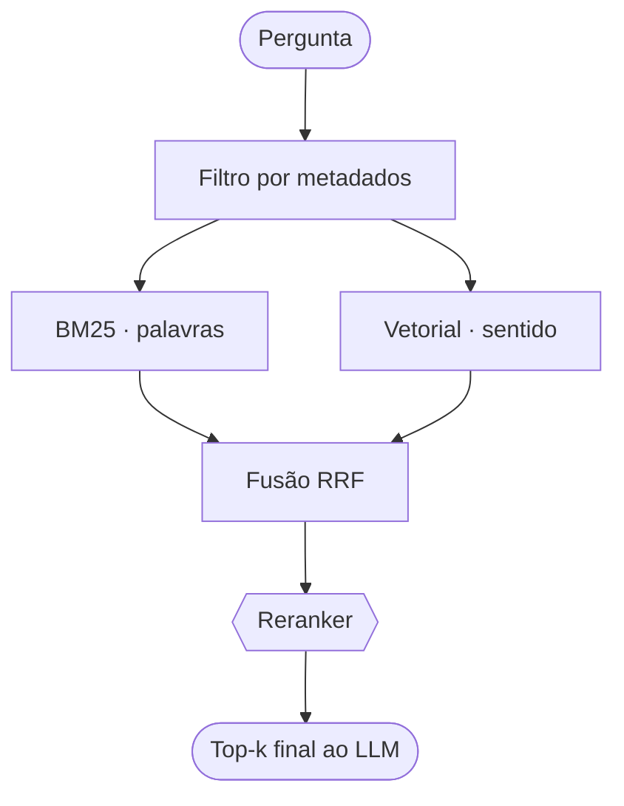

## O que é

Busca híbrida combina dois jeitos de achar trechos: a busca vetorial (por sentido, usando embeddings, vetores numéricos que representam o significado do texto) e a busca por palavra-chave, em geral com o algoritmo BM25. Reranking (reordenação) é um segundo passo: um modelo reavalia os candidatos encontrados e coloca os melhores no topo.

## Por que importa para um AI Engineer

A busca vetorial entende que "o compressor não liga" e "falha de partida" falam da mesma coisa. Mas ela costuma errar o que não tem "sentido" para generalizar: um código como `E-21`, uma sigla, um nome próprio, um número de peça. Em manuais técnicos, isso é metade das perguntas. Se o trecho certo não chega ao prompt, o LLM (modelo de linguagem) responde errado, e nenhum ajuste de prompt corrige.

## Como funciona

O BM25 pontua cada trecho pelas palavras da pergunta: conta quantas vezes aparecem, dá mais peso a palavras raras (`E-21` vale mais que "erro") e compensa o tamanho do trecho. Acha o termo exato, mas não entende sinônimos.

O pipeline típico tem três passos:

1. **Duas buscas em paralelo**: BM25 e vetorial, cada uma devolvendo seus melhores trechos (top-k, os k primeiros).
2. **Fusão** dos dois rankings. Os scores têm escalas diferentes, então a fusão mais usada olha só a posição: o RRF (reciprocal rank fusion) soma `1 / (60 + posição)` de cada ranking. O 60 é a constante do artigo original.
3. **Reranking** dos melhores candidatos com um cross-encoder: um modelo que lê pergunta e trecho juntos e dá uma nota. É mais preciso que a comparação de vetores, mas mais lento, então você o aplica só a algumas dezenas de candidatos e guarda os poucos melhores para o prompt.



```python
def rrf(rankings, k=60):
    pontos = {}
    for ranking in rankings:
        for pos, doc in enumerate(ranking, start=1):
            pontos[doc] = pontos.get(doc, 0) + 1 / (k + pos)
    return sorted(pontos, key=pontos.get, reverse=True)

bm25 = ["c3", "c1", "c7"]        # exemplo ilustrativo: ranking por palavra-chave
vetorial = ["c1", "c5", "c3"]    # exemplo ilustrativo: ranking vetorial
print(rrf([bm25, vetorial]))     # ['c1', 'c3', 'c5', 'c7']
```

O `c1` vence porque aparece bem nas duas listas. Por fim, os **filtros por metadados** (manual, modelo da máquina, data) restringem a busca antes de ranquear, o que também melhora a precisão.

## Na prática

No P2: RAG de Manuais Técnicos, a pergunta "o que é o erro E-21?" é o caso clássico: o BM25 acha o código exato e a busca vetorial acha o parágrafo que explica a causa. No PostgreSQL, a busca por palavra-chave vem do full-text search (o ranking é parecido com o BM25, não idêntico) e a vetorial vem do pgvector, no mesmo banco. O artigo Contextual Retrieval, da Anthropic, mostra que combinar embeddings, BM25 e reranking reduz as falhas de recuperação em relação a só embeddings; confira o método e os números nele.

## Erros comuns

- **Somar scores de escalas diferentes.** Um score de BM25 e uma similaridade de cosseno não são comparáveis; fusione por posição ou normalize antes.
- **Rerankear a base inteira.** O cross-encoder é lento; use-o só nos candidatos da primeira etapa.
- **Aplicar tudo sem medir.** Híbrida e reranking custam latência e complexidade. Compare com recall@k (o trecho certo está entre os k primeiros?) antes e depois, no mesmo conjunto de perguntas.
- **Ignorar os metadados.** Sem filtro, o manual de outro modelo de máquina entra nos resultados.

## Como estudar

1. Leia a seção de busca do Contextual Retrieval (1 hora).
2. Implemente o `rrf` acima e troque os rankings de exemplo pelos de duas buscas reais, uma BM25 (a biblioteca `rank_bm25` serve) e uma vetorial (1 dia).
3. Monte 20 perguntas, metade com códigos e siglas, e compare recall@5 de BM25, vetorial e híbrida (2 dias).
4. Teste um cross-encoder do Sentence Transformers sobre os 30 primeiros candidatos (1 dia).
5. Leia o artigo do RRF e o capítulo de full-text search do PostgreSQL (meio dia cada).

## Como mostrar

No README do P2, traga uma tabela com recall@5 de cada estratégia nas suas perguntas e dois exemplos de código de falha que só a híbrida acertou. Na entrevista, explique por que a vetorial erra `E-21` e por que a fusão usa posição em vez de score.
