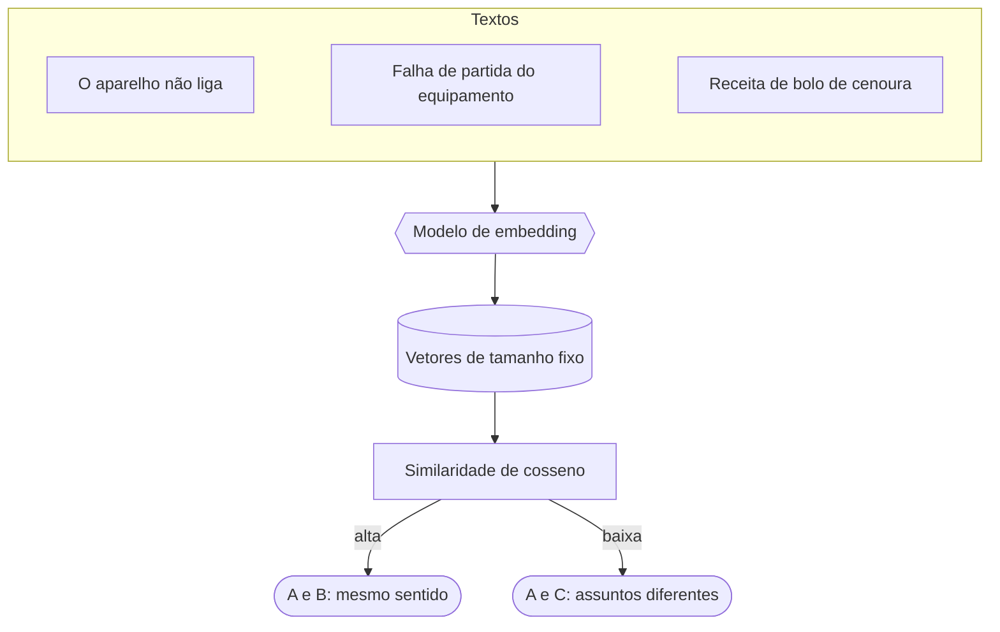

## O que é

Um embedding é uma lista de números (um vetor) que representa o significado de um texto. Textos com sentido parecido recebem vetores próximos; textos sem relação ficam distantes. Imagine um mapa em que cada frase é um ponto e frases sobre o mesmo assunto moram no mesmo bairro. Na prática, esse mapa tem centenas ou milhares de dimensões, mas a ideia é a mesma.

## Por que importa para um AI Engineer

Buscar por palavras exatas falha quando o usuário escreve "o aparelho não liga" e o manual diz "falha de partida do equipamento". Com embeddings, a busca compara sentidos. Por isso eles estão na base de busca semântica, de recomendação, de agrupar textos parecidos, de classificar sem treinar um modelo e do RAG, que você estuda no nível 2.

## Como funciona

Um **modelo de embedding** (diferente do LLM de chat) recebe um texto e devolve um vetor de tamanho fixo. Para comparar dois textos, mede-se a **similaridade de cosseno**: um número entre -1 e 1 que diz o quanto os vetores apontam na mesma direção. Perto de 1, sentidos parecidos. Você não precisa calcular à mão: a biblioteca faz.



```python
from sentence_transformers import SentenceTransformer, util

modelo = SentenceTransformer("paraphrase-multilingual-MiniLM-L12-v2")
frases = ["O aparelho não liga", "Falha de partida do equipamento", "Receita de bolo de cenoura"]
vetores = modelo.encode(frases)

print(float(util.cos_sim(vetores[0], vetores[1])))  # alta
print(float(util.cos_sim(vetores[0], vetores[2])))  # baixa
```

Instale com `pip install sentence-transformers`; o modelo é baixado na primeira execução. Espera-se que o primeiro par pontue bem mais que o segundo, mesmo sem palavras em comum.

Usos principais:

- **Busca:** vetorize os documentos uma vez e, a cada pergunta, ache os mais próximos.
- **Agrupamento:** textos próximos formam grupos (por exemplo, reclamações parecidas).
- **Classificação:** compare um texto com exemplos de cada categoria.

Escolha do modelo: veja se ele suporta português (os multilíngues suportam), o tamanho do vetor (maior custa mais armazenamento e tempo) e o limite de tokens por texto. Use sempre o mesmo modelo para indexar e para buscar, porque vetores de modelos diferentes não são comparáveis.

**Limites:** o embedding captura o assunto geral, mas é fraco com códigos, siglas e números ("erro E-21" e "erro E-12" podem parecer iguais); também não distingue bem negação ("liga" e "não liga" ficam próximas). Por isso a busca híbrida, que mistura vetor e palavra-chave, existe.

## Na prática

No P2: RAG de Manuais Técnicos, cada trecho do manual vira um vetor guardado no PostgreSQL com pgvector, e a pergunta do técnico vira outro vetor para achar os trechos mais próximos. Você mede se o trecho certo aparece entre os primeiros resultados e, quando códigos falham, adiciona busca por palavra-chave.

## Erros comuns

- **Misturar modelos de embedding.** Indexar com um e buscar com outro devolve resultado sem sentido.
- **Esperar que "perto" signifique "correto".** O trecho mais parecido pode tratar do assunto e não responder à pergunta.
- **Usar embeddings para códigos e identificadores.** Para "E-21", a busca por palavra-chave funciona melhor.
- **Vetorizar texto enorme de uma vez.** Acima do limite do modelo, o final é cortado; divida em pedaços.
- **Nunca reavaliar.** Trocar o modelo de embedding exige reindexar tudo e medir de novo.

## Como estudar

1. Leia "The Illustrated Word2vec" para formar a intuição do mapa de significados (2 horas).
2. Rode o exemplo com dez frases suas e veja as pontuações (2 horas).
3. Faça uma busca semântica sobre 50 parágrafos de um texto que você conhece (1 dia).
4. Teste uma consulta com sigla ou código e anote onde a busca falha (2 horas).
5. Leia a documentação do Sentence Transformers, seção de busca semântica, e a página de embeddings da documentação do Claude, que explica que a Anthropic não tem modelo próprio de embeddings e recomenda a Voyage AI (3 horas).

## Como mostrar

No portfólio, um notebook ou script com busca semântica e exemplos de acertos e falhas, com explicação. Na entrevista, explique com suas palavras o que é um embedding, como a similaridade é usada e por que siglas e negações são problemas.
